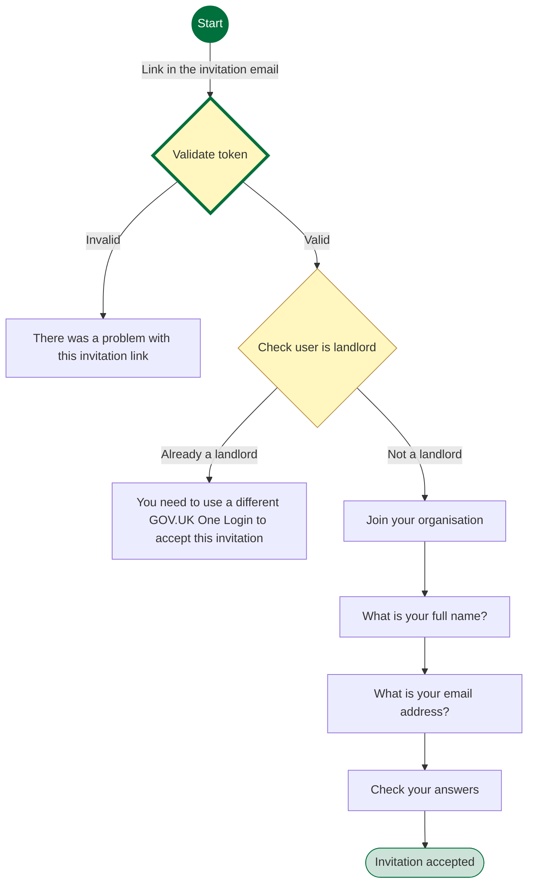
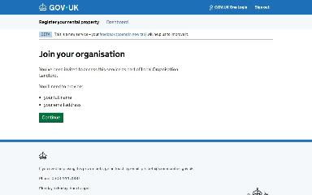
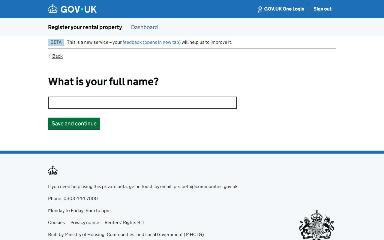
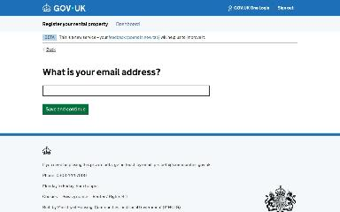
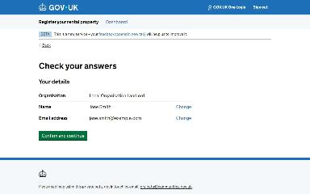
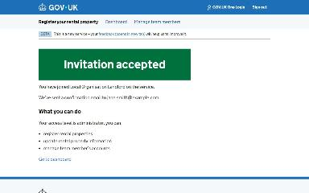
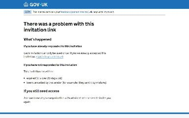

# Join an organisation journey map

Generated 2026-10-23T09:42:37.413333100Z at commit `3a5832daa`. Feature flags: failover-test-endpoints=false, subject-identifier-page=true, pdjb-939-property-registration-phase-two=false, pdjb-1053-dashboard-nav-link=true, pdjb-1022-delegate-to-letting-agent=true, pdjb-1664-password-benchmark-endpoint=false, pdjb-238-gatling-post-endpoint=false, pdjb-1040-correspondence-address=true, pdjb-1009-payments=false, pdjb-926-landlord-dashboard-update=true, pdjb-1210-multi-user-organisations=true.

Open `index.html` for the interactive map. `report.md` lists gaps and errors.

## Pages

### You need to use a different GOV.UK One Login to accept this invitation

`already-landlord` · UserIsAlreadyLandlordStepConfig

Shown on the default route

### Join your organisation

`join-your-organisation` · JoinOrganisationStepConfig

Shown when Starting point: Invited user is not a landlord

### What is your full name?

`name` · FullNameStepConfig

Shown when Starting point: Invited user is not a landlord

### What is your email address?

`email` · EmailAddressStepConfig

Shown when Starting point: Invited user is not a landlord

### Check your answers

`check-answers` · AcceptOrganisationalLandlordInvitationCheckAnswersStepConfig

Shown when Starting point: Invited user is not a landlord

### Invitation accepted

`/landlord/accept-invitation/confirmation`

Shown when Starting point: Invited user is not a landlord

### There was a problem with this invitation link

`invalid-link` · InvalidLinkStepConfig

Shown when Starting point: Invitation has expired

