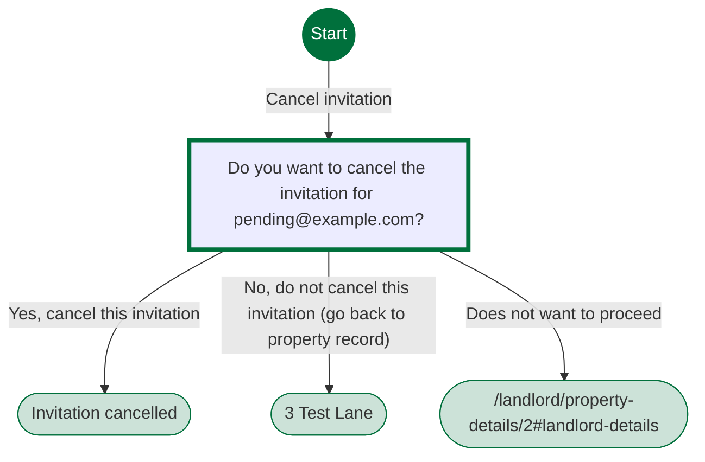
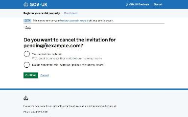
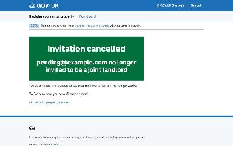
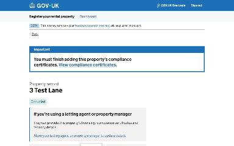

# Cancel a joint landlord invitation journey map

Generated 2026-10-23T09:40:20.247845700Z at commit `3a5832daa`. Feature flags: failover-test-endpoints=false, subject-identifier-page=true, pdjb-939-property-registration-phase-two=false, pdjb-1053-dashboard-nav-link=true, pdjb-1022-delegate-to-letting-agent=true, pdjb-1664-password-benchmark-endpoint=false, pdjb-238-gatling-post-endpoint=false, pdjb-1040-correspondence-address=true, pdjb-1009-payments=false, pdjb-926-landlord-dashboard-update=true, pdjb-1210-multi-user-organisations=false.

Open `index.html` for the interactive map. `report.md` lists gaps and errors.

## Pages

### Do you want to cancel the invitation for pending@example.com?

`are-you-sure` · AreYouSureStepConfig

Shown on the default route

### Invitation cancelled

`/landlord/cancel-joint-landlord-invitation/confirmation`

Shown when Do you want to cancel the invitation for pending@example.com?: Yes, cancel this invitation

### 3 Test Lane

`/landlord/property-details/2`

Shown when Do you want to cancel the invitation for pending@example.com?: No, do not cancel this invitation (go back to property record)

### /landlord/property-details/2#landlord-details

`/landlord/property-details/2#landlord-details`

_Not reached by the generator._
