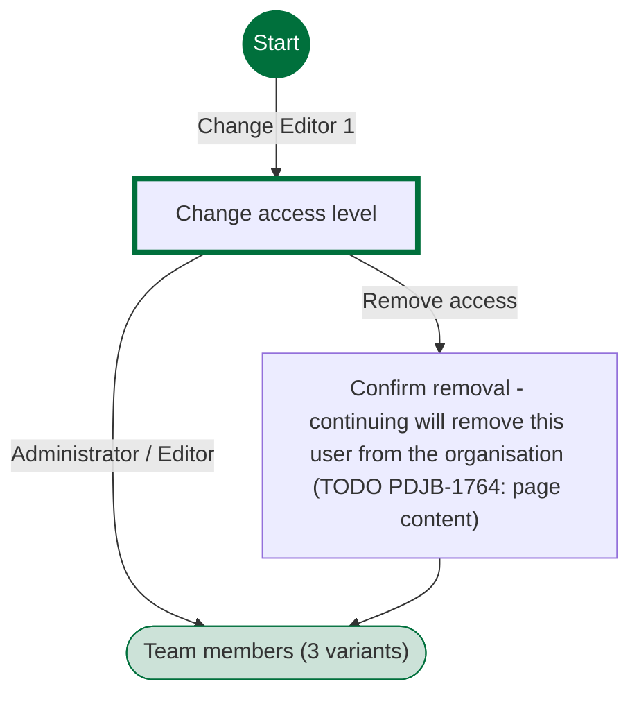
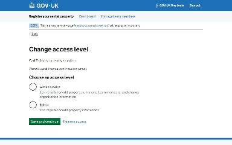
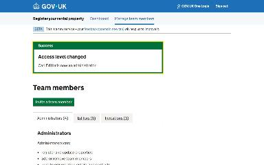
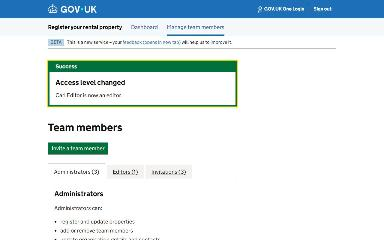
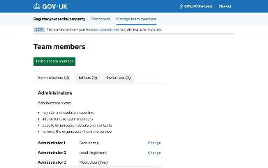
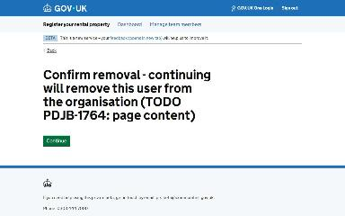

# Change a team member's access level journey map

Generated 2026-10-23T09:42:33.205948300Z at commit `3a5832daa`. Feature flags: failover-test-endpoints=false, subject-identifier-page=true, pdjb-939-property-registration-phase-two=false, pdjb-1053-dashboard-nav-link=true, pdjb-1022-delegate-to-letting-agent=true, pdjb-1664-password-benchmark-endpoint=false, pdjb-238-gatling-post-endpoint=false, pdjb-1040-correspondence-address=true, pdjb-1009-payments=false, pdjb-926-landlord-dashboard-update=true, pdjb-1210-multi-user-organisations=true.

Open `index.html` for the interactive map. `report.md` lists gaps and errors.

## Pages

### Change access level

`access-level` · AccessLevelStepConfig

Shown on the default route

### Team members

`/landlord/team-members`

Shown when Change access level: Administrator

Shown when Change access level: Editor

Shown when Change access level: Remove access

### Confirm removal - continuing will remove this user from the organisation (TODO PDJB-1764: page content)

`confirm-removal` · RemoveOrgUserConfirmationStepConfig

Shown when Change access level: Remove access

