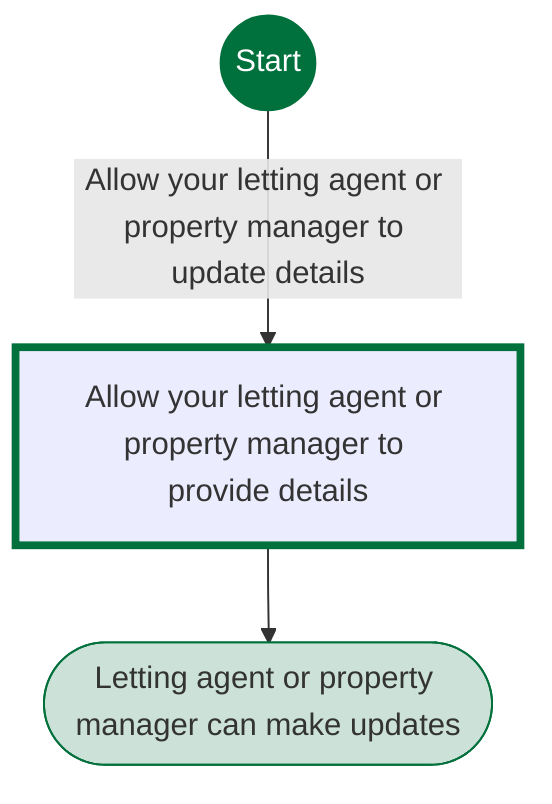
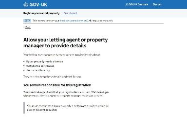
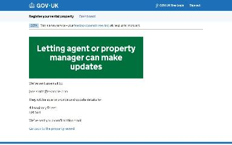

# Delegate a property to a letting agent journey map

Generated 2026-10-23T09:42:22.316264100Z at commit `3a5832daa`. Feature flags: failover-test-endpoints=false, subject-identifier-page=true, pdjb-939-property-registration-phase-two=false, pdjb-1053-dashboard-nav-link=true, pdjb-1022-delegate-to-letting-agent=true, pdjb-1664-password-benchmark-endpoint=false, pdjb-238-gatling-post-endpoint=false, pdjb-1040-correspondence-address=true, pdjb-1009-payments=false, pdjb-926-landlord-dashboard-update=true, pdjb-1210-multi-user-organisations=false.

Open `index.html` for the interactive map. `report.md` lists gaps and errors.

## Pages

### Allow your letting agent or property manager to provide details

`allow-letting-agent` · AllowLettingAgentStepConfig

Shown on the default route

### Letting agent or property manager can make updates

`/landlord/delegate-to-letting-agent/4/confirmation`

Shown on the default route

