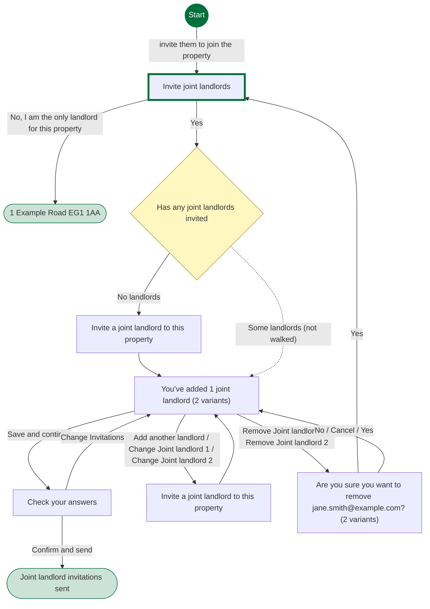
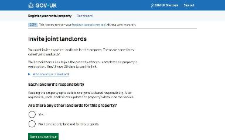
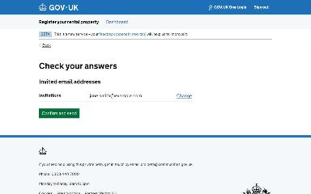

# Invite a joint landlord journey map

Generated 2026-10-23T09:36:39.865524100Z at commit `3a5832daa`. Feature flags: failover-test-endpoints=false, subject-identifier-page=true, pdjb-939-property-registration-phase-two=false, pdjb-1053-dashboard-nav-link=true, pdjb-1022-delegate-to-letting-agent=true, pdjb-1664-password-benchmark-endpoint=false, pdjb-238-gatling-post-endpoint=false, pdjb-1040-correspondence-address=true, pdjb-1009-payments=false, pdjb-926-landlord-dashboard-update=true, pdjb-1210-multi-user-organisations=false.

Open `index.html` for the interactive map. `report.md` lists gaps and errors.

## Pages

### Invite joint landlords

`has-joint-landlords` · HasJointLandlordsConfig

Shown on the default route

### 1 Example Road EG1 1AA

`/landlord/property-details/1`

Shown when Invite joint landlords: No, I am the only landlord for this property

### Invite a joint landlord to this property

`invite-joint-landlord` · InviteJointLandlordStepConfig

Shown on the default route

### You’ve added 1 joint landlord

`check-joint-landlords` · CheckJointLandlordsStepConfig

Shown on the default route

Shown when You’ve added 1 joint landlord: Add another landlord

### Check your answers

`check-invitations` · CheckInvitationsStepConfig

Shown on the default route

### Joint landlord invitations sent

`/landlord/property-details/1/invite-joint-landlord/confirmation`

Shown when Check your answers: Confirm and send

### Invite a joint landlord to this property

`invite-another-joint-landlord` · InviteJointLandlordStepConfig

Shown when You’ve added 1 joint landlord: Add another landlord

### Are you sure you want to remove jane.smith@example.com?

`remove-joint-landlord` · RemoveJointLandlordAreYouSureStepConfig

Shown when You’ve added 1 joint landlord: Remove Joint landlord 1

Shown when You’ve added 1 joint landlord: Add another landlord; You’ve added 2 joint landlords: Remove Joint landlord 2

