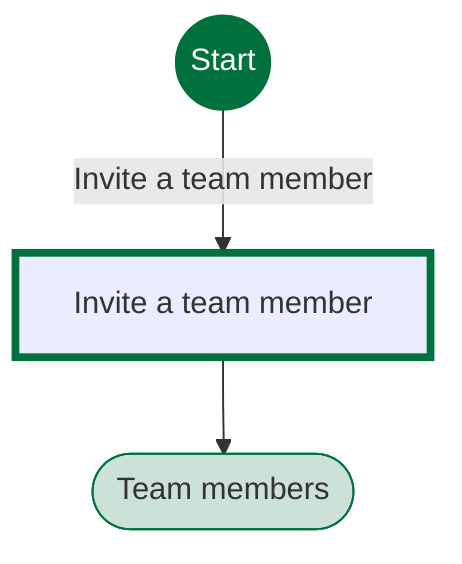
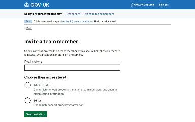
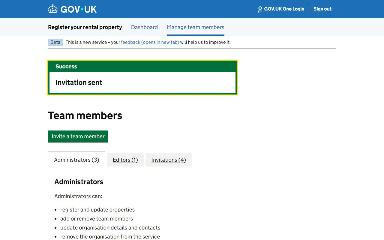

# Invite a team member journey map

Generated 2026-11-03T12:37:23.085226Z at commit `f960f1073`. Feature flags: failover-test-endpoints=false, subject-identifier-page=true, pdjb-939-property-registration-phase-two=true, pdjb-939-property-registration-phase-three=false, pdjb-1664-password-benchmark-endpoint=false, pdjb-238-gatling-post-endpoint=false, pdjb-1009-payments=true, pdjb-1210-multi-user-organisations=true, pdjb-1894-gas-certificate-14-month-expiry=false, pdjb-955-associated-parties=false, pdjb-1666-eic-issue-date=false, pdjb-973-asynchronous-email-sending=false.

Open `index.html` for the interactive map. `report.md` lists gaps and errors.

## Pages

### Invite a team member

`invite-team-member` · InviteOrganisationalLandlordUserStepConfig

Shown on the default route

### Team members

`/landlord/team-members`

Shown when Invite a team member: Administrator

