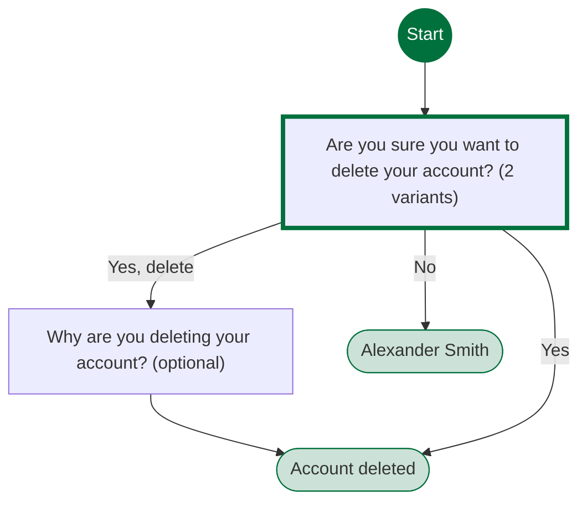
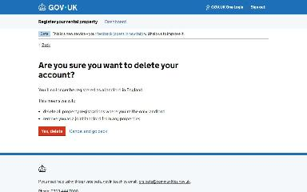
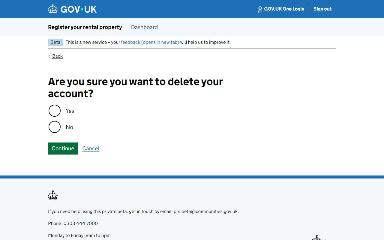
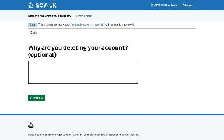
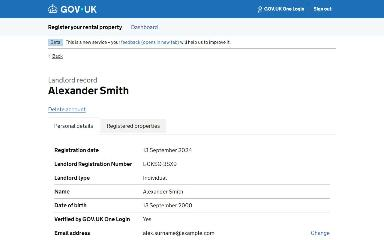

# Delete your landlord account journey map

Generated 2026-11-03T12:28:04.383094700Z at commit `f960f1073`. Feature flags: failover-test-endpoints=false, subject-identifier-page=true, pdjb-939-property-registration-phase-two=true, pdjb-939-property-registration-phase-three=false, pdjb-1664-password-benchmark-endpoint=false, pdjb-238-gatling-post-endpoint=false, pdjb-1009-payments=true, pdjb-1210-multi-user-organisations=true, pdjb-1894-gas-certificate-14-month-expiry=false, pdjb-955-associated-parties=false, pdjb-1666-eic-issue-date=false, pdjb-973-asynchronous-email-sending=false.

Open `index.html` for the interactive map. `report.md` lists gaps and errors.

## Pages

### Are you sure you want to delete your account?

`are-you-sure` · AreYouSureStepConfig

Shown on the default route

Shown when Starting point: Landlord has no properties

### Why are you deleting your account? (optional)

`reason` · ReasonStepConfig

Shown on the default route

### Account deleted

`/landlord/deregister-landlord/confirmation`

Shown on the default route

### Alexander Smith

`/landlord/landlord-details`

Shown when Starting point: Landlord has no properties; Are you sure you want to delete your account?: No

