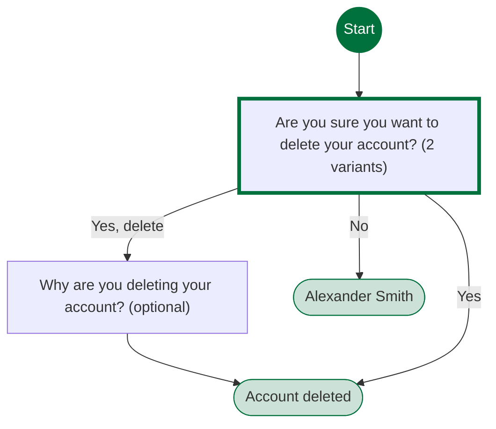
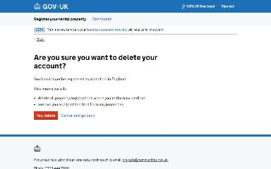
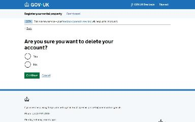
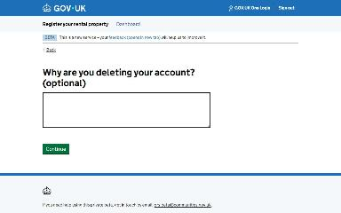
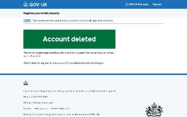
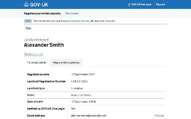

# Delete your landlord account journey map

Generated 2026-10-23T09:33:34.718011300Z at commit `3a5832daa`. Feature flags: failover-test-endpoints=false, subject-identifier-page=true, pdjb-939-property-registration-phase-two=false, pdjb-1053-dashboard-nav-link=true, pdjb-1022-delegate-to-letting-agent=true, pdjb-1664-password-benchmark-endpoint=false, pdjb-238-gatling-post-endpoint=false, pdjb-1040-correspondence-address=true, pdjb-1009-payments=false, pdjb-926-landlord-dashboard-update=true, pdjb-1210-multi-user-organisations=false.

Open `index.html` for the interactive map. `report.md` lists gaps and errors.

## Pages

### Are you sure you want to delete your account?

`are-you-sure` · AreYouSureStepConfig

Shown on the default route

Shown when Starting point: Landlord has no properties

### Why are you deleting your account? (optional)

`reason` · ReasonStepConfig

Shown on the default route

### Account deleted

`/landlord/deregister-landlord/confirmation`

Shown on the default route

### Alexander Smith

`/landlord/landlord-details`

Shown when Starting point: Landlord has no properties; Are you sure you want to delete your account?: No

