# Register as a landlord journey map

Generated 2026-10-23T09:24:22.733506800Z at commit `3a5832daa`. Feature flags: failover-test-endpoints=false, subject-identifier-page=true, pdjb-939-property-registration-phase-two=false, pdjb-1053-dashboard-nav-link=true, pdjb-1022-delegate-to-letting-agent=true, pdjb-1664-password-benchmark-endpoint=false, pdjb-238-gatling-post-endpoint=false, pdjb-1040-correspondence-address=true, pdjb-1009-payments=false, pdjb-926-landlord-dashboard-update=true, pdjb-1210-multi-user-organisations=false.

Open `index.html` for the interactive map. `report.md` lists gaps and errors.

```mermaid
flowchart TD
    journeyStart(("Start"))
    subgraph c0["Register as a landlord"]
        subgraph c1["Landlord registration"]
            subgraph c2["Identity"]
                n1["You have not proven your identity using GOV.UK One Login"]
                n2["What is your full name? (2 variants)"]
                n3["What is your date of birth? (2 variants)"]
                n19["Confirm your name and date of birth"]
                n66{"Identity verifying"}
            end
            subgraph c3["Org landlord registration"]
                subgraph c4["Org address"]
                    n21["What is your organisation’s address? (2 variants)"]
                    n22["Select your organisation’s address"]
                    n44["No matching address in England or Wales found for ZZ9 9ZZ and 1"]
                    n45["What is your organisation’s address?"]
                end
                subgraph c5["Lead trustee"]
                    subgraph c6["Trustee address"]
                        n50["What is the lead trustee’s contact address?"]
                        n51["Select your address"]
                        n62["No matching address in England or Wales found for ZZ9 9ZZ and 1"]
                        n63["What is the lead trustee’s contact address?"]
                    end
                    n46["What is the lead trustee’s full name? (2 variants)"]
                    n47["What is the lead trustee’s date of birth?"]
                    n48["What is the lead trustee’s email address?"]
                    n49["What is the lead trustee’s phone number?"]
                end
                subgraph c7["Org charity"]
                    n26["Is your organisation a registered charity? (2 variants)"]
                    n27["Who is your charity registered with? (2 variants)"]
                    n28["What is your organisation’s charity number? (2 variants)"]
                    n52["What is your organisation’s charity number? (2 variants)"]
                    n53["What is your organisation’s charity number? (2 variants)"]
                end
                subgraph c8["Org companies house"]
                    n29["Is your organisation registered with Companies House? (2 variants)"]
                    n30["What is your organisation’s company number? (2 variants)"]
                end
                subgraph c9["Org gov body"]
                    subgraph c10["Org gov body members"]
                        subgraph c11["Gov body member address"]
                            n59["What is their contact address?"]
                            n60["Select their address"]
                            n64["No matching address in England or Wales found for ZZ9 9ZZ and 1"]
                            n65["What is their contact address?"]
                        end
                        n56["Who do you want to provide details for? (2 variants)"]
                        n57["What is their full name?"]
                        n58["What is their date of birth?"]
                        n61["You’ve added 1 person (2 variants)"]
                        n69{"Has any gov body members"}
                        n70{"Has any gov body members"}
                        n72{"Remove gov body member"}
                    end
                    n54["Providing details about your organisation’s governing body (2 variants)"]
                    n55["You need to provide more information to register (2 variants)"]
                    n71{"Gov body members back routing"}
                end
                n20["What is the name of your organisation? (2 variants)"]
                n23["What is your organisation’s email address? (2 variants)"]
                n24["What is your organisation’s phone number? (2 variants)"]
                n25["Select your organisation’s type (2 variants)"]
                n31["Who is the main contact for your organisation? (2 variants)"]
            end
            subgraph c12["Individual landlord location"]
                subgraph c13["Landlord address"]
                    n9["What is your contact address? (2 variants)"]
                    n10["Select your address (2 variants)"]
                    n42["No matching address in England or Wales found for ZZ9 9ZZ and 1"]
                    n43["What is your contact address?"]
                end
                n7["Do you live in England or Wales? (2 variants)"]
                n8["This private beta is only available to landlords who live in England or Wales"]
            end
            n0["Your data privacy"]
            n4["What is your email address? (2 variants)"]
            n5["What is your phone number? (2 variants)"]
            n6["Are you registering as an individual or an organisation? (2 variants)"]
            n11["Check your answers (10 variants)"]
        end
    end
    subgraph c14["Org companies house change gov body"]
    end
    subgraph c15["Changing answers"]
        n13["What is the name of your organisation?"]
        n14["What is your organisation’s address?"]
        n15["Select your organisation’s address"]
        n16["What is your organisation’s email address?"]
        n17["What is your organisation’s address?"]
        n18["What is your contact address?"]
        n32["You must provide trustee details"]
        n33["What is the lead trustee’s full name?"]
        n34["What is the lead trustee’s date of birth?"]
        n35["What is the lead trustee’s email address?"]
        n36["What is your organisation’s charity number?"]
        n37["What is your organisation’s charity number?"]
        n38["Your new answer affects other sections of your landlord record"]
        n39["Who do you want to provide details for?"]
        n40["What is their full name?"]
        n41["What is their date of birth?"]
    end
    n12(["Registered as a landlord"])
    n67{"Org type update routing"}
    n68{"Org companies house update routing"}
    journeyStart --> n0
    n0 --> n66
    n66 -->|"Not verified"| n1
    n66 -->|"Verified"| n19
    n1 --> n2
    n2 --> n3
    n3 --> n4
    n4 --> n5
    n5 --> n6
    n6 -->|"An individual"| n7
    n6 -->|"An organisation"| n20
    n7 -->|"Yes"| n9
    n7 -->|"No"| n8
    n9 -->|"Find address"| n10
    n9 -->|"Postcode: ZZ9 9ZZ"| n42
    n10 -->|"1 PRSDB Square, EG1 2AA / 2 PRSDB Square, EG1 2AA and 3 more"| n11
    n10 -->|"I want to manually enter my address"| n43
    n10 -->|"Search again"| n9
    n11 --> n12
    n6 -.->|"An organisation"| n13
    n13 -.->|"Continue"| n14
    n14 -.->|"Find address"| n15
    n15 -.->|"1 PRSDB Square, EG1 2AA / 2 PRSDB Square, EG1 2AA and 3 more"| n16
    n15 -.->|"I want to manually enter my address"| n17
    n15 -.->|"Search again"| n14
    n10 -.->|"I want to manually enter my address"| n18
    n18 -.->|"Continue"| n11
    n19 --> n4
    n20 --> n21
    n21 -->|"Find address"| n22
    n21 -->|"Postcode: ZZ9 9ZZ"| n44
    n22 -->|"1 PRSDB Square, EG1 2AA / 2 PRSDB Square, EG1 2AA and 3 more"| n23
    n22 -->|"I want to manually enter my address"| n45
    n22 -->|"Search again"| n21
    n23 --> n24
    n24 --> n25
    n25 -->|"Company / Charity / None of these"| n26
    n25 -->|"Trust"| n46
    n26 -->|"Yes"| n27
    n26 -->|"No"| n29
    n27 -->|"Charities Commission of England and Wales"| n28
    n27 -->|"Charities Commission of Northern Ireland"| n52
    n27 -->|"Scottish Charity Regulator"| n53
    n27 -->|"None of these"| n29
    n28 --> n29
    n29 -->|"Yes"| n30
    n29 -->|"No"| n54
    n30 --> n31
    n31 --> n11
    n67 -.->|"Adding trust"| n32
    n32 -.->|"Continue with the change"| n33
    n33 -.->|"Continue"| n34
    n34 -.->|"Continue"| n35
    n27 -.->|"Charities Commission of Northern Ireland"| n36
    n27 -.->|"Scottish Charity Regulator"| n37
    n36 -.->|"Continue"| n11
    n37 -.->|"Continue"| n11
    n68 -.->|"Changed to non company"| n38
    n38 -.->|"Continue to other sections"| n69
    n69 -.->|"No members"| n39
    n39 -.->|"Director / Trustee and 2 more"| n40
    n40 -.->|"Continue"| n41
    n42 -->|"Enter address manually"| n43
    n42 -->|"search again."| n9
    n43 --> n11
    n44 -->|"Enter address manually"| n45
    n44 -->|"search again."| n21
    n45 --> n23
    n46 --> n47
    n47 --> n48
    n48 --> n49
    n49 --> n50
    n50 -->|"Find address"| n51
    n50 -->|"Postcode: ZZ9 9ZZ"| n62
    n51 -->|"1 PRSDB Square, EG1 2AA / 2 PRSDB Square, EG1 2AA and 3 more"| n26
    n51 -->|"I want to manually enter my address"| n63
    n51 -->|"Search again"| n50
    n52 --> n29
    n53 --> n29
    n54 -->|"Continue"| n70
    n70 -->|"No members"| n56
    n54 -->|"I don’t have these details"| n55
    n56 --> n57
    n57 --> n58
    n58 --> n59
    n59 -->|"Find address"| n60
    n59 -->|"Postcode: ZZ9 9ZZ"| n64
    n60 -->|"1 PRSDB Square, EG1 2AA / 2 PRSDB Square, EG1 2AA and 3 more"| n61
    n60 -->|"I want to manually enter my address"| n65
    n60 -->|"Search again"| n59
    n61 -->|"Continue"| n71
    n71 -->|"Some members"| n31
    n61 -->|"Add another person / Change Person 1"| n56
    n61 -->|"Remove Person 1"| n72
    n72 --> n54
    n62 -->|"Enter address manually"| n63
    n62 -->|"search again."| n50
    n63 --> n26
    n64 -->|"Enter address manually"| n65
    n64 -->|"search again."| n59
    n65 --> n61
    n22 -.->|"Address already registered (not walked)"| n23
    n51 -.->|"Address already registered (not walked)"| n26
    n72 -->|"No members"| n71
    n72 -.->|"Some members (not walked)"| n61
    n60 -.->|"Address already registered (not walked)"| n61
    n10 -.->|"Address already registered (not walked)"| n11
    n70 -.->|"Some members (not walked)"| n61
    n71 -->|"No members"| n54
    classDef gap fill:#f3f2f1,stroke:#b1b4b6,stroke-dasharray: 5 5,color:#505a5f
    classDef decision fill:#fff7bf,stroke:#b58840
    classDef terminal fill:#cce2d8,stroke:#00703c
    classDef change stroke:#1d70b8,stroke-width:3px
    classDef startNode fill:#00703c,stroke:#00703c,color:#ffffff
    classDef entryPoint stroke:#00703c,stroke-width:4px
    class journeyStart startNode
    class n0 entryPoint
    class n12 terminal
    class n13 change
    class n14 change
    class n15 change
    class n16 change
    class n17 change
    class n18 change
    class n32 change
    class n33 change
    class n34 change
    class n35 change
    class n36 change
    class n37 change
    class n38 change
    class n39 change
    class n40 change
    class n41 change
    class n66 decision
    class n67 decision
    class n68 decision
    class n69 decision
    class n70 decision
    class n71 decision
    class n72 decision
```

## Pages

### Your data privacy

`privacy-notice` · PrivacyNoticeStepConfig

[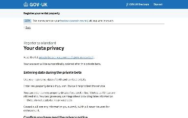](img/privacy-notice/v1.jpg)

Shown on the default route

### You have not proven your identity using GOV.UK One Login

`identity-not-verified` · IdentityNotVerifiedStepConfig

[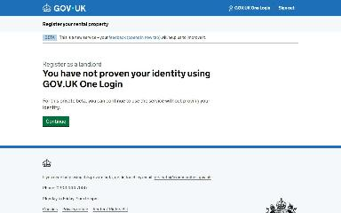](img/identity-not-verified/v1.jpg)

Shown on the default route

### What is your full name?

`name` · NameStepConfig

[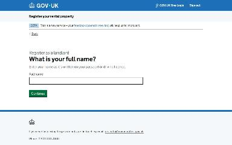](img/name/v1.jpg)

Shown on the default route

[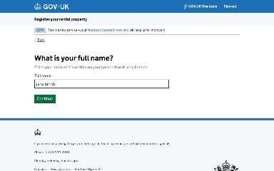](img/name/v2.jpg)

Shown when Check your answers: Change Name (when changing an answer)

### What is your date of birth?

`date-of-birth` · DateOfBirthStepConfig

[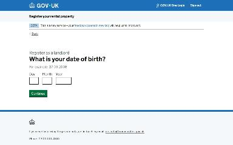](img/date-of-birth/v1.jpg)

Shown on the default route

[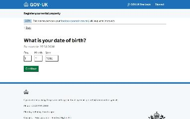](img/date-of-birth/v2.jpg)

Shown when Check your answers: Change Date of birth (when changing an answer)

### What is your email address?

`email` · EmailStepConfig

[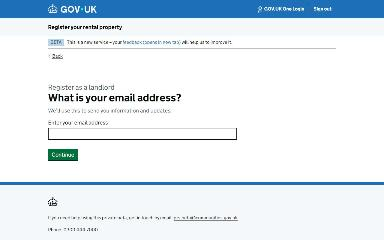](img/email/v1.jpg)

Shown on the default route

[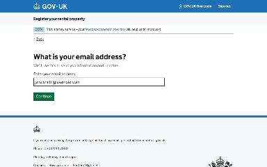](img/email/v2.jpg)

Shown when Check your answers: Change Email address (when changing an answer)

### What is your phone number?

`phone-number` · PhoneNumberStepConfig

[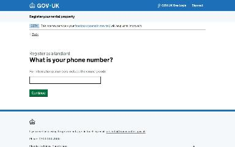](img/phone-number/v1.jpg)

Shown on the default route

[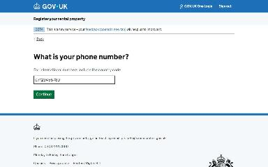](img/phone-number/v2.jpg)

Shown when Check your answers: Change Phone number (when changing an answer)

### Are you registering as an individual or an organisation?

`landlord-type` · LandlordTypeStepConfig

[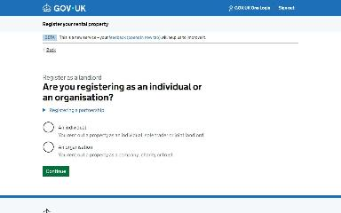](img/landlord-type/v1.jpg)

Shown on the default route

[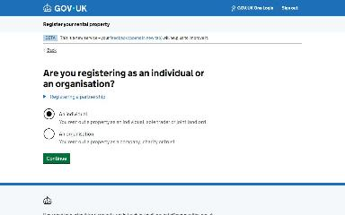](img/landlord-type/v2.jpg)

Shown when Check your answers: Change Landlord type (when changing an answer)

### Do you live in England or Wales?

`country-of-residence` · CountryOfResidenceStepConfig

[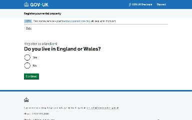](img/country-of-residence/v1.jpg)

Shown on the default route

[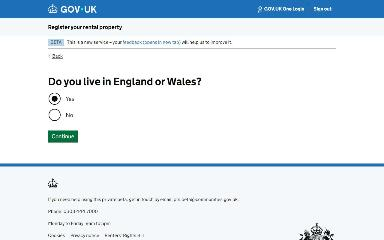](img/country-of-residence/v2.jpg)

Shown when Check your answers: Change Resident in England or Wales (when changing an answer)

### This private beta is only available to landlords who live in England or Wales

`neither-england-nor-wales-address` · NonEnglandOrWalesAddressStepConfig

Shown when Do you live in England or Wales?: No

### What is your contact address?

`lookup-address` · LookupAddressStepConfig

Shown on the default route

[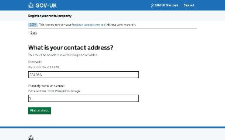](img/lookup-address/v2.jpg)

Shown when Check your answers: Change Contact address (when changing an answer)

### Select your address

`select-address` · SelectAddressStepConfig

Shown on the default route

[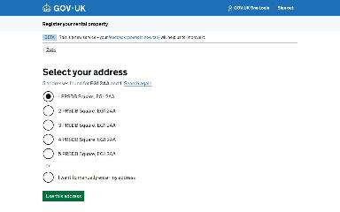](img/select-address/v2.jpg)

Shown when Check your answers: Change Contact address (when changing an answer)

### Check your answers

`check-answers` · LandlordRegistrationCyaStepConfig

[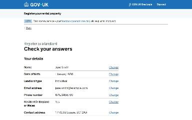](img/check-answers/v1.jpg)

Shown on the default route

[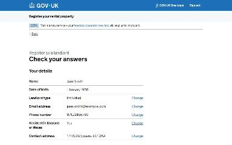](img/check-answers/v2.jpg)

Shown when One Login identity check: Identity verified

Shown when Are you registering as an individual or an organisation?: An organisation

Shown when Are you registering as an individual or an organisation?: An organisation; Select your organisation’s type: Trust

[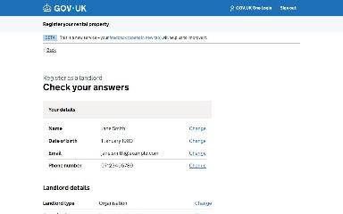](img/check-answers/v5.jpg)

Shown when Are you registering as an individual or an organisation?: An organisation; Is your organisation a registered charity?: No

Shown when Are you registering as an individual or an organisation?: An organisation; Who is your charity registered with?: None of these

Shown when Are you registering as an individual or an organisation?: An organisation; Is your organisation registered with Companies House?: No

Shown when Are you registering as an individual or an organisation?: An organisation; Is your organisation registered with Companies House?: No; Who do you want to provide details for?: Trustee

Shown when Are you registering as an individual or an organisation?: An organisation; Is your organisation registered with Companies House?: No; Who do you want to provide details for?: Partner

Shown when Are you registering as an individual or an organisation?: An organisation; Is your organisation registered with Companies House?: No; Who do you want to provide details for?: Other member of the governing body

### Registered as a landlord

`/landlord/register-as-a-landlord/confirmation`

[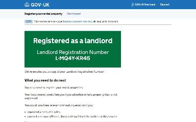](img/landlord_register-as-a-landlord_confirmation/v1.jpg)

Shown on the default route

### What is the name of your organisation?

`organisation-name` · OrgNameStepConfig

[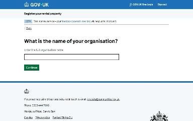](img/change_organisation-name/v1.jpg)

Shown when Check your answers: Change Landlord type; Are you registering as an individual or an organisation?: An organisation (when changing an answer)

### What is your organisation’s address?

`organisation-address/lookup-address` · LookupAddressStepConfig

Shown when Check your answers: Change Landlord type (when changing an answer)

### Select your organisation’s address

`organisation-address/select-address` · SelectAddressStepConfig

[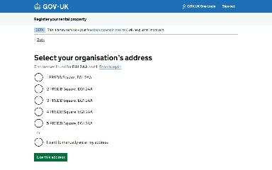](img/change_organisation-address_select-address/v1.jpg)

Shown when Check your answers: Change Landlord type (when changing an answer)

### What is your organisation’s email address?

`organisation-email` · OrgEmailStepConfig

Shown when Check your answers: Change Landlord type; Select your organisation’s address: 1 PRSDB Square, EG1 2AA (when changing an answer)

### What is your organisation’s address?

`organisation-address/manual-address` · ManualAddressStepConfig

Shown when Check your answers: Change Landlord type; Select your organisation’s address: I want to manually enter my address (when changing an answer)

### What is your contact address?

`manual-address` · ManualAddressStepConfig

Shown when Check your answers: Change Contact address; Select your address: I want to manually enter my address (when changing an answer)

### Confirm your name and date of birth

`confirm-identity` · ConfirmIdentityStepConfig

[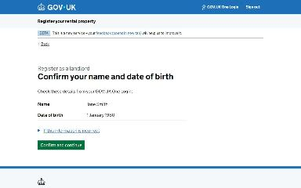](img/confirm-identity/v1.jpg)

Shown when One Login identity check: Identity verified

### What is the name of your organisation?

`organisation-name` · OrgNameStepConfig

[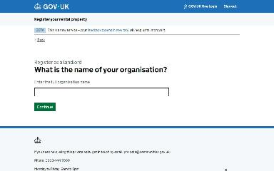](img/organisation-name/v1.jpg)

Shown when Are you registering as an individual or an organisation?: An organisation

Shown when Are you registering as an individual or an organisation?: An organisation; Check your answers: Change Organisation name (when changing an answer)

### What is your organisation’s address?

`organisation-address/lookup-address` · LookupAddressStepConfig

[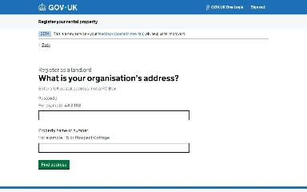](img/organisation-address_lookup-address/v1.jpg)

Shown when Are you registering as an individual or an organisation?: An organisation

[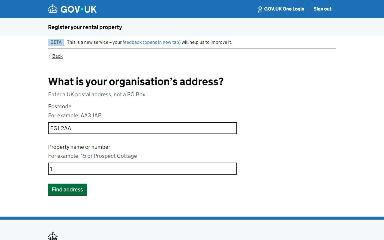](img/organisation-address_lookup-address/v2.jpg)

Shown when Are you registering as an individual or an organisation?: An organisation; Check your answers: Change Organisation address (when changing an answer)

### Select your organisation’s address

`organisation-address/select-address` · SelectAddressStepConfig

[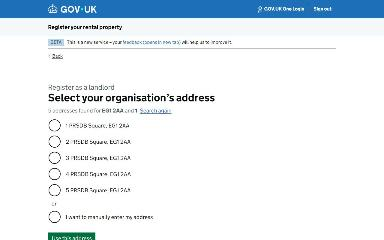](img/organisation-address_select-address/v1.jpg)

Shown when Are you registering as an individual or an organisation?: An organisation

### What is your organisation’s email address?

`organisation-email` · OrgEmailStepConfig

[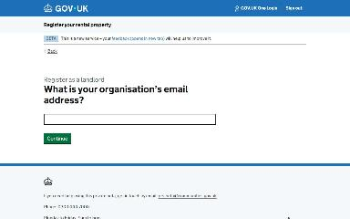](img/organisation-email/v1.jpg)

Shown when Are you registering as an individual or an organisation?: An organisation

[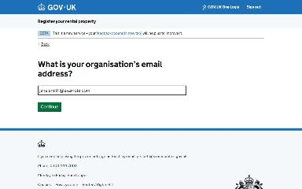](img/organisation-email/v2.jpg)

Shown when Are you registering as an individual or an organisation?: An organisation; Check your answers: Change Organisation email (when changing an answer)

### What is your organisation’s phone number?

`organisation-phone-number` · OrgPhoneNumberStepConfig

[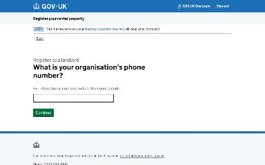](img/organisation-phone-number/v1.jpg)

Shown when Are you registering as an individual or an organisation?: An organisation

[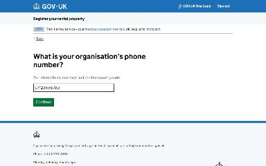](img/organisation-phone-number/v2.jpg)

Shown when Are you registering as an individual or an organisation?: An organisation; Check your answers: Change Organisation phone number (when changing an answer)

### Select your organisation’s type

`organisation-type` · OrgTypeStepConfig

[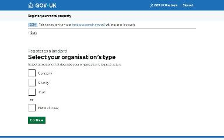](img/organisation-type/v1.jpg)

Shown when Are you registering as an individual or an organisation?: An organisation

[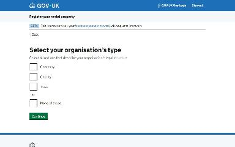](img/organisation-type/v2.jpg)

Shown when Are you registering as an individual or an organisation?: An organisation; Check your answers: Change Organisation type (when changing an answer)

### Is your organisation a registered charity?

`organisation-charity` · OrgIsRegisteredCharityStepConfig

[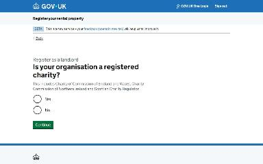](img/organisation-charity/v1.jpg)

Shown when Are you registering as an individual or an organisation?: An organisation

[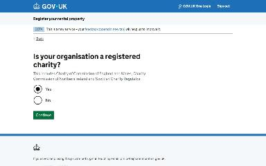](img/organisation-charity/v2.jpg)

Shown when Are you registering as an individual or an organisation?: An organisation; Check your answers: Change Registered charity (when changing an answer)

### Who is your charity registered with?

`organisation-charity-registered-with` · OrgCharityRegisteredWithStepConfig

[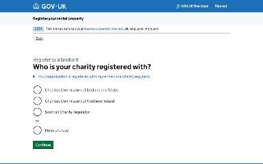](img/organisation-charity-registered-with/v1.jpg)

Shown when Are you registering as an individual or an organisation?: An organisation

[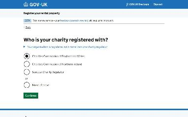](img/organisation-charity-registered-with/v2.jpg)

Shown when Are you registering as an individual or an organisation?: An organisation; Check your answers: Change Registered charity; Is your organisation a registered charity?: Yes (when changing an answer)

### What is your organisation’s charity number?

`organisation-charity-number` · OrgCharityNumberEnglandAndWalesStepConfig

Shown when Are you registering as an individual or an organisation?: An organisation

Shown when Are you registering as an individual or an organisation?: An organisation; Check your answers: Change Registered charity; Who is your charity registered with?: Charities Commission of England and Wales (when changing an answer)

### Is your organisation registered with Companies House?

`organisation-companies-house` · OrgIsRegisteredCompanyStepConfig

[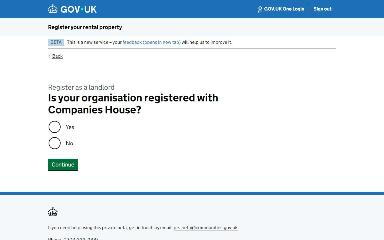](img/organisation-companies-house/v1.jpg)

Shown when Are you registering as an individual or an organisation?: An organisation

[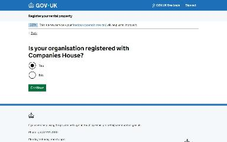](img/organisation-companies-house/v2.jpg)

Shown when Are you registering as an individual or an organisation?: An organisation; Check your answers: Change Registered with Companies House (when changing an answer)

### What is your organisation’s company number?

`organisation-company-number` · OrgCompanyNumberStepConfig

[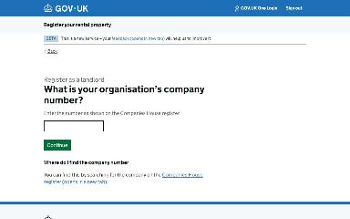](img/organisation-company-number/v1.jpg)

Shown when Are you registering as an individual or an organisation?: An organisation

[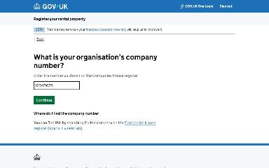](img/organisation-company-number/v2.jpg)

Shown when Are you registering as an individual or an organisation?: An organisation; Check your answers: Change Companies House number (when changing an answer)

### Who is the main contact for your organisation?

`organisation-main-contact` · OrgMainContactStepConfig

[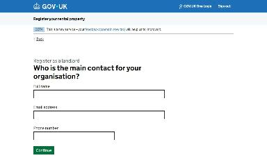](img/organisation-main-contact/v1.jpg)

Shown when Are you registering as an individual or an organisation?: An organisation

[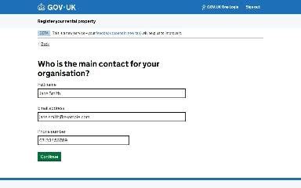](img/organisation-main-contact/v2.jpg)

Shown when Are you registering as an individual or an organisation?: An organisation; Check your answers: Change (when changing an answer)

### You must provide trustee details

`organisation-type-trust-interruption` · OrgTypeTrustInterruptionStepConfig

Shown when Are you registering as an individual or an organisation?: An organisation; Check your answers: Change Organisation type; Select your organisation’s type: Trust (when changing an answer)

### What is the lead trustee’s full name?

`lead-trustee-name` · LeadTrusteeNameStepConfig

Shown when Are you registering as an individual or an organisation?: An organisation; Check your answers: Change Organisation type (when changing an answer)

### What is the lead trustee’s date of birth?

`lead-trustee-dob` · LeadTrusteeDobStepConfig

Shown when Are you registering as an individual or an organisation?: An organisation; Check your answers: Change Organisation type (when changing an answer)

### What is the lead trustee’s email address?

`lead-trustee-email` · LeadTrusteeEmailStepConfig

[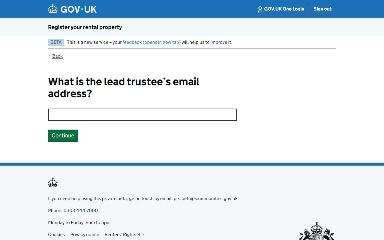](img/change_lead-trustee-email/v1.jpg)

Shown when Are you registering as an individual or an organisation?: An organisation; Check your answers: Change Organisation type (when changing an answer)

### What is your organisation’s charity number?

`organisation-charity-number-northern-ireland` · OrgCharityNumberNorthernIrelandStepConfig

Shown when Are you registering as an individual or an organisation?: An organisation; Check your answers: Change Registered charity; Who is your charity registered with?: Charities Commission of Northern Ireland (when changing an answer)

### What is your organisation’s charity number?

`organisation-charity-number-scotland` · OrgCharityNumberScotlandStepConfig

Shown when Are you registering as an individual or an organisation?: An organisation; Check your answers: Change Registered charity; Who is your charity registered with?: Scottish Charity Regulator (when changing an answer)

### Your new answer affects other sections of your landlord record

`organisation-companies-house-interruption` · OrgCompaniesHouseInterruptionStepConfig

[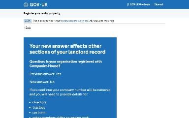](img/change_organisation-companies-house-interruption/v1.jpg)

Shown when Are you registering as an individual or an organisation?: An organisation; Check your answers: Change Registered with Companies House; Is your organisation registered with Companies House?: No (when changing an answer)

### Who do you want to provide details for?

`organisation-governing-body-who-to-provide` · OrgGovBodyWhoToProvideStepConfig

Shown when Are you registering as an individual or an organisation?: An organisation; Check your answers: Change Registered with Companies House (when changing an answer)

### What is their full name?

`organisation-governing-body-member-name` · OrgGovBodyMemberNameStepConfig

[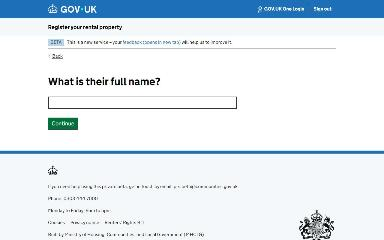](img/change_organisation-governing-body-member-name/v1.jpg)

Shown when Are you registering as an individual or an organisation?: An organisation; Check your answers: Change Registered with Companies House; Who do you want to provide details for?: Director (when changing an answer)

### What is their date of birth?

`organisation-governing-body-member-dob` · OrgGovBodyMemberDobStepConfig

Shown when Are you registering as an individual or an organisation?: An organisation; Check your answers: Change Registered with Companies House (when changing an answer)

### No matching address in England or Wales found for ZZ9 9ZZ and 1

`no-address-found` · NoAddressFoundStepConfig

Shown when What is your contact address?: Postcode: ZZ9 9ZZ

### What is your contact address?

`manual-address` · ManualAddressStepConfig

[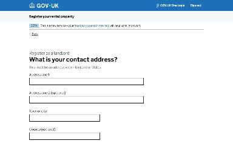](img/manual-address/v1.jpg)

Shown when What is your contact address?: Postcode: ZZ9 9ZZ

### No matching address in England or Wales found for ZZ9 9ZZ and 1

`organisation-address/no-address-found` · NoAddressFoundStepConfig

Shown when Are you registering as an individual or an organisation?: An organisation; What is your organisation’s address?: Postcode: ZZ9 9ZZ

### What is your organisation’s address?

`organisation-address/manual-address` · ManualAddressStepConfig

[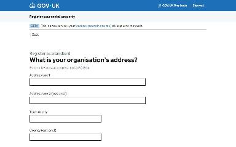](img/organisation-address_manual-address/v1.jpg)

Shown when Are you registering as an individual or an organisation?: An organisation; What is your organisation’s address?: Postcode: ZZ9 9ZZ

### What is the lead trustee’s full name?

`lead-trustee-name` · LeadTrusteeNameStepConfig

[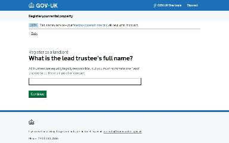](img/lead-trustee-name/v1.jpg)

Shown when Are you registering as an individual or an organisation?: An organisation; Select your organisation’s type: Trust

Shown when Are you registering as an individual or an organisation?: An organisation; Select your organisation’s type: Trust; Check your answers: Change (when changing an answer)

### What is the lead trustee’s date of birth?

`lead-trustee-dob` · LeadTrusteeDobStepConfig

Shown when Are you registering as an individual or an organisation?: An organisation; Select your organisation’s type: Trust

### What is the lead trustee’s email address?

`lead-trustee-email` · LeadTrusteeEmailStepConfig

Shown when Are you registering as an individual or an organisation?: An organisation; Select your organisation’s type: Trust

### What is the lead trustee’s phone number?

`lead-trustee-phone` · LeadTrusteePhoneStepConfig

Shown when Are you registering as an individual or an organisation?: An organisation; Select your organisation’s type: Trust

### What is the lead trustee’s contact address?

`lead-trustee-address/lookup-address` · LookupAddressStepConfig

Shown when Are you registering as an individual or an organisation?: An organisation; Select your organisation’s type: Trust

### Select your address

`lead-trustee-address/select-address` · SelectAddressStepConfig

Shown when Are you registering as an individual or an organisation?: An organisation; Select your organisation’s type: Trust

### What is your organisation’s charity number?

`organisation-charity-number-northern-ireland` · OrgCharityNumberNorthernIrelandStepConfig

Shown when Are you registering as an individual or an organisation?: An organisation; Who is your charity registered with?: Charities Commission of Northern Ireland

Shown when Are you registering as an individual or an organisation?: An organisation; Who is your charity registered with?: Charities Commission of Northern Ireland; Check your answers: Change Charity number (when changing an answer)

### What is your organisation’s charity number?

`organisation-charity-number-scotland` · OrgCharityNumberScotlandStepConfig

Shown when Are you registering as an individual or an organisation?: An organisation; Who is your charity registered with?: Scottish Charity Regulator

Shown when Are you registering as an individual or an organisation?: An organisation; Who is your charity registered with?: Scottish Charity Regulator; Check your answers: Change Charity number (when changing an answer)

### Providing details about your organisation’s governing body

`organisation-governing-body-details` · OrgGovBodyDetailsStepConfig

Shown when Are you registering as an individual or an organisation?: An organisation; Is your organisation registered with Companies House?: No

Shown when Are you registering as an individual or an organisation?: An organisation; Is your organisation registered with Companies House?: No; Check your answers: Change; You’ve added 1 person: Remove Person 1 (when changing an answer)

### You need to provide more information to register

`organisation-governing-body-must-provide-info` · OrgGovBodyMustProvideInfoStepConfig

Shown when Are you registering as an individual or an organisation?: An organisation; Is your organisation registered with Companies House?: No; Providing details about your organisation’s governing body: I don’t have these details

Shown when Are you registering as an individual or an organisation?: An organisation; Is your organisation registered with Companies House?: No; Check your answers: Change; Providing details about your organisation’s governing body: I don’t have these details (when changing an answer)

### Who do you want to provide details for?

`organisation-governing-body-who-to-provide` · OrgGovBodyWhoToProvideStepConfig

Shown when Are you registering as an individual or an organisation?: An organisation; Is your organisation registered with Companies House?: No

Shown when Are you registering as an individual or an organisation?: An organisation; Is your organisation registered with Companies House?: No; Check your answers: Change; You’ve added 1 person: Add another person (when changing an answer)

### What is their full name?

`organisation-governing-body-member-name` · OrgGovBodyMemberNameStepConfig

Shown when Are you registering as an individual or an organisation?: An organisation; Is your organisation registered with Companies House?: No

### What is their date of birth?

`organisation-governing-body-member-dob` · OrgGovBodyMemberDobStepConfig

Shown when Are you registering as an individual or an organisation?: An organisation; Is your organisation registered with Companies House?: No

### What is their contact address?

`organisation-governing-body-member-address/lookup-address` · LookupAddressStepConfig

Shown when Are you registering as an individual or an organisation?: An organisation; Is your organisation registered with Companies House?: No

### Select their address

`organisation-governing-body-member-address/select-address` · SelectAddressStepConfig

Shown when Are you registering as an individual or an organisation?: An organisation; Is your organisation registered with Companies House?: No

### You’ve added 1 person

`organisation-governing-body-member-list` · OrgGovBodyMemberListStepConfig

Shown when Are you registering as an individual or an organisation?: An organisation; Is your organisation registered with Companies House?: No

Shown when Are you registering as an individual or an organisation?: An organisation; Is your organisation registered with Companies House?: No; Check your answers: Change (when changing an answer)

### No matching address in England or Wales found for ZZ9 9ZZ and 1

`lead-trustee-address/no-address-found` · NoAddressFoundStepConfig

Shown when Are you registering as an individual or an organisation?: An organisation; Select your organisation’s type: Trust; What is the lead trustee’s contact address?: Postcode: ZZ9 9ZZ

### What is the lead trustee’s contact address?

`lead-trustee-address/manual-address` · ManualAddressStepConfig

Shown when Are you registering as an individual or an organisation?: An organisation; Select your organisation’s type: Trust; What is the lead trustee’s contact address?: Postcode: ZZ9 9ZZ

### No matching address in England or Wales found for ZZ9 9ZZ and 1

`organisation-governing-body-member-address/no-address-found` · NoAddressFoundStepConfig

Shown when Are you registering as an individual or an organisation?: An organisation; Is your organisation registered with Companies House?: No; What is their contact address?: Postcode: ZZ9 9ZZ

### What is their contact address?

`organisation-governing-body-member-address/manual-address` · ManualAddressStepConfig

Shown when Are you registering as an individual or an organisation?: An organisation; Is your organisation registered with Companies House?: No; What is their contact address?: Postcode: ZZ9 9ZZ

