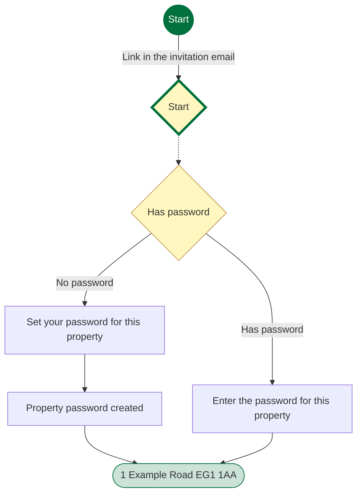
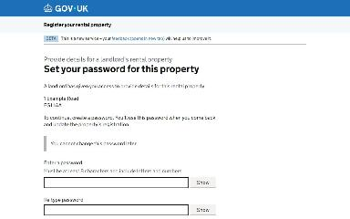
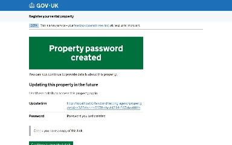
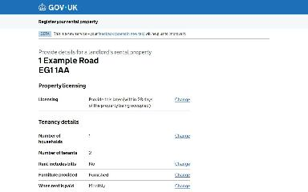
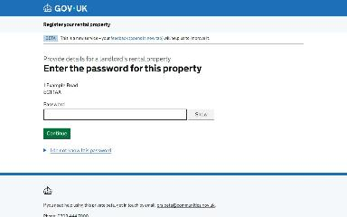

# Accept an invitation to act as a letting agent journey map

Generated 2026-10-23T09:42:40.246969400Z at commit `3a5832daa`. Feature flags: failover-test-endpoints=false, subject-identifier-page=true, pdjb-939-property-registration-phase-two=false, pdjb-1053-dashboard-nav-link=true, pdjb-1022-delegate-to-letting-agent=true, pdjb-1664-password-benchmark-endpoint=false, pdjb-238-gatling-post-endpoint=false, pdjb-1040-correspondence-address=true, pdjb-1009-payments=false, pdjb-926-landlord-dashboard-update=true, pdjb-1210-multi-user-organisations=false.

Open `index.html` for the interactive map. `report.md` lists gaps and errors.

## Pages

### Set your password for this property

`set-password` · SetPasswordStepConfig

Shown on the default route

### Property password created

`confirmation` · ConfirmationStepConfig

Shown on the default route

### 1 Example Road EG1 1AA

`/landlord/letting-agent/property-details/3334abcd-5678-abcd-1234-567abcd1111a`

Shown on the default route

### Enter the password for this property

`enter-password` · EnterPasswordStepConfig

Shown when Starting point: Letting agent already has a password

