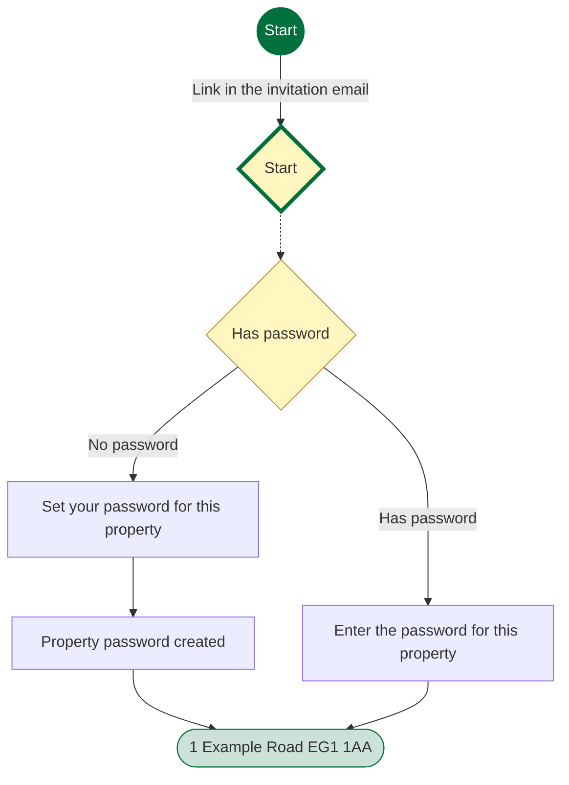
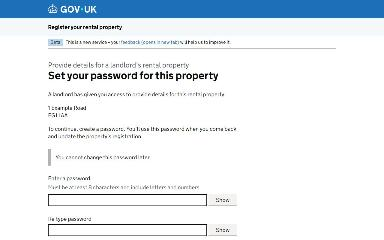
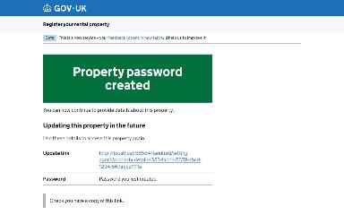
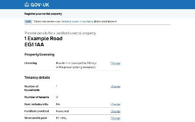
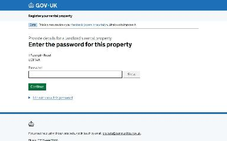

# Accept an invitation to act as a letting agent journey map

Generated 2026-11-03T12:37:34.521369600Z at commit `f960f1073`. Feature flags: failover-test-endpoints=false, subject-identifier-page=true, pdjb-939-property-registration-phase-two=true, pdjb-939-property-registration-phase-three=false, pdjb-1664-password-benchmark-endpoint=false, pdjb-238-gatling-post-endpoint=false, pdjb-1009-payments=true, pdjb-1210-multi-user-organisations=true, pdjb-1894-gas-certificate-14-month-expiry=false, pdjb-955-associated-parties=false, pdjb-1666-eic-issue-date=false, pdjb-973-asynchronous-email-sending=false.

Open `index.html` for the interactive map. `report.md` lists gaps and errors.

## Pages

### Set your password for this property

`set-password` · SetPasswordStepConfig

Shown on the default route

### Property password created

`confirmation` · ConfirmationStepConfig

Shown on the default route

### 1 Example Road EG1 1AA

`/landlord/letting-agent/property-details/3334abcd-5678-abcd-1234-567abcd1111a`

Shown on the default route

### Enter the password for this property

`enter-password` · EnterPasswordStepConfig

Shown when Starting point: Letting agent already has a password

