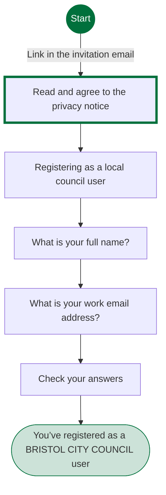
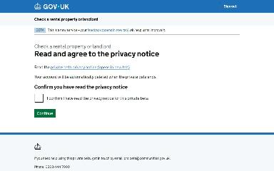
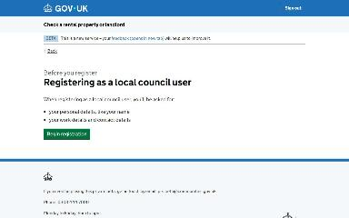
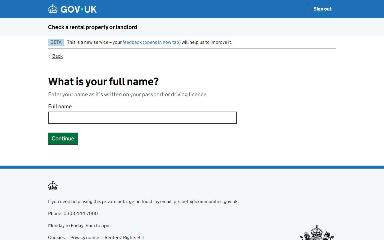
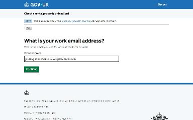
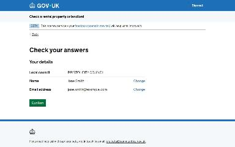
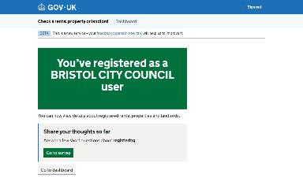

# Register as a local council user journey map

Generated 2026-10-23T09:42:45.589621900Z at commit `3a5832daa`. Feature flags: failover-test-endpoints=false, subject-identifier-page=true, pdjb-939-property-registration-phase-two=false, pdjb-1053-dashboard-nav-link=true, pdjb-1022-delegate-to-letting-agent=true, pdjb-1664-password-benchmark-endpoint=false, pdjb-238-gatling-post-endpoint=false, pdjb-1040-correspondence-address=true, pdjb-1009-payments=false, pdjb-926-landlord-dashboard-update=true, pdjb-1210-multi-user-organisations=false.

Open `index.html` for the interactive map. `report.md` lists gaps and errors.

## Pages

### Read and agree to the privacy notice

`privacy-notice` · PrivacyNoticeStepConfig

Shown on the default route

### Registering as a local council user

`landing-page` · LandingPageStepConfig

Shown on the default route

### What is your full name?

`name` · NameStepConfig

Shown on the default route

### What is your work email address?

`email` · EmailStepConfig

Shown on the default route

### Check your answers

`check-answers` · LocalCouncilUserCyaStepConfig

Shown on the default route

### You’ve registered as a BRISTOL CITY COUNCIL user

`/local-council/register-local-council-user/confirmation`

Shown on the default route

