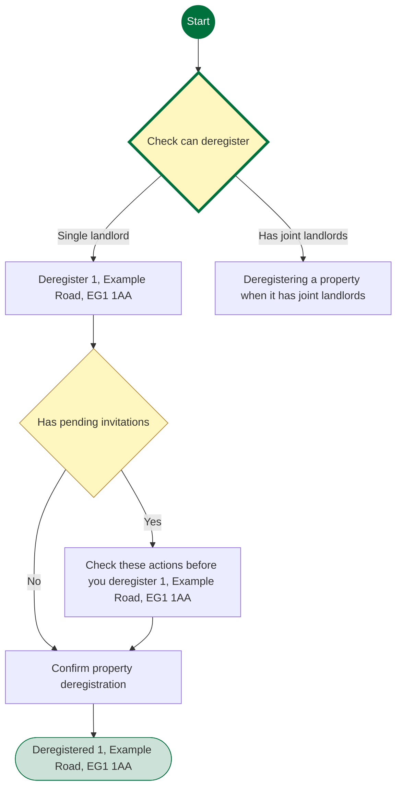
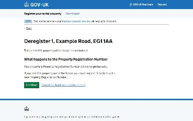
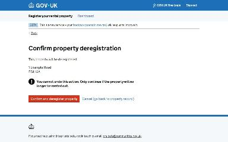
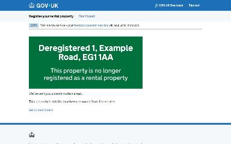
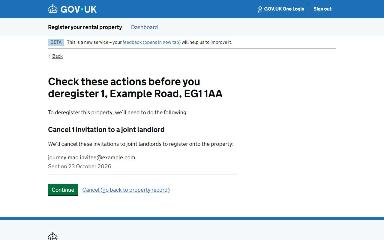
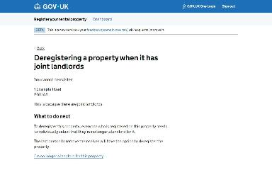

# Delete a property record journey map

Generated 2026-10-23T09:33:38.248091700Z at commit `3a5832daa`. Feature flags: failover-test-endpoints=false, subject-identifier-page=true, pdjb-939-property-registration-phase-two=false, pdjb-1053-dashboard-nav-link=true, pdjb-1022-delegate-to-letting-agent=true, pdjb-1664-password-benchmark-endpoint=false, pdjb-238-gatling-post-endpoint=false, pdjb-1040-correspondence-address=true, pdjb-1009-payments=false, pdjb-926-landlord-dashboard-update=true, pdjb-1210-multi-user-organisations=false.

Open `index.html` for the interactive map. `report.md` lists gaps and errors.

## Pages

### Deregister 1, Example Road, EG1 1AA

`info` · DeregisterInfoStepConfig

Shown on the default route

### Confirm property deregistration

`confirm` · ConfirmStepConfig

Shown on the default route

### Deregistered 1, Example Road, EG1 1AA

`/landlord/deregister-property/1/confirmation`

Shown on the default route

### Check these actions before you deregister 1, Example Road, EG1 1AA

`check-invitations` · CheckPendingInvitationsStepConfig

Shown when Starting point: Property has a pending joint landlord invitation

### Deregistering a property when it has joint landlords

`cannot-deregister` · CannotDeregisterStepConfig

Shown when Starting point: Property has joint landlords

