# Register a property journey map

Generated 2026-10-23T09:33:30.190527700Z at commit `3a5832daa`. Feature flags: failover-test-endpoints=false, subject-identifier-page=true, pdjb-939-property-registration-phase-two=false, pdjb-1053-dashboard-nav-link=true, pdjb-1022-delegate-to-letting-agent=true, pdjb-1664-password-benchmark-endpoint=false, pdjb-238-gatling-post-endpoint=false, pdjb-1040-correspondence-address=true, pdjb-1009-payments=false, pdjb-926-landlord-dashboard-update=true, pdjb-1210-multi-user-organisations=false.

Open `index.html` for the interactive map. `report.md` lists gaps and errors.

```mermaid
flowchart TD
    journeyStart(("Start"))
    subgraph c0["Property details"]
        subgraph c1["Property details"]
            subgraph c2["Property registration address"]
                n1["What is the property address? (2 variants)"]
                n2["Select your address (2 variants)"]
                n3["This property is registered on the database (2 variants)"]
                n66["No matching address in England found for ZZ9 9ZZ and Slate House"]
                n67["What is the property address?"]
                n68["What local council area is your property in? (2 variants)"]
            end
            n4["What type of property are you registering? (2 variants)"]
            n5["How many bedrooms in your property? (2 variants)"]
        end
    end
    subgraph c3["Ownership and landlords"]
        subgraph c4["Ownership and landlords"]
            subgraph c5["Joint landlords property registration"]
                subgraph c6["Invite joint landlords"]
                    n8["Invite a joint landlord to this property (2 variants)"]
                    n9["You’ve added 1 joint landlord (3 variants)"]
                    n69["Invite a joint landlord to this property"]
                    n70["Are you sure you want to remove jane.smith@example.com? (2 variants)"]
                    n100{"Has any joint landlords invited"}
                end
                n7["Invite joint landlords (2 variants)"]
                n99{"Has any joint landlords invited"}
            end
            n6["Select the type of ownership you have for your property (2 variants)"]
        end
    end
    subgraph c7["Who the council should contact"]
        subgraph c8["Correspondence"]
            subgraph c9["Correspondence address"]
                n11["Where the council should send post about this property (2 variants)"]
                n12["Select a postal address (2 variants)"]
                n71["No matching address in England or Wales found for ZZ9 9ZZ and Slate House"]
                n72["Enter a postal address"]
            end
            n10["Where should the council send emails? (2 variants)"]
        end
    end
    subgraph c10["Tell us if your property’s occupied"]
        n13["Is your property occupied by tenants? (2 variants)"]
    end
    subgraph c11["Who provides details"]
        n14["Who will provide details about how your property’s rented out"]
        n73["Allow your letting agent or property manager to provide details"]
    end
    subgraph c12["Tell us if your property needs a license"]
        subgraph c13["Licensing"]
            n15["Select the type of licence you have for your property (2 variants)"]
            n16["What is your selective licence number? (2 variants)"]
            n74["Provide details about property licensing later"]
            n75["What is your HMO mandatory licence number?"]
            n76["What is your HMO additional licence number?"]
        end
    end
    subgraph c14["Gas safety certificate"]
        subgraph c15["Gas safety"]
            subgraph c16["Gas safety details"]
                n17["Does the property have a gas supply or any gas appliances? (2 variants)"]
                n18["Do you have a gas safety certificate for this property? (2 variants)"]
                n19["What’s the issue date on the gas safety certificate? (2 variants)"]
                n20["Upload the gas safety certificate (2 variants)"]
                n21["You’ve uploaded 1 file (6 variants)"]
                n77["Provide these details later"]
                n78["You must get a valid gas safety certificate for this property"]
                n79["This gas safety certificate has expired"]
                n80["Are you sure you want to remove validFile.png?"]
                n101{"Has any in collection"}
            end
            n22["Gas safety certificate (4 variants)"]
        end
    end
    subgraph c17["Electrical safety certificate"]
        subgraph c18["Electrical safety"]
            subgraph c19["Electrical safety details"]
                n23["Which electrical safety certificate do you have for this property? (2 variants)"]
                n24["What’s the expiry date on the Electrical Installation Certificate? (3 variants)"]
                n25["Upload the Electrical Installation Certificate (EIC) (3 variants)"]
                n26["You’ve uploaded 1 file (7 variants)"]
                n81["Provide your electrical safety certificate later"]
                n82["You must get a valid electrical safety certificate for this property"]
                n83["This electrical safety certificate has expired"]
                n84["Are you sure you want to remove validFile.png?"]
                n102{"Has any in collection"}
            end
            n27["Electrical safety certificate (3 variants)"]
        end
    end
    subgraph c20["Energy performance certificate (EPC)"]
        subgraph c21["Epc"]
            subgraph c22["Epc details"]
                n28["Do you have an EPC for this property? (2 variants)"]
                n29["Find your EPC (2 variants)"]
                n30["Confirm your EPC (2 variants)"]
                n85["Check this EPC"]
                n86["Confirm when the current tenancy began"]
                n87["You need a registered energy efficiency exemption to let this property"]
                n88["Which energy efficiency exemption did you register for this property?"]
                n89["Provide your EPC details later"]
                n90["Is an EPC required to let this property?"]
                n91["Your property is missing an EPC (2 variants)"]
                n92["We could not find your EPC"]
                n93["There’s a newer EPC for this property"]
                n94["This property’s EPC has expired (2 variants)"]
                n96["This property does not meet energy efficiency requirements for letting"]
                n97["Why does this property not need an EPC to be let?"]
                n103{"Epc lookup by uprn"}
                n104{"Epc age check"}
                n105{"Epc energy rating check"}
                n108{"Property occupied check"}
            end
            n31["Energy performance certificate (EPC) (8 variants)"]
        end
    end
    subgraph c23["Tenancy details"]
        subgraph c24["Tenancy details"]
            subgraph c25["Households and tenants"]
                n32["Households in your property (2 variants)"]
                n33["How many people live in your property? (2 variants)"]
                n95["Provide tenancy details later"]
            end
            subgraph c26["Rent includes bills"]
                n34["Does the rent include bills? (2 variants)"]
                n35["Which of these do you include in the rent? (2 variants)"]
            end
            subgraph c27["Rent frequency and amount"]
                n37["When you charge rent (2 variants)"]
                n38["What is the monthly rent? (6 variants)"]
            end
            n36["Is the property furnished? (2 variants)"]
        end
    end
    subgraph c28["Submit your registration"]
        n39["Check your answers for: Slate House, PRSDB Square, AA3 1AB (11 variants)"]
        n98["Confirm missing compliance certificates"]
        n106{"Has missing compliance"}
    end
    subgraph c29["Changing answers"]
        n41["What is the property address?"]
        n42["What local council area is your property in?"]
        n43["Invite a joint landlord to this property"]
        n44["Are you sure you want to remove jane.smith@example.com? (2 variants)"]
        n45["You’ve added 2 joint landlords"]
        n46["Enter a postal address"]
        n47["Are you sure you want to change this?"]
        n48["Allow your letting agent or property manager to provide details"]
        n49["Provide details about property licensing later"]
        n50["What is your HMO mandatory licence number?"]
        n51["What is your HMO additional licence number?"]
        n52["Provide these details later"]
        n53["You must get a valid gas safety certificate for this property"]
        n54["Are you sure you want to remove validFile.png?"]
        n55["Provide your electrical safety certificate later"]
        n56["What’s the expiry date on the Electrical Installation Condition Report?"]
        n57["You must get a valid electrical safety certificate for this property"]
        n58["Are you sure you want to remove validFile.png?"]
        n59["You’ve uploaded 2 files"]
        n60["Provide your EPC details later"]
        n61["Is an EPC required to let this property?"]
        n62["Your property is missing an EPC"]
        n63["Why does this property not need an EPC to be let?"]
        n64["Provide tenancy details later"]
        n65["What is the 4-weekly rent? (2 variants)"]
    end
    n0["Register a rental property"]
    n40(["Property registered (5 variants)"])
    n107{"Who provides update routing"}
    journeyStart --> n0
    n0 -->|"Property details"| n1
    n1 -->|"Find address"| n2
    n1 -->|"Postcode: ZZ9 9ZZ"| n66
    n2 -->|"Slate House, PRSDB Square, AA3 1AB / Slate House, PRSDB Road, AA3 1AB / Grate House, PRSDB Road, AA3 1AB"| n4
    n2 -->|"Registered House, PRSDB Road, AA3 1AB / Stage House, PRSDB Road, AA3 1AB"| n3
    n2 -->|"I want to manually enter my address"| n67
    n2 -->|"Search again"| n1
    n4 --> n5
    n5 --> n6
    n6 --> n99
    n99 -->|"No landlords"| n7
    n7 -->|"Yes"| n100
    n100 -->|"No landlords"| n8
    n7 -->|"No, I am the only landlord for this property"| n10
    n8 --> n9
    n9 -->|"Save and continue"| n10
    n9 -->|"Add another landlord / Change Joint landlord 1 / Change Joint landlord 2"| n69
    n9 -->|"Remove Joint landlord 1 / Remove Joint landlord 2"| n70
    n10 --> n11
    n11 -->|"Find address"| n12
    n11 -->|"Postcode: ZZ9 9ZZ"| n71
    n12 -->|"Slate House, PRSDB Square, AA3 1AB / Slate House, PRSDB Road, AA3 1AB and 3 more"| n13
    n12 -->|"I want to manually enter my address"| n72
    n12 -->|"Search again"| n11
    n13 -->|"Yes"| n14
    n13 -->|"No"| n15
    n14 -->|"I will provide these details"| n15
    n14 -->|"My letting agent or property manager"| n73
    n15 -->|"Selective licence, Save and continue"| n16
    n15 -->|"Selective licence, Provide this later / HMO mandatory licence, Provide this later and 2 more"| n74
    n15 -->|"HMO mandatory licence, Save and continue"| n75
    n15 -->|"HMO additional licence, Save and continue"| n76
    n15 -->|"This property does not need a licence, Save and continue"| n17
    n16 --> n17
    n17 -->|"Yes, Save and continue"| n18
    n17 -->|"Yes, Provide this later / No, Provide this later"| n77
    n17 -->|"No, Save and continue"| n22
    n18 -->|"Yes, Save and continue"| n19
    n18 -->|"No, Save and continue"| n78
    n19 -->|"Save and continue"| n101
    n101 -->|"No members"| n20
    n19 -->|"Date: 23 October 2027"| n79
    n20 --> n21
    n21 -->|"Save and continue"| n22
    n21 -->|"Upload another file"| n20
    n21 -->|"Remove validFile.png"| n80
    n22 -->|"Save and continue"| n0
    n22 -->|"Change Does the property have a gas supply or any gas appliances?"| n17
    n22 -->|"Change Do you have a valid gas safety certificate for this property? / Change Do you have a gas safety certificate for this property?"| n18
    n22 -->|"Change Issue date"| n19
    n22 -->|"Change Your certificate"| n21
    n0 -->|"Ownership and landlords"| n6
    n0 -->|"Who the council should contact"| n10
    n0 -->|"Tell us if your property’s occupied"| n13
    n0 -->|"Who will provide these details"| n14
    n0 -->|"Tell us if your property needs a license"| n15
    n0 -->|"Gas safety certificate"| n17
    n0 -->|"Electrical safety certificate"| n23
    n23 -->|"Electrical Installation Certificate (EIC), Save and continue / Electrical Installation Condition Report (EICR), Save and continue"| n24
    n23 -->|"Electrical Installation Certificate (EIC), Provide this later / Electrical Installation Condition Report (EICR), Provide this later / None of the above, Provide this later"| n81
    n23 -->|"None of the above, Save and continue"| n82
    n24 -->|"Save and continue"| n102
    n102 -->|"No members"| n25
    n24 -->|"Date: 23 September 2026"| n83
    n25 --> n26
    n26 -->|"Save and continue"| n27
    n26 -->|"Upload another file"| n25
    n26 -->|"Remove validFile.png"| n84
    n27 -->|"Save and continue"| n0
    n27 -->|"Change Which electrical safety certificate do you have for this property?"| n23
    n27 -->|"Change Expiry date"| n24
    n27 -->|"Change Your certificate"| n26
    n0 -->|"Energy performance certificate (EPC)"| n103
    n103 -->|"Not found"| n28
    n103 -->|"Epc found"| n85
    n28 -->|"Yes, Save and continue"| n29
    n28 -->|"Yes, Provide details later / No (for example, the property does not require an EPC to be let), Provide details later"| n89
    n28 -->|"No (for example, the property does not require an EPC to be let), Save and continue"| n90
    n29 -->|"Search"| n30
    n29 -->|"Search"| n92
    n29 -->|"Search"| n93
    n30 -->|"Yes"| n104
    n104 -->|"Epc 10 years or newer"| n105
    n105 -->|"Epc meets energy requirements"| n31
    n30 -->|"No, search again"| n29
    n31 -->|"Save and continue"| n0
    n31 -->|"Change / Change Do you have an EPC for this property?"| n103
    n0 -->|"Tenancy details"| n32
    n32 -->|"Save and continue"| n33
    n32 -->|"Provide this later"| n95
    n33 --> n34
    n34 -->|"Yes"| n35
    n34 -->|"No"| n36
    n35 --> n36
    n36 --> n37
    n37 --> n38
    n38 --> n39
    n39 --> n106
    n106 -->|"Unoccupied or valid certificates or delegated"| n40
    n2 -.->|"I want to manually enter my address"| n41
    n41 -.->|"Continue"| n42
    n42 -.->|"ADUR DISTRICT COUNCIL"| n39
    n9 -.->|"Add another landlord / Change Joint landlord 1"| n43
    n9 -.->|"Remove Joint landlord 1"| n44
    n43 -.->|"Save and continue"| n45
    n44 -.->|"Yes"| n7
    n44 -.->|"No / Cancel"| n9
    n45 -.->|"Change Joint landlord 2"| n43
    n45 -.->|"Remove Joint landlord 2"| n44
    n12 -.->|"I want to manually enter my address"| n46
    n46 -.->|"Confirm and continue"| n39
    n107 -.->|"Changed to letting agent"| n47
    n47 -.->|"Continue with the change"| n48
    n48 -.->|"Save and continue"| n39
    n15 -.->|"Selective licence, Provide this later / HMO mandatory licence, Provide this later and 2 more"| n49
    n15 -.->|"HMO mandatory licence, Save and continue"| n50
    n15 -.->|"HMO additional licence, Save and continue"| n51
    n49 -.->|"Save and continue"| n39
    n50 -.->|"Save and continue"| n39
    n51 -.->|"Save and continue"| n39
    n17 -.->|"Yes, Provide this later / No, Provide this later"| n52
    n18 -.->|"No, Save and continue"| n53
    n52 -.->|"Continue"| n39
    n53 -.->|"Continue without a valid gas safety certificate"| n39
    n21 -.->|"Remove validFile.png"| n54
    n23 -.->|"Electrical Installation Certificate (EIC), Provide this later / Electrical Installation Condition Report (EICR), Provide this later / None of the above, Provide this later"| n55
    n23 -.->|"Electrical Installation Condition Report (EICR), Save and continue"| n56
    n23 -.->|"None of the above, Save and continue"| n57
    n55 -.->|"Save and continue"| n39
    n57 -.->|"Continue without a valid electrical safety certificate"| n39
    n26 -.->|"Remove validFile.png"| n58
    n25 -.->|"Upload a file"| n59
    n58 -.->|"Yes"| n25
    n58 -.->|"No / Cancel"| n26
    n28 -.->|"Yes, Provide details later / No (for example, the property does not require an EPC to be let), Provide details later"| n60
    n28 -.->|"No (for example, the property does not require an EPC to be let), Save and continue"| n61
    n60 -.->|"Save and continue"| n39
    n61 -.->|"Yes"| n62
    n61 -.->|"No"| n63
    n62 -.->|"Continue anyway"| n39
    n63 -.->|"It has protected architectural or historical merit / It’s smaller than 50 metres squared and 3 more"| n39
    n32 -.->|"Provide this later"| n64
    n64 -.->|"Save and continue"| n39
    n37 -.->|"4 weekly / Weekly"| n65
    n66 -->|"Enter address manually"| n67
    n66 -->|"search again."| n1
    n67 --> n68
    n68 --> n4
    n69 --> n9
    n70 -->|"Yes"| n7
    n70 -->|"No / Cancel / Yes"| n9
    n71 -->|"Enter address manually"| n72
    n71 -->|"search again."| n11
    n72 --> n13
    n73 --> n39
    n74 --> n17
    n75 --> n17
    n76 --> n17
    n77 --> n22
    n78 --> n22
    n79 -->|"Continue without a valid gas safety certificate"| n22
    n79 -->|"Change the issue date"| n19
    n80 -->|"Yes"| n20
    n80 -->|"No / Cancel / Yes"| n21
    n19 -->|"Save and continue"| n21
    n81 --> n27
    n82 --> n27
    n83 -->|"Continue without a valid electrical safety certificate"| n27
    n83 -->|"Change the expiry date"| n24
    n84 -->|"Yes"| n25
    n84 -->|"No / Cancel / Yes"| n26
    n24 -->|"Save and continue"| n26
    n85 -->|"Yes"| n104
    n85 -->|"No (use a different EPC or the property does not need one)"| n28
    n104 -->|"Epc older than 10 years"| n108
    n108 -->|"Yes"| n86
    n86 -->|"Yes"| n105
    n86 -->|"No"| n94
    n31 -->|"Change Was the EPC still in date when the current tenancy began?"| n86
    n105 -->|"Epc low energy rating"| n87
    n87 -->|"Yes"| n88
    n87 -->|"No"| n96
    n88 --> n31
    n31 -->|"Change Do you have a registered energy efficiency exemption for this property?"| n87
    n31 -->|"Change Registered exemption"| n88
    n89 --> n31
    n90 -->|"Yes"| n91
    n90 -->|"No"| n97
    n91 --> n31
    n31 -->|"Change Is an EPC required to let this property?"| n90
    n92 -->|"I do not have an EPC for this property"| n90
    n92 -->|"search again"| n29
    n93 -->|"Continue with most recent EPC"| n104
    n93 -->|"Search by certificate number again"| n29
    n94 --> n31
    n95 --> n39
    n96 --> n31
    n97 --> n31
    n31 -->|"Change Why does this property not need an EPC?"| n97
    n0 -->|"Check and submit your answers"| n39
    n108 -->|"No"| n94
    n106 -->|"Occupied and has invalid certificates"| n98
    n98 -->|"Yes (at risk of prosecution or fine)"| n40
    n98 -->|"No, go back"| n39
    n99 -.->|"Some landlords (not walked)"| n100
    n100 -.->|"Some landlords (not walked)"| n9
    n101 -->|"Some members"| n21
    n102 -->|"Some members"| n26
    classDef gap fill:#f3f2f1,stroke:#b1b4b6,stroke-dasharray: 5 5,color:#505a5f
    classDef decision fill:#fff7bf,stroke:#b58840
    classDef terminal fill:#cce2d8,stroke:#00703c
    classDef change stroke:#1d70b8,stroke-width:3px
    classDef startNode fill:#00703c,stroke:#00703c,color:#ffffff
    classDef entryPoint stroke:#00703c,stroke-width:4px
    class journeyStart startNode
    class n0 entryPoint
    class n40 terminal
    class n41 change
    class n42 change
    class n43 change
    class n44 change
    class n45 change
    class n46 change
    class n47 change
    class n48 change
    class n49 change
    class n50 change
    class n51 change
    class n52 change
    class n53 change
    class n54 change
    class n55 change
    class n56 change
    class n57 change
    class n58 change
    class n59 change
    class n60 change
    class n61 change
    class n62 change
    class n63 change
    class n64 change
    class n65 change
    class n99 decision
    class n100 decision
    class n101 decision
    class n102 decision
    class n103 decision
    class n104 decision
    class n105 decision
    class n106 decision
    class n107 decision
    class n108 decision
```

## Pages

### Register a rental property

`task-list` · PropertyRegistrationTaskListStepConfig

[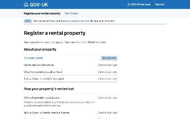](img/task-list/v1.jpg)

Shown on the default route


### What is the property address?

`lookup-address` · LookupAddressStepConfig

[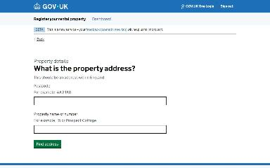](img/lookup-address/v1.jpg)

Shown on the default route

[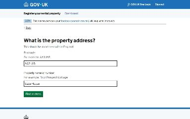](img/lookup-address/v2.jpg)

Shown when Check your answers for: Slate House, PRSDB Square, AA3 1AB: Change Address (when changing an answer)


### Select your address

`select-address` · SelectAddressStepConfig

[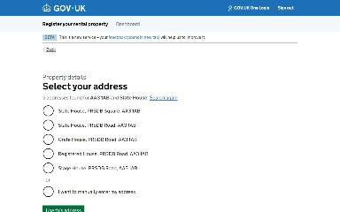](img/select-address/v1.jpg)

Shown on the default route

[](img/select-address/v2.jpg)

Shown when Check your answers for: Slate House, PRSDB Square, AA3 1AB: Change Address (when changing an answer)


### This property is registered on the database

`already-registered` · AlreadyRegisteredStepConfig

[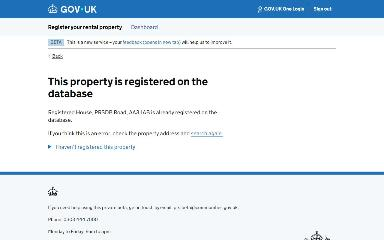](img/already-registered/v1.jpg)

Shown when Select your address: Registered House, PRSDB Road, AA3 1AB

[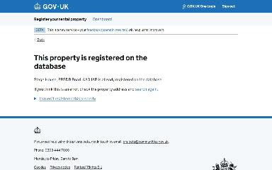](img/already-registered/v2.jpg)

Shown when Select your address: Stage House, PRSDB Road, AA3 1AB


### What type of property are you registering?

`property-type` · PropertyTypeStepConfig

[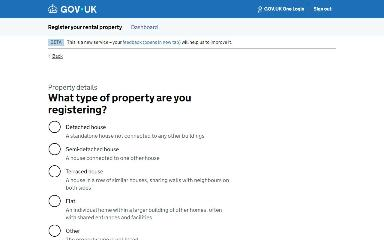](img/property-type/v1.jpg)

Shown on the default route

[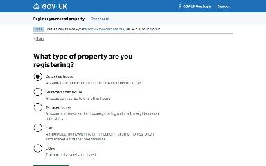](img/property-type/v2.jpg)

Shown when Check your answers for: Slate House, PRSDB Square, AA3 1AB: Change Property type (when changing an answer)


### How many bedrooms in your property?

`number-of-bedrooms` · BedroomsStepConfig

[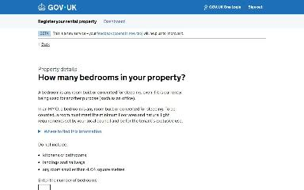](img/number-of-bedrooms/v1.jpg)

Shown on the default route

[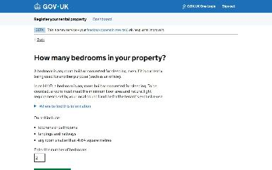](img/number-of-bedrooms/v2.jpg)

Shown when Check your answers for: Slate House, PRSDB Square, AA3 1AB: Change Number of bedrooms (when changing an answer)


### Select the type of ownership you have for your property

`ownership-type` · OwnershipTypeStepConfig

[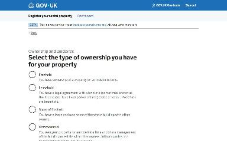](img/ownership-type/v1.jpg)

Shown on the default route

[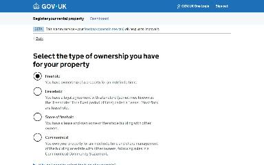](img/ownership-type/v2.jpg)

Shown when Check your answers for: Slate House, PRSDB Square, AA3 1AB: Change How do you own this property? (when changing an answer)


### Invite joint landlords

`has-joint-landlords` · HasJointLandlordsConfig

[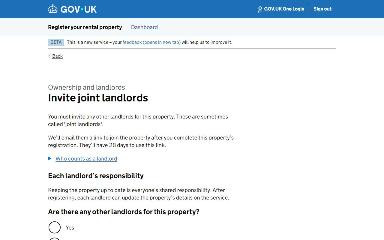](img/has-joint-landlords/v1.jpg)

Shown on the default route

[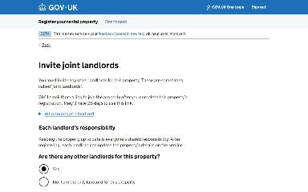](img/has-joint-landlords/v2.jpg)

Shown when Check your answers for: Slate House, PRSDB Square, AA3 1AB: Change Joint landlord invitations; Are you sure you want to remove jane.smith@example.com?: Yes (when changing an answer)


### Invite a joint landlord to this property

`invite-joint-landlord` · InviteJointLandlordStepConfig

[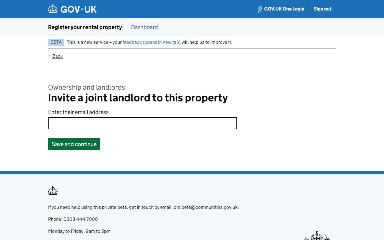](img/invite-joint-landlord/v1.jpg)

Shown on the default route

[](img/invite-joint-landlord/v2.jpg)

Shown when Check your answers for: Slate House, PRSDB Square, AA3 1AB: Change Joint landlord invitations; Invite joint landlords: Yes (when changing an answer)


### You’ve added 1 joint landlord

`check-joint-landlords` · CheckJointLandlordsStepConfig

[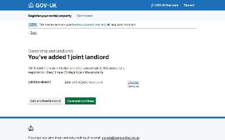](img/check-joint-landlords/v1.jpg)

Shown on the default route

[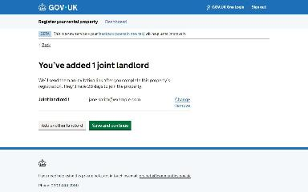](img/check-joint-landlords/v2.jpg)

Shown when Check your answers for: Slate House, PRSDB Square, AA3 1AB: Change Joint landlord invitations (when changing an answer)

[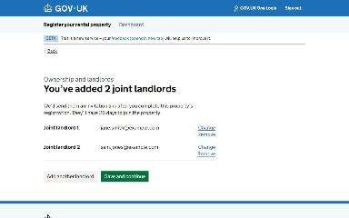](img/check-joint-landlords/v3.jpg)

Shown when You’ve added 1 joint landlord: Add another landlord


### Where should the council send emails?

`correspondence-email` · CorrespondenceEmailStepConfig

[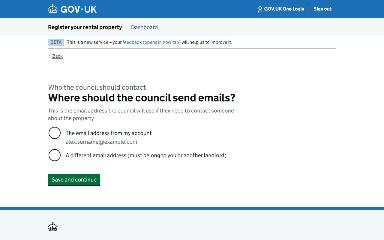](img/correspondence-email/v1.jpg)

Shown on the default route

[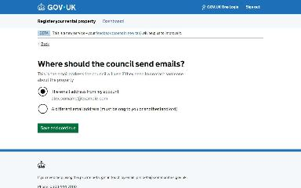](img/correspondence-email/v2.jpg)

Shown when Check your answers for: Slate House, PRSDB Square, AA3 1AB: Change Email address (when changing an answer)


### Where the council should send post about this property

`correspondence-address/lookup-address` · LookupAddressStepConfig

[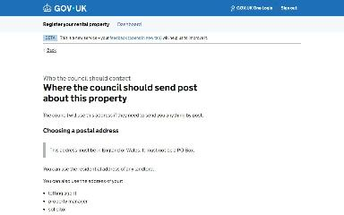](img/correspondence-address_lookup-address/v1.jpg)

Shown on the default route

[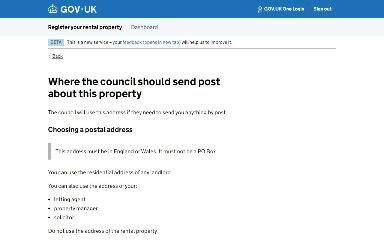](img/correspondence-address_lookup-address/v2.jpg)

Shown when Check your answers for: Slate House, PRSDB Square, AA3 1AB: Change Postal address (when changing an answer)


### Select a postal address

`correspondence-address/select-address` · SelectAddressStepConfig

[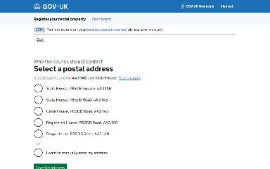](img/correspondence-address_select-address/v1.jpg)

Shown on the default route

[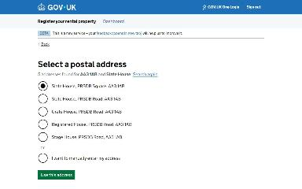](img/correspondence-address_select-address/v2.jpg)

Shown when Check your answers for: Slate House, PRSDB Square, AA3 1AB: Change Postal address (when changing an answer)


### Is your property occupied by tenants?

`occupancy` · OccupiedStepConfig

[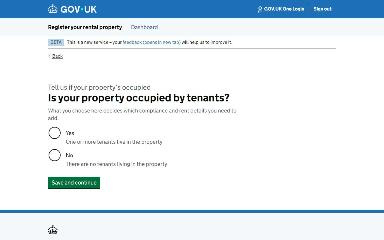](img/occupancy/v1.jpg)

Shown on the default route

[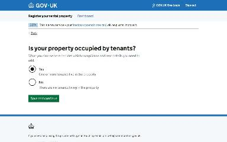](img/occupancy/v2.jpg)

Shown when Check your answers for: Slate House, PRSDB Square, AA3 1AB: Change Is this property occupied by tenants? (when changing an answer)


### Who will provide details about how your property’s rented out

`who-provides-rental-details` · WhoProvidesRentalDetailsStepConfig

[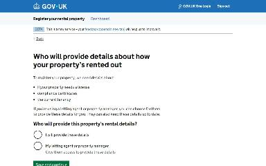](img/who-provides-rental-details/v1.jpg)

Shown on the default route


### Select the type of licence you have for your property

`licensing-type` · LicensingTypeStepConfig

[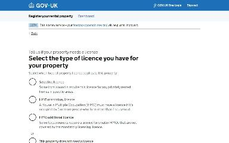](img/licensing-type/v1.jpg)

Shown on the default route

[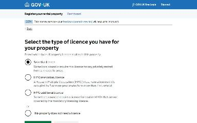](img/licensing-type/v2.jpg)

Shown when Check your answers for: Slate House, PRSDB Square, AA3 1AB: Change Licensing type (when changing an answer)


### What is your selective licence number?

`selective-licence` · SelectiveLicenceStepConfig

[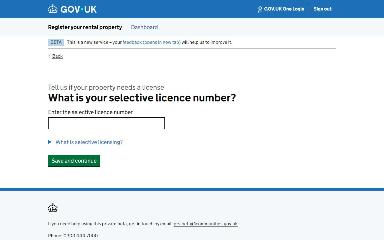](img/selective-licence/v1.jpg)

Shown on the default route

[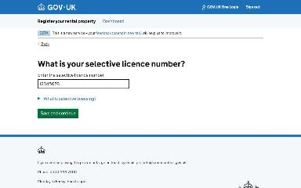](img/selective-licence/v2.jpg)

Shown when Check your answers for: Slate House, PRSDB Square, AA3 1AB: Change Licensing type; Select the type of licence you have for your property: Selective licence, Save and continue (when changing an answer)


### Does the property have a gas supply or any gas appliances?

`has-gas-supply` · HasGasSupplyStepConfig

[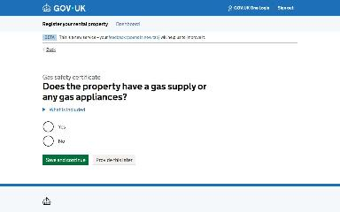](img/has-gas-supply/v1.jpg)

Shown on the default route

[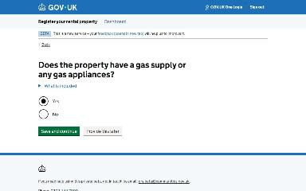](img/has-gas-supply/v2.jpg)

Shown when Check your answers for: Slate House, PRSDB Square, AA3 1AB: Change Does the property have a gas supply or any gas appliances? (when changing an answer)


### Do you have a gas safety certificate for this property?

`has-gas-safety` · HasGasCertStepConfig

[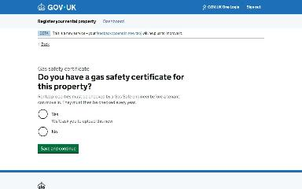](img/has-gas-safety/v1.jpg)

Shown on the default route

[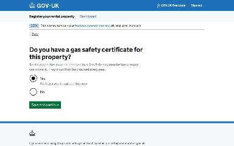](img/has-gas-safety/v2.jpg)

Shown when Check your answers for: Slate House, PRSDB Square, AA3 1AB: Change Does the property have a gas supply or any gas appliances?; Does the property have a gas supply or any gas appliances?: Yes, Save and continue (when changing an answer)


### What’s the issue date on the gas safety certificate?

`gas-safety-certificate-issue-date` · GasCertIssueDateStepConfig

[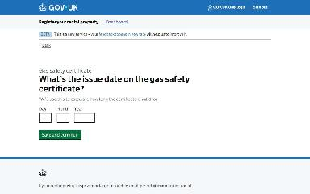](img/gas-safety-certificate-issue-date/v1.jpg)

Shown on the default route

[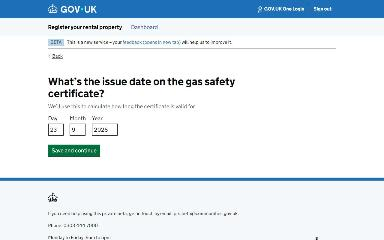](img/gas-safety-certificate-issue-date/v2.jpg)

Shown when Check your answers for: Slate House, PRSDB Square, AA3 1AB: Change Does the property have a gas supply or any gas appliances?; Do you have a gas safety certificate for this property?: Yes, Save and continue (when changing an answer)


### Upload the gas safety certificate

`gas-safety-certificate-file-upload` · UploadGasCertStepConfig

[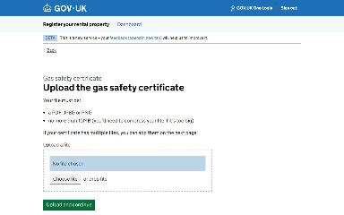](img/gas-safety-certificate-file-upload/v1.jpg)

Shown on the default route

[](img/gas-safety-certificate-file-upload/v2.jpg)

Shown when Check your answers for: Slate House, PRSDB Square, AA3 1AB: Change Does the property have a gas supply or any gas appliances?; You’ve uploaded 1 file: Upload another file (when changing an answer)


### You’ve uploaded 1 file

`check-gas-safety-certificate-uploads` · CheckGasCertUploadsStepConfig

[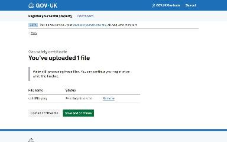](img/check-gas-safety-certificate-uploads/v1.jpg)

Shown on the default route

[](img/check-gas-safety-certificate-uploads/v2.jpg)

Shown when Check your answers for: Slate House, PRSDB Square, AA3 1AB: Change Does the property have a gas supply or any gas appliances? (when changing an answer)

[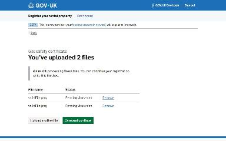](img/check-gas-safety-certificate-uploads/v3.jpg)

Shown when You’ve uploaded 1 file: Upload another file

[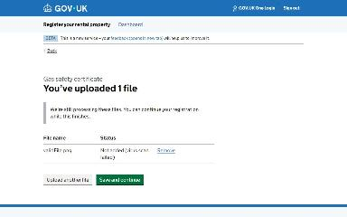](img/check-gas-safety-certificate-uploads/v4.jpg)

Shown when You’ve uploaded 1 file: Remove validFile.png

[](img/check-gas-safety-certificate-uploads/v5.jpg)

Shown when You’ve uploaded 1 file: Upload another file; You’ve uploaded 2 files: Upload another file

[](img/check-gas-safety-certificate-uploads/v6.jpg)

Shown when You’ve uploaded 1 file: Upload another file; You’ve uploaded 2 files: Remove validFile.png


### Gas safety certificate

`check-gas-safety-answers` · CheckGasSafetyAnswersStepConfig

[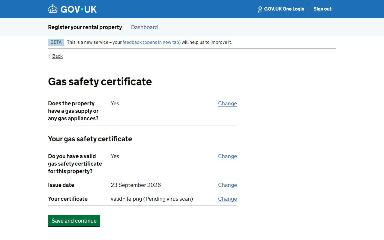](img/check-gas-safety-answers/v1.jpg)

Shown on the default route

[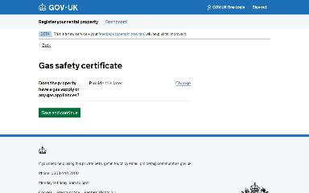](img/check-gas-safety-answers/v2.jpg)

Shown when Does the property have a gas supply or any gas appliances?: Yes, Provide this later

[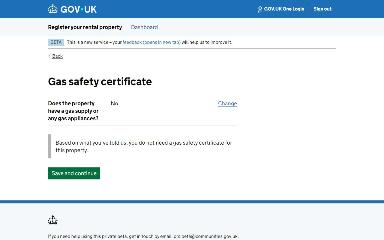](img/check-gas-safety-answers/v3.jpg)

Shown when Does the property have a gas supply or any gas appliances?: No, Save and continue

[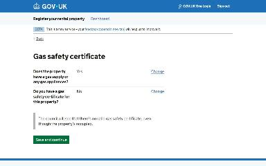](img/check-gas-safety-answers/v4.jpg)

Shown when Do you have a gas safety certificate for this property?: No, Save and continue


### Which electrical safety certificate do you have for this property?

`has-electrical-safety` · HasElectricalCertStepConfig

[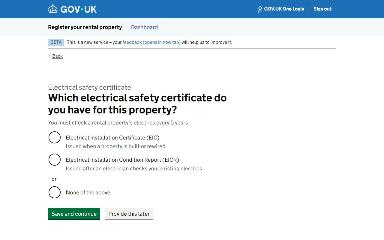](img/has-electrical-safety/v1.jpg)

Shown on the default route

[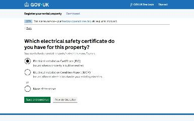](img/has-electrical-safety/v2.jpg)

Shown when Check your answers for: Slate House, PRSDB Square, AA3 1AB: Change Which electrical safety certificate do you have for this property? (when changing an answer)


### What’s the expiry date on the Electrical Installation Certificate?

`electrical-safety-certificate-expiry-date` · ElectricalCertExpiryDateStepConfig

[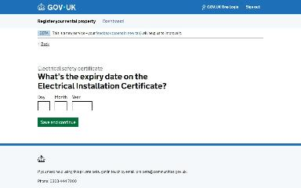](img/electrical-safety-certificate-expiry-date/v1.jpg)

Shown on the default route

[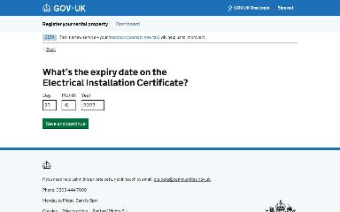](img/electrical-safety-certificate-expiry-date/v2.jpg)

Shown when Check your answers for: Slate House, PRSDB Square, AA3 1AB: Change Which electrical safety certificate do you have for this property?; Which electrical safety certificate do you have for this property?: Electrical Installation Certificate (EIC), Save and continue (when changing an answer)

[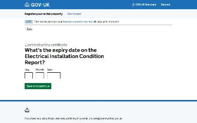](img/electrical-safety-certificate-expiry-date/v3.jpg)

Shown when Which electrical safety certificate do you have for this property?: Electrical Installation Condition Report (EICR), Save and continue


### Upload the Electrical Installation Certificate (EIC)

`electrical-safety-certificate-file-upload` · UploadElectricalCertStepConfig

[](img/electrical-safety-certificate-file-upload/v1.jpg)

Shown on the default route

[](img/electrical-safety-certificate-file-upload/v2.jpg)

Shown when Check your answers for: Slate House, PRSDB Square, AA3 1AB: Change Which electrical safety certificate do you have for this property?; You’ve uploaded 1 file: Upload another file (when changing an answer)

[](img/electrical-safety-certificate-file-upload/v3.jpg)

Shown when Which electrical safety certificate do you have for this property?: Electrical Installation Condition Report (EICR), Save and continue


### You’ve uploaded 1 file

`check-electrical-safety-certificate-uploads` · CheckElectricalCertUploadsStepConfig

[](img/check-electrical-safety-certificate-uploads/v1.jpg)

Shown on the default route

[](img/check-electrical-safety-certificate-uploads/v2.jpg)

Shown when Check your answers for: Slate House, PRSDB Square, AA3 1AB: Change Which electrical safety certificate do you have for this property? (when changing an answer)

[](img/check-electrical-safety-certificate-uploads/v3.jpg)

Shown when Check your answers for: Slate House, PRSDB Square, AA3 1AB: Change Which electrical safety certificate do you have for this property?; Are you sure you want to remove validFile.png?: No (when changing an answer)

[](img/check-electrical-safety-certificate-uploads/v4.jpg)

Shown when You’ve uploaded 1 file: Upload another file

[](img/check-electrical-safety-certificate-uploads/v5.jpg)

Shown when You’ve uploaded 1 file: Remove validFile.png

[](img/check-electrical-safety-certificate-uploads/v6.jpg)

Shown when You’ve uploaded 1 file: Upload another file; You’ve uploaded 2 files: Upload another file

[](img/check-electrical-safety-certificate-uploads/v7.jpg)

Shown when You’ve uploaded 1 file: Upload another file; You’ve uploaded 2 files: Remove validFile.png


### Electrical safety certificate

`check-electrical-safety-answers` · CheckElectricalSafetyAnswersStepConfig

[](img/check-electrical-safety-answers/v1.jpg)

Shown on the default route

[](img/check-electrical-safety-answers/v2.jpg)

Shown when Which electrical safety certificate do you have for this property?: Electrical Installation Certificate (EIC), Provide this later

[](img/check-electrical-safety-answers/v3.jpg)

Shown when Which electrical safety certificate do you have for this property?: None of the above, Save and continue


### Do you have an EPC for this property?

`has-epc` · HasEpcStepConfig

[](img/has-epc/v1.jpg)

Shown on the default route

[](img/has-epc/v2.jpg)

Shown when Check your answers for: Slate House, PRSDB Square, AA3 1AB: Change (when changing an answer)


### Find your EPC

`find-your-epc` · FindYourEpcStepConfig

[](img/find-your-epc/v1.jpg)

Shown on the default route

[](img/find-your-epc/v2.jpg)

Shown when Check your answers for: Slate House, PRSDB Square, AA3 1AB: Change; Do you have an EPC for this property?: Yes, Save and continue (when changing an answer)


### Confirm your EPC

`confirm-epc-details` · ConfirmEpcDetailsRetrievedByCertificateNumberStepConfig

[](img/confirm-epc-details/v1.jpg)

Shown on the default route

[](img/confirm-epc-details/v2.jpg)

Shown when Check your answers for: Slate House, PRSDB Square, AA3 1AB: Change (when changing an answer)


### Energy performance certificate (EPC)

`check-epc-answers` · CheckEpcAnswersStepConfig

[](img/check-epc-answers/v1.jpg)

Shown on the default route

[](img/check-epc-answers/v2.jpg)

Shown when EPC register search by address: Expired EPC found

[](img/check-epc-answers/v3.jpg)

Shown when EPC register search by address: Low rated EPC found

[](img/check-epc-answers/v4.jpg)

Shown when Do you have an EPC for this property?: Yes, Provide details later

[](img/check-epc-answers/v5.jpg)

Shown when Do you have an EPC for this property?: No (for example, the property does not require an EPC to be let), Save and continue

[](img/check-epc-answers/v6.jpg)

Shown when EPC register search by address: Expired EPC found

[](img/check-epc-answers/v7.jpg)

Shown when EPC register search by address: Low rated EPC found; You need a registered energy efficiency exemption to let this property: No

[](img/check-epc-answers/v8.jpg)

Shown when Do you have an EPC for this property?: No (for example, the property does not require an EPC to be let), Save and continue; Is an EPC required to let this property?: No


### Households in your property

`number-of-households` · HouseholdStepConfig

[](img/number-of-households/v1.jpg)

Shown on the default route

[](img/number-of-households/v2.jpg)

Shown when Check your answers for: Slate House, PRSDB Square, AA3 1AB: Change Number of households (when changing an answer)


### How many people live in your property?

`number-of-people` · TenantsStepConfig

[](img/number-of-people/v1.jpg)

Shown on the default route

[](img/number-of-people/v2.jpg)

Shown when Check your answers for: Slate House, PRSDB Square, AA3 1AB: Change Number of households; Households in your property: Save and continue (when changing an answer)


### Does the rent include bills?

`rent-includes-bills` · RentIncludesBillsStepConfig

[](img/rent-includes-bills/v1.jpg)

Shown on the default route

[](img/rent-includes-bills/v2.jpg)

Shown when Check your answers for: Slate House, PRSDB Square, AA3 1AB: Change Rent includes bills (when changing an answer)


### Which of these do you include in the rent?

`bills-included` · BillsIncludedStepConfig

[](img/bills-included/v1.jpg)

Shown on the default route

[](img/bills-included/v2.jpg)

Shown when Check your answers for: Slate House, PRSDB Square, AA3 1AB: Change Rent includes bills; Does the rent include bills?: Yes (when changing an answer)


### Is the property furnished?

`property-furnished` · FurnishedStatusStepConfig

[](img/property-furnished/v1.jpg)

Shown on the default route

[](img/property-furnished/v2.jpg)

Shown when Check your answers for: Slate House, PRSDB Square, AA3 1AB: Change Furniture provided (when changing an answer)


### When you charge rent

`rent-frequency` · RentFrequencyStepConfig

[](img/rent-frequency/v1.jpg)

Shown on the default route

[](img/rent-frequency/v2.jpg)

Shown when Check your answers for: Slate House, PRSDB Square, AA3 1AB: Change When rent is paid (when changing an answer)


### What is the monthly rent?

`rent-amount` · RentAmountStepConfig

[](img/rent-amount/v1.jpg)

Shown on the default route

[](img/rent-amount/v2.jpg)

Shown when Check your answers for: Slate House, PRSDB Square, AA3 1AB: Change When rent is paid; When you charge rent: Monthly (when changing an answer)

[](img/rent-amount/v3.jpg)

Shown when Check your answers for: Slate House, PRSDB Square, AA3 1AB: Change When rent is paid; When you charge rent: Other (when changing an answer)

[](img/rent-amount/v4.jpg)

Shown when When you charge rent: 4 weekly

[](img/rent-amount/v5.jpg)

Shown when When you charge rent: Weekly

[](img/rent-amount/v6.jpg)

Shown when When you charge rent: Other


### Check your answers for: Slate House, PRSDB Square, AA3 1AB

`check-answers` · PropertyRegistrationCyaStepConfig

[](img/check-answers/v1.jpg)

Shown on the default route

[](img/check-answers/v2.jpg)

Shown when Who will provide details about how your property’s rented out: My letting agent or property manager

[](img/check-answers/v3.jpg)

Shown when Households in your property: Provide this later

[](img/check-answers/v4.jpg)

Shown when Does the rent include bills?: No

[](img/check-answers/v5.jpg)

Shown when What is the property address?: Postcode: ZZ9 9ZZ

[](img/check-answers/v6.jpg)

Shown when Select your address: Slate House, PRSDB Road, AA3 1AB

[](img/check-answers/v7.jpg)

Shown when Invite joint landlords: No, I am the only landlord for this property

[](img/check-answers/v8.jpg)

Shown when Is your property occupied by tenants?: No

[](img/check-answers/v9.jpg)

Shown when Select the type of licence you have for your property: Selective licence, Provide this later

[](img/check-answers/v10.jpg)

Shown when Does the property have a gas supply or any gas appliances?: Yes, Provide this later

[](img/check-answers/v11.jpg)

Shown when Do you have a gas safety certificate for this property?: No, Save and continue


### Property registered

`/landlord/register-property/confirmation`

[](img/landlord_register-property_confirmation/v1.jpg)

Shown on the default route

[](img/landlord_register-property_confirmation/v2.jpg)

Shown when Who will provide details about how your property’s rented out: My letting agent or property manager

[](img/landlord_register-property_confirmation/v3.jpg)

Shown when What is the property address?: Postcode: ZZ9 9ZZ

[](img/landlord_register-property_confirmation/v4.jpg)

Shown when Select your address: Slate House, PRSDB Road, AA3 1AB

[](img/landlord_register-property_confirmation/v5.jpg)

Shown when Do you have a gas safety certificate for this property?: No, Save and continue; Confirm missing compliance certificates: Yes (at risk of prosecution or fine)


### What is the property address?

`manual-address` · ManualAddressStepConfig

[](img/change_manual-address/v1.jpg)

Shown when Check your answers for: Slate House, PRSDB Square, AA3 1AB: Change Address; Select your address: I want to manually enter my address (when changing an answer)


### What local council area is your property in?

`local-council` · LocalCouncilStepConfig

[](img/change_local-council/v1.jpg)

Shown when Check your answers for: Slate House, PRSDB Square, AA3 1AB: Change Address (when changing an answer)


### Invite a joint landlord to this property

`invite-another-joint-landlord` · InviteJointLandlordStepConfig

[](img/change_invite-another-joint-landlord/v1.jpg)

Shown when Check your answers for: Slate House, PRSDB Square, AA3 1AB: Change Joint landlord invitations; You’ve added 1 joint landlord: Add another landlord (when changing an answer)


### Are you sure you want to remove jane.smith@example.com?

`remove-joint-landlord` · RemoveJointLandlordAreYouSureStepConfig

[](img/change_remove-joint-landlord/v1.jpg)

Shown when Check your answers for: Slate House, PRSDB Square, AA3 1AB: Change Joint landlord invitations; You’ve added 1 joint landlord: Remove Joint landlord 1 (when changing an answer)

[](img/change_remove-joint-landlord/v2.jpg)

Shown when Check your answers for: Slate House, PRSDB Square, AA3 1AB: Change Joint landlord invitations; You’ve added 2 joint landlords: Remove Joint landlord 2 (when changing an answer)


### You’ve added 2 joint landlords

`check-joint-landlords` · CheckJointLandlordsStepConfig

[](img/change_check-joint-landlords/v1.jpg)

Shown when Check your answers for: Slate House, PRSDB Square, AA3 1AB: Change Joint landlord invitations (when changing an answer)


### Enter a postal address

`correspondence-address/manual-address` · ManualAddressStepConfig

[](img/change_correspondence-address_manual-address/v1.jpg)

Shown when Check your answers for: Slate House, PRSDB Square, AA3 1AB: Change Postal address; Select a postal address: I want to manually enter my address (when changing an answer)


### Are you sure you want to change this?

`confirm-change-to-letting-agent` · ConfirmChangeToLettingAgentStepConfig

[](img/change_confirm-change-to-letting-agent/v1.jpg)

Shown when Check your answers for: Slate House, PRSDB Square, AA3 1AB: Change Who will provide this property’s rental details?; Who will provide details about how your property’s rented out: My letting agent or property manager (when changing an answer)


### Allow your letting agent or property manager to provide details

`letting-agent-email` · LettingAgentEmailStepConfig

[](img/change_letting-agent-email/v1.jpg)

Shown when Check your answers for: Slate House, PRSDB Square, AA3 1AB: Change Who will provide this property’s rental details? (when changing an answer)


### Provide details about property licensing later

`provide-licensing-later` · ProvideLicensingLaterStepConfig

[](img/change_provide-licensing-later/v1.jpg)

Shown when Check your answers for: Slate House, PRSDB Square, AA3 1AB: Change Licensing type; Select the type of licence you have for your property: Selective licence, Provide this later (when changing an answer)


### What is your HMO mandatory licence number?

`hmo-mandatory-licence` · HmoMandatoryLicenceStepConfig

[](img/change_hmo-mandatory-licence/v1.jpg)

Shown when Check your answers for: Slate House, PRSDB Square, AA3 1AB: Change Licensing type; Select the type of licence you have for your property: HMO mandatory licence, Save and continue (when changing an answer)


### What is your HMO additional licence number?

`hmo-additional-licence` · HmoAdditionalLicenceStepConfig

[](img/change_hmo-additional-licence/v1.jpg)

Shown when Check your answers for: Slate House, PRSDB Square, AA3 1AB: Change Licensing type; Select the type of licence you have for your property: HMO additional licence, Save and continue (when changing an answer)


### Provide these details later

`provide-gas-safety-certificate-later` · ProvideGasCertLaterStepConfig

[](img/change_provide-gas-safety-certificate-later/v1.jpg)

Shown when Check your answers for: Slate House, PRSDB Square, AA3 1AB: Change Does the property have a gas supply or any gas appliances?; Does the property have a gas supply or any gas appliances?: Yes, Provide this later (when changing an answer)


### You must get a valid gas safety certificate for this property

`gas-safety-certificate-missing` · GasCertMissingStepConfig

[](img/change_gas-safety-certificate-missing/v1.jpg)

Shown when Check your answers for: Slate House, PRSDB Square, AA3 1AB: Change Does the property have a gas supply or any gas appliances?; Do you have a gas safety certificate for this property?: No, Save and continue (when changing an answer)


### Are you sure you want to remove validFile.png?

`remove-gas-safety-certificate-upload` · RemoveGasCertUploadStepConfig

[](img/change_remove-gas-safety-certificate-upload/v1.jpg)

Shown when Check your answers for: Slate House, PRSDB Square, AA3 1AB: Change Does the property have a gas supply or any gas appliances?; You’ve uploaded 1 file: Remove validFile.png (when changing an answer)


### Provide your electrical safety certificate later

`provide-electrical-safety-certificate-later` · ProvideElectricalCertLaterStepConfig

[](img/change_provide-electrical-safety-certificate-later/v1.jpg)

Shown when Check your answers for: Slate House, PRSDB Square, AA3 1AB: Change Which electrical safety certificate do you have for this property?; Which electrical safety certificate do you have for this property?: Electrical Installation Certificate (EIC), Provide this later (when changing an answer)


### What’s the expiry date on the Electrical Installation Condition Report?

`electrical-safety-certificate-expiry-date` · ElectricalCertExpiryDateStepConfig

[](img/change_electrical-safety-certificate-expiry-date/v1.jpg)

Shown when Check your answers for: Slate House, PRSDB Square, AA3 1AB: Change Which electrical safety certificate do you have for this property?; Which electrical safety certificate do you have for this property?: Electrical Installation Condition Report (EICR), Save and continue (when changing an answer)


### You must get a valid electrical safety certificate for this property

`electrical-safety-certificate-missing` · ElectricalCertMissingStepConfig

[](img/change_electrical-safety-certificate-missing/v1.jpg)

Shown when Check your answers for: Slate House, PRSDB Square, AA3 1AB: Change Which electrical safety certificate do you have for this property?; Which electrical safety certificate do you have for this property?: None of the above, Save and continue (when changing an answer)


### Are you sure you want to remove validFile.png?

`remove-electrical-safety-certificate-upload` · RemoveElectricalCertUploadStepConfig

[](img/change_remove-electrical-safety-certificate-upload/v1.jpg)

Shown when Check your answers for: Slate House, PRSDB Square, AA3 1AB: Change Which electrical safety certificate do you have for this property?; You’ve uploaded 1 file: Remove validFile.png (when changing an answer)


### You’ve uploaded 2 files

`check-electrical-safety-certificate-uploads` · CheckElectricalCertUploadsStepConfig

[](img/change_check-electrical-safety-certificate-uploads/v1.jpg)

Shown when Check your answers for: Slate House, PRSDB Square, AA3 1AB: Change Which electrical safety certificate do you have for this property? (when changing an answer)


### Provide your EPC details later

`provide-epc-later` · ProvideEpcLaterStepConfig

[](img/change_provide-epc-later/v1.jpg)

Shown when Check your answers for: Slate House, PRSDB Square, AA3 1AB: Change; Do you have an EPC for this property?: Yes, Provide details later (when changing an answer)


### Is an EPC required to let this property?

`is-epc-required` · IsEpcRequiredStepConfig

[](img/change_is-epc-required/v1.jpg)

Shown when Check your answers for: Slate House, PRSDB Square, AA3 1AB: Change; Do you have an EPC for this property?: No (for example, the property does not require an EPC to be let), Save and continue (when changing an answer)


### Your property is missing an EPC

`epc-missing` · EpcMissingStepConfig

[](img/change_epc-missing/v1.jpg)

Shown when Check your answers for: Slate House, PRSDB Square, AA3 1AB: Change; Is an EPC required to let this property?: Yes (when changing an answer)


### Why does this property not need an EPC to be let?

`epc-exemption` · EpcExemptionStepConfig

[](img/change_epc-exemption/v1.jpg)

Shown when Check your answers for: Slate House, PRSDB Square, AA3 1AB: Change; Is an EPC required to let this property?: No (when changing an answer)


### Provide tenancy details later

`provide-tenancy-details-later` · ProvideTenancyDetailsLaterStepConfig

[](img/change_provide-tenancy-details-later/v1.jpg)

Shown when Check your answers for: Slate House, PRSDB Square, AA3 1AB: Change Number of households; Households in your property: Provide this later (when changing an answer)


### What is the 4-weekly rent?

`rent-amount` · RentAmountStepConfig

[](img/change_rent-amount/v1.jpg)

Shown when Check your answers for: Slate House, PRSDB Square, AA3 1AB: Change When rent is paid; When you charge rent: 4 weekly (when changing an answer)

[](img/change_rent-amount/v2.jpg)

Shown when Check your answers for: Slate House, PRSDB Square, AA3 1AB: Change When rent is paid; When you charge rent: Weekly (when changing an answer)


### No matching address in England found for ZZ9 9ZZ and Slate House

`no-address-found` · NoAddressFoundStepConfig

[](img/no-address-found/v1.jpg)

Shown when What is the property address?: Postcode: ZZ9 9ZZ


### What is the property address?

`manual-address` · ManualAddressStepConfig

[](img/manual-address/v1.jpg)

Shown when What is the property address?: Postcode: ZZ9 9ZZ


### What local council area is your property in?

`local-council` · LocalCouncilStepConfig

[](img/local-council/v1.jpg)

Shown when What is the property address?: Postcode: ZZ9 9ZZ

[](img/local-council/v2.jpg)

Shown when What is the property address?: Postcode: ZZ9 9ZZ; Check your answers for: 1 Example Street, 1 Example Street, Exampleton, Example text, AA3 1AB: Change Local council (when changing an answer)


### Invite a joint landlord to this property

`invite-another-joint-landlord` · InviteJointLandlordStepConfig

[](img/invite-another-joint-landlord/v1.jpg)

Shown when You’ve added 1 joint landlord: Add another landlord


### Are you sure you want to remove jane.smith@example.com?

`remove-joint-landlord` · RemoveJointLandlordAreYouSureStepConfig

[](img/remove-joint-landlord/v1.jpg)

Shown when You’ve added 1 joint landlord: Remove Joint landlord 1

[](img/remove-joint-landlord/v2.jpg)

Shown when You’ve added 1 joint landlord: Add another landlord; You’ve added 2 joint landlords: Remove Joint landlord 2


### No matching address in England or Wales found for ZZ9 9ZZ and Slate House

`correspondence-address/no-address-found` · NoAddressFoundStepConfig

[](img/correspondence-address_no-address-found/v1.jpg)

Shown when Where the council should send post about this property: Postcode: ZZ9 9ZZ


### Enter a postal address

`correspondence-address/manual-address` · ManualAddressStepConfig

[](img/correspondence-address_manual-address/v1.jpg)

Shown when Where the council should send post about this property: Postcode: ZZ9 9ZZ


### Allow your letting agent or property manager to provide details

`letting-agent-email` · LettingAgentEmailStepConfig

[](img/letting-agent-email/v1.jpg)

Shown when Who will provide details about how your property’s rented out: My letting agent or property manager


### Provide details about property licensing later

`provide-licensing-later` · ProvideLicensingLaterStepConfig

[](img/provide-licensing-later/v1.jpg)

Shown when Select the type of licence you have for your property: Selective licence, Provide this later


### What is your HMO mandatory licence number?

`hmo-mandatory-licence` · HmoMandatoryLicenceStepConfig

[](img/hmo-mandatory-licence/v1.jpg)

Shown when Select the type of licence you have for your property: HMO mandatory licence, Save and continue


### What is your HMO additional licence number?

`hmo-additional-licence` · HmoAdditionalLicenceStepConfig

[](img/hmo-additional-licence/v1.jpg)

Shown when Select the type of licence you have for your property: HMO additional licence, Save and continue


### Provide these details later

`provide-gas-safety-certificate-later` · ProvideGasCertLaterStepConfig

[](img/provide-gas-safety-certificate-later/v1.jpg)

Shown when Does the property have a gas supply or any gas appliances?: Yes, Provide this later


### You must get a valid gas safety certificate for this property

`gas-safety-certificate-missing` · GasCertMissingStepConfig

[](img/gas-safety-certificate-missing/v1.jpg)

Shown when Do you have a gas safety certificate for this property?: No, Save and continue


### This gas safety certificate has expired

`gas-safety-certificate-expired` · GasCertExpiredStepConfig

[](img/gas-safety-certificate-expired/v1.jpg)

Shown when What’s the issue date on the gas safety certificate?: Date: 23 October 2027


### Are you sure you want to remove validFile.png?

`remove-gas-safety-certificate-upload` · RemoveGasCertUploadStepConfig

[](img/remove-gas-safety-certificate-upload/v1.jpg)

Shown when You’ve uploaded 1 file: Remove validFile.png


### Provide your electrical safety certificate later

`provide-electrical-safety-certificate-later` · ProvideElectricalCertLaterStepConfig

[](img/provide-electrical-safety-certificate-later/v1.jpg)

Shown when Which electrical safety certificate do you have for this property?: Electrical Installation Certificate (EIC), Provide this later


### You must get a valid electrical safety certificate for this property

`electrical-safety-certificate-missing` · ElectricalCertMissingStepConfig

[](img/electrical-safety-certificate-missing/v1.jpg)

Shown when Which electrical safety certificate do you have for this property?: None of the above, Save and continue


### This electrical safety certificate has expired

`electrical-safety-certificate-expired` · ElectricalCertExpiredStepConfig

[](img/electrical-safety-certificate-expired/v1.jpg)

Shown when What’s the expiry date on the Electrical Installation Certificate?: Date: 23 September 2026


### Are you sure you want to remove validFile.png?

`remove-electrical-safety-certificate-upload` · RemoveElectricalCertUploadStepConfig

[](img/remove-electrical-safety-certificate-upload/v1.jpg)

Shown when You’ve uploaded 1 file: Remove validFile.png


### Check this EPC

`check-epc-details` · ConfirmEpcRetrievedByUprnStepConfig

[](img/check-epc-details/v1.jpg)

Shown when EPC register search by address: EPC found


### Confirm when the current tenancy began

`epc-in-date-at-start-of-tenancy-check` · EpcInDateAtStartOfTenancyCheckStepConfig

[](img/epc-in-date-at-start-of-tenancy-check/v1.jpg)

Shown when EPC register search by address: Expired EPC found


### You need a registered energy efficiency exemption to let this property

`has-mees-exemption` · HasMeesExemptionStepConfig

[](img/has-mees-exemption/v1.jpg)

Shown when EPC register search by address: Low rated EPC found


### Which energy efficiency exemption did you register for this property?

`mees-exemption` · MeesExemptionStepConfig

[](img/mees-exemption/v1.jpg)

Shown when EPC register search by address: Low rated EPC found


### Provide your EPC details later

`provide-epc-later` · ProvideEpcLaterStepConfig

[](img/provide-epc-later/v1.jpg)

Shown when Do you have an EPC for this property?: Yes, Provide details later


### Is an EPC required to let this property?

`is-epc-required` · IsEpcRequiredStepConfig

[](img/is-epc-required/v1.jpg)

Shown when Do you have an EPC for this property?: No (for example, the property does not require an EPC to be let), Save and continue


### Your property is missing an EPC

`epc-missing` · EpcMissingStepConfig

[](img/epc-missing/v1.jpg)

Shown when Do you have an EPC for this property?: No (for example, the property does not require an EPC to be let), Save and continue

[](img/epc-missing/v2.jpg)

Shown when Is your property occupied by tenants?: No; EPC register search by certificate number: Certificate not found


### We could not find your EPC

`epc-not-found` · EpcNotFoundStepConfig

[](img/epc-not-found/v1.jpg)

Shown when EPC register search by certificate number: Certificate not found


### There’s a newer EPC for this property

`epc-superseded` · EpcSuperseededStepConfig

[](img/epc-superseded/v1.jpg)

Shown when EPC register search by certificate number: Superseded certificate found


### This property’s EPC has expired

`epc-expired` · EpcExpiredStepConfig

[](img/epc-expired/v1.jpg)

Shown when EPC register search by address: Expired EPC found

[](img/epc-expired/v2.jpg)

Shown when Is your property occupied by tenants?: No; EPC register search by address: Expired EPC found


### Provide tenancy details later

`provide-tenancy-details-later` · ProvideTenancyDetailsLaterStepConfig

[](img/provide-tenancy-details-later/v1.jpg)

Shown when Households in your property: Provide this later


### This property does not meet energy efficiency requirements for letting

`low-energy-rating` · LowEnergyRatingStepConfig

[](img/low-energy-rating/v1.jpg)

Shown when EPC register search by address: Low rated EPC found; You need a registered energy efficiency exemption to let this property: No


### Why does this property not need an EPC to be let?

`epc-exemption` · EpcExemptionStepConfig

[](img/epc-exemption/v1.jpg)

Shown when Do you have an EPC for this property?: No (for example, the property does not require an EPC to be let), Save and continue; Is an EPC required to let this property?: No


### Confirm missing compliance certificates

`confirm-missing-compliance` · ConfirmMissingComplianceStepConfig

[](img/confirm-missing-compliance/v1.jpg)

Shown when Do you have a gas safety certificate for this property?: No, Save and continue

