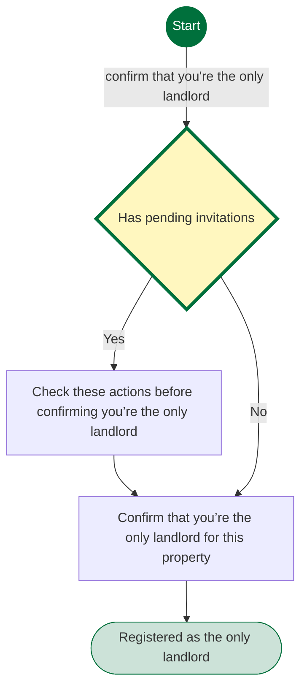
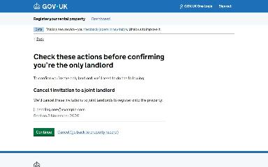
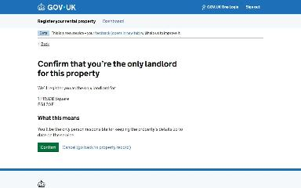
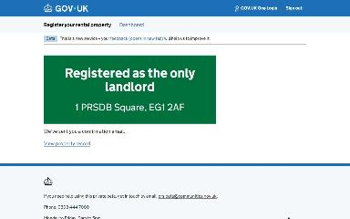

# Register as the only landlord of a property journey map

Generated 2026-11-03T12:37:21.281179800Z at commit `f960f1073`. Feature flags: failover-test-endpoints=false, subject-identifier-page=true, pdjb-939-property-registration-phase-two=true, pdjb-939-property-registration-phase-three=false, pdjb-1664-password-benchmark-endpoint=false, pdjb-238-gatling-post-endpoint=false, pdjb-1009-payments=true, pdjb-1210-multi-user-organisations=true, pdjb-1894-gas-certificate-14-month-expiry=false, pdjb-955-associated-parties=false, pdjb-1666-eic-issue-date=false, pdjb-973-asynchronous-email-sending=false.

Open `index.html` for the interactive map. `report.md` lists gaps and errors.

## Pages

### Check these actions before confirming you’re the only landlord

`check-invitations` · CheckPendingInvitationsStepConfig

Shown on the default route

### Confirm that you’re the only landlord for this property

`confirm` · ConfirmOnlyLandlordStepConfig

Shown on the default route

### Registered as the only landlord

`/landlord/property-details/13/switch-to-individual/confirmation`

Shown on the default route

