# Update whether the organisation is registered with Companies House journey map

Generated 2026-10-23T09:39:29.588225700Z at commit `3a5832daa`. Feature flags: failover-test-endpoints=false, subject-identifier-page=true, pdjb-939-property-registration-phase-two=false, pdjb-1053-dashboard-nav-link=true, pdjb-1022-delegate-to-letting-agent=true, pdjb-1664-password-benchmark-endpoint=false, pdjb-238-gatling-post-endpoint=false, pdjb-1040-correspondence-address=true, pdjb-1009-payments=false, pdjb-926-landlord-dashboard-update=true, pdjb-1210-multi-user-organisations=false.

Open `index.html` for the interactive map. `report.md` lists gaps and errors.

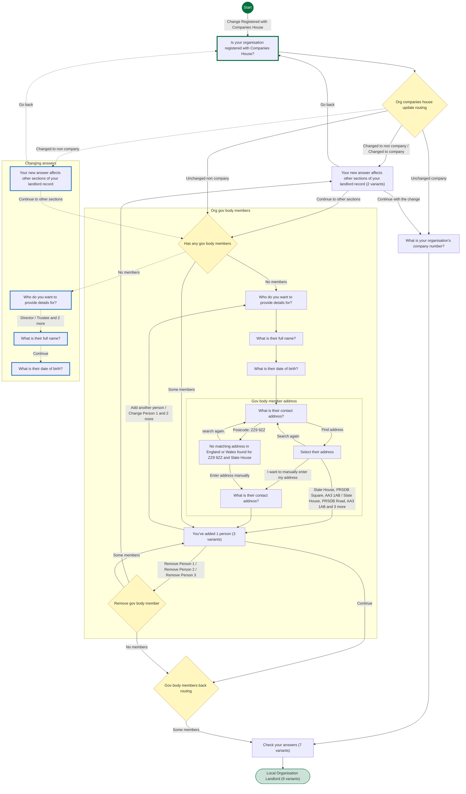

## Pages

### Is your organisation registered with Companies House?

`organisation-companies-house` · OrgIsRegisteredCompanyStepConfig

[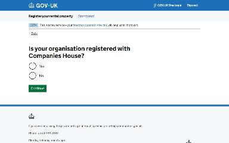](img/organisation-companies-house/v1.jpg)

Shown on the default route

### What is your organisation’s company number?

`organisation-company-number` · OrgCompanyNumberStepConfig

[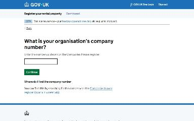](img/organisation-company-number/v1.jpg)

Shown on the default route

### Check your answers

`check-answers` · CompaniesHouseUpdateCheckAnswersStepConfig

[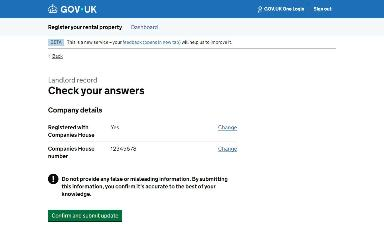](img/check-answers/v1.jpg)

Shown on the default route

[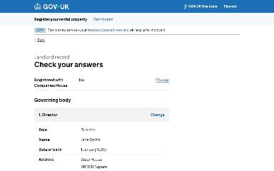](img/check-answers/v2.jpg)

Shown when Is your organisation registered with Companies House?: No

Shown when Is your organisation registered with Companies House?: No; Who do you want to provide details for?: Trustee

Shown when Is your organisation registered with Companies House?: No; Who do you want to provide details for?: Partner

Shown when Is your organisation registered with Companies House?: No; Who do you want to provide details for?: Other member of the governing body

Shown when Starting point: Organisation is a trust; Is your organisation registered with Companies House?: No

[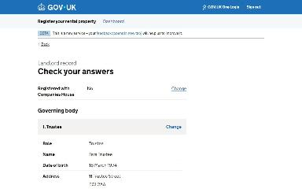](img/check-answers/v7.jpg)

Shown when Starting point: Organisation is a trust; Is your organisation registered with Companies House?: No; You’ve added 2 people: Add another person

### Local Organisation Landlord

`/landlord/landlord-details`

[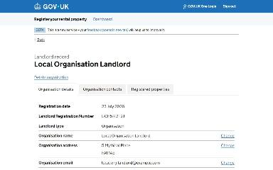](img/landlord_landlord-details/v1.jpg)

Shown on the default route

Shown when Is your organisation registered with Companies House?: No

Shown when Is your organisation registered with Companies House?: No; Who do you want to provide details for?: Trustee

Shown when Is your organisation registered with Companies House?: No; Who do you want to provide details for?: Partner

Shown when Is your organisation registered with Companies House?: No; Who do you want to provide details for?: Other member of the governing body

Shown when Starting point: Organisation is a trust

Shown when Starting point: Organisation is a trust; Is your organisation registered with Companies House?: No

Shown when Starting point: Organisation is a trust; Is your organisation registered with Companies House?: No; You’ve added 2 people: Add another person

Shown when Starting point: Organisation is a trust; Is your organisation registered with Companies House?: No; You’ve added 2 people: Remove Person 1

### Your new answer affects other sections of your landlord record

`organisation-companies-house-interruption` · OrgCompaniesHouseInterruptionStepConfig

[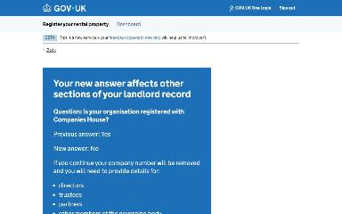](img/change_organisation-companies-house-interruption/v1.jpg)

Shown when Check your answers: Change Registered with Companies House; Is your organisation registered with Companies House?: No (when changing an answer)

### Who do you want to provide details for?

`organisation-governing-body-who-to-provide` · OrgGovBodyWhoToProvideStepConfig

Shown when Check your answers: Change Registered with Companies House; Your new answer affects other sections of your landlord record: Continue to other sections (when changing an answer)

### What is their full name?

`organisation-governing-body-member-name` · OrgGovBodyMemberNameStepConfig

Shown when Check your answers: Change Registered with Companies House; Who do you want to provide details for?: Director (when changing an answer)

### What is their date of birth?

`organisation-governing-body-member-dob` · OrgGovBodyMemberDobStepConfig

[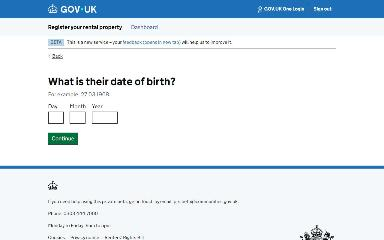](img/change_organisation-governing-body-member-dob/v1.jpg)

Shown when Check your answers: Change Registered with Companies House (when changing an answer)

### Your new answer affects other sections of your landlord record

`organisation-companies-house-interruption` · OrgCompaniesHouseInterruptionStepConfig

Shown when Is your organisation registered with Companies House?: No

[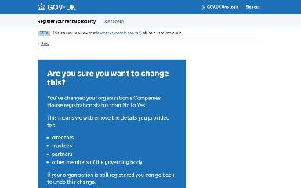](img/organisation-companies-house-interruption/v2.jpg)

Shown when Starting point: Organisation is a trust

### Who do you want to provide details for?

`organisation-governing-body-who-to-provide` · OrgGovBodyWhoToProvideStepConfig

Shown when Is your organisation registered with Companies House?: No

### What is their full name?

`organisation-governing-body-member-name` · OrgGovBodyMemberNameStepConfig

[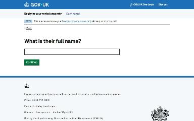](img/organisation-governing-body-member-name/v1.jpg)

Shown when Is your organisation registered with Companies House?: No

### What is their date of birth?

`organisation-governing-body-member-dob` · OrgGovBodyMemberDobStepConfig

Shown when Is your organisation registered with Companies House?: No

### What is their contact address?

`organisation-governing-body-member-address/lookup-address` · LookupAddressStepConfig

[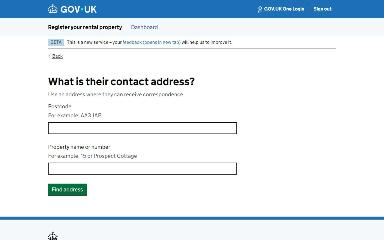](img/organisation-governing-body-member-address_lookup-address/v1.jpg)

Shown when Is your organisation registered with Companies House?: No

### Select their address

`organisation-governing-body-member-address/select-address` · SelectAddressStepConfig

[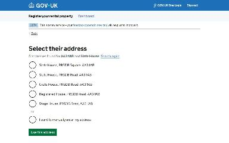](img/organisation-governing-body-member-address_select-address/v1.jpg)

Shown when Is your organisation registered with Companies House?: No

### You’ve added 1 person

`organisation-governing-body-member-list` · OrgGovBodyMemberListStepConfig

[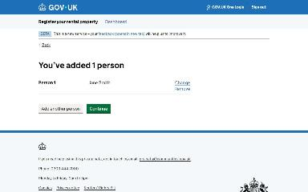](img/organisation-governing-body-member-list/v1.jpg)

Shown when Is your organisation registered with Companies House?: No

[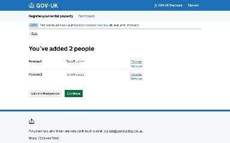](img/organisation-governing-body-member-list/v2.jpg)

Shown when Starting point: Organisation is a trust; Is your organisation registered with Companies House?: No

[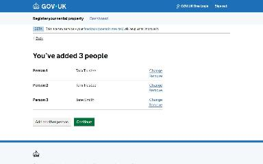](img/organisation-governing-body-member-list/v3.jpg)

Shown when Starting point: Organisation is a trust; Is your organisation registered with Companies House?: No; You’ve added 2 people: Add another person

### No matching address in England or Wales found for ZZ9 9ZZ and Slate House

`organisation-governing-body-member-address/no-address-found` · NoAddressFoundStepConfig

[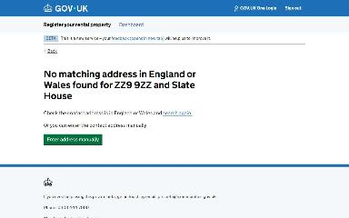](img/organisation-governing-body-member-address_no-address-found/v1.jpg)

Shown when Is your organisation registered with Companies House?: No; What is their contact address?: Postcode: ZZ9 9ZZ

### What is their contact address?

`organisation-governing-body-member-address/manual-address` · ManualAddressStepConfig

[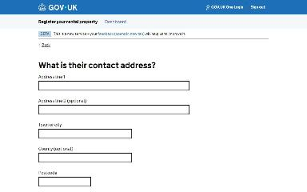](img/organisation-governing-body-member-address_manual-address/v1.jpg)

Shown when Is your organisation registered with Companies House?: No; What is their contact address?: Postcode: ZZ9 9ZZ

