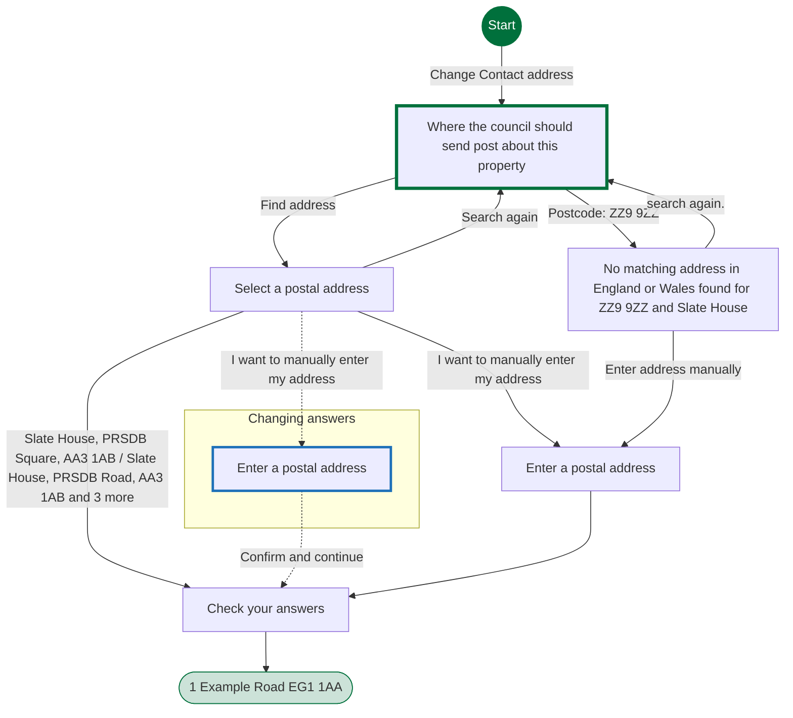
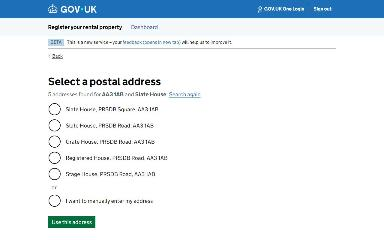
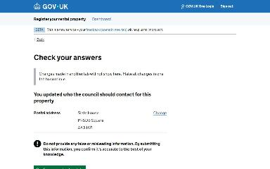

# Update the correspondence address journey map

Generated 2026-10-23T09:33:49.728385800Z at commit `3a5832daa`. Feature flags: failover-test-endpoints=false, subject-identifier-page=true, pdjb-939-property-registration-phase-two=false, pdjb-1053-dashboard-nav-link=true, pdjb-1022-delegate-to-letting-agent=true, pdjb-1664-password-benchmark-endpoint=false, pdjb-238-gatling-post-endpoint=false, pdjb-1040-correspondence-address=true, pdjb-1009-payments=false, pdjb-926-landlord-dashboard-update=true, pdjb-1210-multi-user-organisations=false.

Open `index.html` for the interactive map. `report.md` lists gaps and errors.

## Pages

### Where the council should send post about this property

`lookup-address` · LookupAddressStepConfig

Shown on the default route

### Select a postal address

`select-address` · SelectAddressStepConfig

Shown on the default route

### Check your answers

`correspondence-address-check-your-answers` · UpdateCorrespondenceAddressCyaConfig

Shown on the default route

### 1 Example Road EG1 1AA

`/landlord/property-details/1`

Shown on the default route

### Enter a postal address

`manual-address` · ManualAddressStepConfig

Shown when Check your answers: Change Postal address; Select a postal address: I want to manually enter my address (when changing an answer)

### No matching address in England or Wales found for ZZ9 9ZZ and Slate House

`no-address-found` · NoAddressFoundStepConfig

Shown when Where the council should send post about this property: Postcode: ZZ9 9ZZ

### Enter a postal address

`manual-address` · ManualAddressStepConfig

Shown when Where the council should send post about this property: Postcode: ZZ9 9ZZ

