# Update electrical safety journey map

Generated 2026-10-23T09:34:19.894367100Z at commit `3a5832daa`. Feature flags: failover-test-endpoints=false, subject-identifier-page=true, pdjb-939-property-registration-phase-two=false, pdjb-1053-dashboard-nav-link=true, pdjb-1022-delegate-to-letting-agent=true, pdjb-1664-password-benchmark-endpoint=false, pdjb-238-gatling-post-endpoint=false, pdjb-1040-correspondence-address=true, pdjb-1009-payments=false, pdjb-926-landlord-dashboard-update=true, pdjb-1210-multi-user-organisations=false.

Open `index.html` for the interactive map. `report.md` lists gaps and errors.

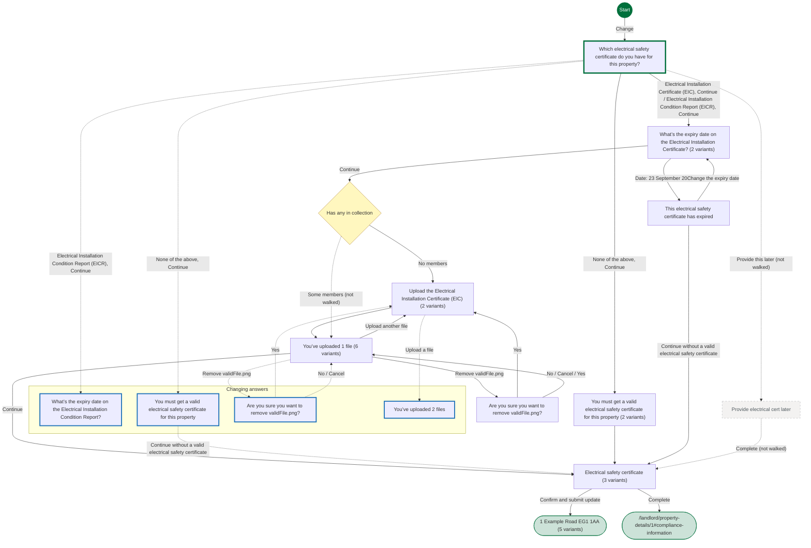

## Pages

### Which electrical safety certificate do you have for this property?

`has-electrical-safety` · HasElectricalCertStepConfig

[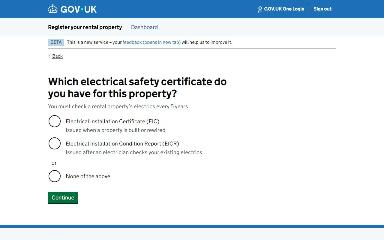](img/has-electrical-safety/v1.jpg)

Shown on the default route

### What’s the expiry date on the Electrical Installation Certificate?

`electrical-safety-certificate-expiry-date` · ElectricalCertExpiryDateStepConfig

Shown on the default route

Shown when Which electrical safety certificate do you have for this property?: Electrical Installation Condition Report (EICR), Continue

### Upload the Electrical Installation Certificate (EIC)

`electrical-safety-certificate-file-upload` · UploadElectricalCertStepConfig

[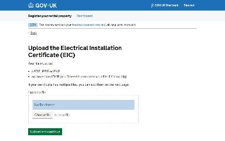](img/electrical-safety-certificate-file-upload/v1.jpg)

Shown on the default route

[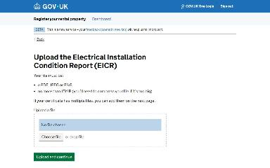](img/electrical-safety-certificate-file-upload/v2.jpg)

Shown when Which electrical safety certificate do you have for this property?: Electrical Installation Condition Report (EICR), Continue

### You’ve uploaded 1 file

`check-electrical-safety-certificate-uploads` · CheckElectricalCertUploadsStepConfig

Shown on the default route

[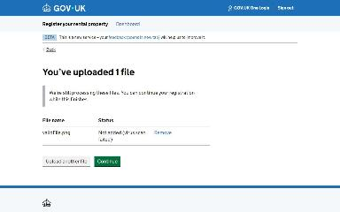](img/check-electrical-safety-certificate-uploads/v2.jpg)

Shown when Electrical safety certificate: Change Which electrical safety certificate do you have for this property?; Are you sure you want to remove validFile.png?: No (when changing an answer)

[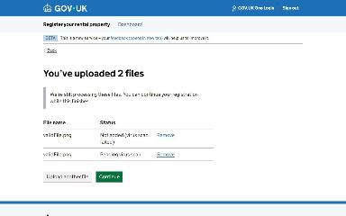](img/check-electrical-safety-certificate-uploads/v3.jpg)

Shown when You’ve uploaded 1 file: Upload another file

[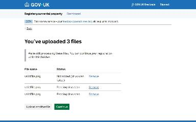](img/check-electrical-safety-certificate-uploads/v4.jpg)

Shown when You’ve uploaded 1 file: Upload another file; You’ve uploaded 2 files: Upload another file

[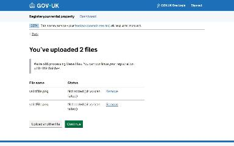](img/check-electrical-safety-certificate-uploads/v5.jpg)

Shown when You’ve uploaded 1 file: Upload another file; You’ve uploaded 2 files: Remove validFile.png

Shown when Starting point: Property is vacant; You’ve uploaded 1 file: Upload another file

### Electrical safety certificate

`check-electrical-safety-answers` · UpdateCheckElectricalSafetyAnswersStepConfig

[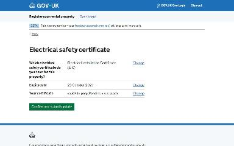](img/check-electrical-safety-answers/v1.jpg)

Shown on the default route

[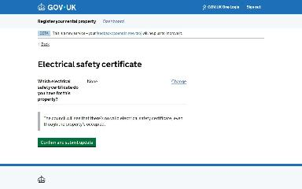](img/check-electrical-safety-answers/v2.jpg)

Shown when Which electrical safety certificate do you have for this property?: None of the above, Continue

[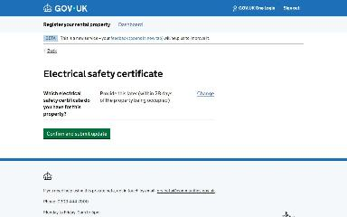](img/check-electrical-safety-answers/v3.jpg)

Shown when Starting point: Property is vacant; Which electrical safety certificate do you have for this property?: None of the above, Continue

### 1 Example Road EG1 1AA

`/landlord/property-details/1`

Shown on the default route

Shown when Which electrical safety certificate do you have for this property?: None of the above, Continue

Shown when What’s the expiry date on the Electrical Installation Certificate?: Date: 23 September 2026

Shown when Starting point: Property is vacant

Shown when Starting point: Property is vacant; Which electrical safety certificate do you have for this property?: None of the above, Continue

### What’s the expiry date on the Electrical Installation Condition Report?

`electrical-safety-certificate-expiry-date` · ElectricalCertExpiryDateStepConfig

[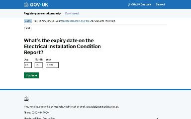](img/change_electrical-safety-certificate-expiry-date/v1.jpg)

Shown when Electrical safety certificate: Change Which electrical safety certificate do you have for this property?; Which electrical safety certificate do you have for this property?: Electrical Installation Condition Report (EICR), Continue (when changing an answer)

### You must get a valid electrical safety certificate for this property

`electrical-safety-certificate-missing` · ElectricalCertMissingStepConfig

Shown when Electrical safety certificate: Change Which electrical safety certificate do you have for this property?; Which electrical safety certificate do you have for this property?: None of the above, Continue (when changing an answer)

### Are you sure you want to remove validFile.png?

`remove-electrical-safety-certificate-upload` · RemoveElectricalCertUploadStepConfig

Shown when Electrical safety certificate: Change Which electrical safety certificate do you have for this property?; You’ve uploaded 1 file: Remove validFile.png (when changing an answer)

### You’ve uploaded 2 files

`check-electrical-safety-certificate-uploads` · CheckElectricalCertUploadsStepConfig

Shown when Electrical safety certificate: Change Which electrical safety certificate do you have for this property? (when changing an answer)

### You must get a valid electrical safety certificate for this property

`electrical-safety-certificate-missing` · ElectricalCertMissingStepConfig

[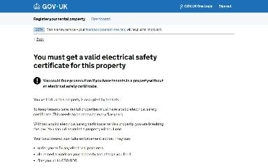](img/electrical-safety-certificate-missing/v1.jpg)

Shown when Which electrical safety certificate do you have for this property?: None of the above, Continue

[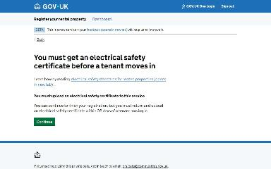](img/electrical-safety-certificate-missing/v2.jpg)

Shown when Starting point: Property is vacant; Which electrical safety certificate do you have for this property?: None of the above, Continue

### This electrical safety certificate has expired

`electrical-safety-certificate-expired` · ElectricalCertExpiredStepConfig

[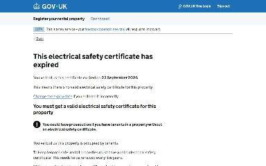](img/electrical-safety-certificate-expired/v1.jpg)

Shown when What’s the expiry date on the Electrical Installation Certificate?: Date: 23 September 2026

### Are you sure you want to remove validFile.png?

`remove-electrical-safety-certificate-upload` · RemoveElectricalCertUploadStepConfig

Shown when You’ve uploaded 1 file: Remove validFile.png

### Provide electrical cert later

`provide-electrical-safety-certificate-later` · ProvideElectricalCertLaterStepConfig

_Not reached by the generator._

### /landlord/property-details/1#compliance-information

`/landlord/property-details/1#compliance-information`

_Not reached by the generator._
