# Update electrical safety journey map

Generated 2026-11-03T12:29:05.004354100Z at commit `f960f1073`. Feature flags: failover-test-endpoints=false, subject-identifier-page=true, pdjb-939-property-registration-phase-two=true, pdjb-939-property-registration-phase-three=false, pdjb-1664-password-benchmark-endpoint=false, pdjb-238-gatling-post-endpoint=false, pdjb-1009-payments=true, pdjb-1210-multi-user-organisations=true, pdjb-1894-gas-certificate-14-month-expiry=false, pdjb-955-associated-parties=false, pdjb-1666-eic-issue-date=false, pdjb-973-asynchronous-email-sending=false.

Open `index.html` for the interactive map. `report.md` lists gaps and errors.

```mermaid
flowchart TD
    journeyStart(("Start"))
    subgraph c1["Changing answers"]
        n6["What’s the expiry date on the Electrical Installation Condition Report?"]
        n7["You must get a valid electrical safety certificate for this property"]
        n8["Upload the Electrical Installation Condition Report (EICR)"]
        n9["Are you sure you want to remove validFile.png?"]
        n10["You’ve uploaded 1 file"]
        n11["You’ve uploaded 2 files"]
        n12["Are you sure you want to remove validFile.png?"]
    end
    n0["Which electrical safety certificate do you have for this property?"]
    n1["What’s the expiry date on the Electrical Installation Certificate?"]
    n2["Upload the Electrical Installation Certificate (EIC)"]
    n3["You’ve uploaded 1 file (6 variants)"]
    n4["Electrical safety certificate (3 variants)"]
    n5(["1 Example Road EG1 1AA (5 variants)"])
    n13["What’s the expiry date on the Electrical Installation Condition Report?"]
    n14["Upload the Electrical Installation Condition Report (EICR)"]
    n15["You’ve uploaded 1 file (5 variants)"]
    n16["You must get a valid electrical safety certificate for this property (2 variants)"]
    n17["This electrical safety certificate has expired"]
    n18["Are you sure you want to remove validFile.png?"]
    n19["This electrical safety certificate has expired"]
    n20["Are you sure you want to remove validFile.png?"]
    n21{"Has any in collection"}
    n22{"Has any in collection"}
    n23["Provide electrical cert later"]
    journeyStart -->|"Change"| n0
    n0 -->|"Electrical Installation Certificate (EIC), Continue"| n1
    n0 -->|"Electrical Installation Condition Report (EICR), Continue"| n13
    n0 -->|"None of the above, Continue"| n16
    n1 -->|"Continue"| n21
    n21 -->|"No members"| n2
    n1 -->|"Date: 3 October 2026"| n17
    n2 --> n3
    n3 -->|"Continue"| n4
    n3 -->|"Upload another file"| n2
    n3 -->|"Remove validFile.png"| n18
    n4 --> n5
    n0 -.->|"Electrical Installation Condition Report (EICR), Continue"| n6
    n0 -.->|"None of the above, Continue"| n7
    n6 -.->|"Continue"| n22
    n22 -.->|"No members"| n8
    n7 -.->|"Continue without a valid electrical safety certificate"| n4
    n3 -.->|"Remove validFile.png"| n9
    n8 -.->|"Upload a file"| n10
    n2 -.->|"Upload a file"| n11
    n9 -.->|"Yes"| n2
    n9 -.->|"No / Cancel"| n3
    n10 -.->|"Continue"| n4
    n10 -.->|"Upload another file"| n8
    n10 -.->|"Remove validFile.png"| n12
    n13 -->|"Continue"| n22
    n22 -->|"No members"| n14
    n13 -->|"Date: 3 October 2026"| n19
    n14 --> n15
    n15 -->|"Continue"| n4
    n15 -->|"Upload another file"| n14
    n15 -->|"Remove validFile.png"| n20
    n16 --> n4
    n17 -->|"Continue without a valid electrical safety certificate"| n4
    n17 -->|"Change the expiry date"| n1
    n18 -->|"Yes"| n2
    n18 -->|"No / Cancel / Yes"| n3
    n19 -->|"Continue without a valid electrical safety certificate"| n4
    n19 -->|"Change the expiry date"| n13
    n20 -->|"Yes"| n14
    n20 -->|"No / Cancel / Yes"| n15
    n0 -.->|"Provide this later (not walked)"| n23
    n23 -.->|"Complete (not walked)"| n4
    n21 -.->|"Some members (not walked)"| n3
    n22 -.->|"No members (not walked)"| n14
    n22 -.->|"Some members (not walked)"| n15
    classDef gap fill:#f3f2f1,stroke:#b1b4b6,stroke-dasharray: 5 5,color:#505a5f
    classDef decision fill:#fff7bf,stroke:#b58840
    classDef terminal fill:#cce2d8,stroke:#00703c
    classDef change stroke:#1d70b8,stroke-width:3px
    classDef startNode fill:#00703c,stroke:#00703c,color:#ffffff
    classDef entryPoint stroke:#00703c,stroke-width:4px
    class journeyStart startNode
    class n0 entryPoint
    class n5 terminal
    class n6 change
    class n7 change
    class n8 change
    class n9 change
    class n10 change
    class n11 change
    class n12 change
    class n21 decision
    class n22 decision
    class n23 gap
```

## Pages

### Which electrical safety certificate do you have for this property?

`has-electrical-safety` · HasElectricalCertStepConfig

[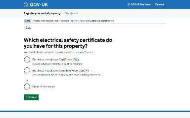](img/has-electrical-safety/v1.jpg)

Shown on the default route

### What’s the expiry date on the Electrical Installation Certificate?

`eic-expiry-date` · EicExpiryDateStepConfig

[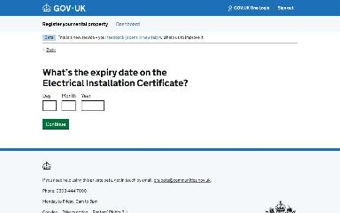](img/eic-expiry-date/v1.jpg)

Shown on the default route

### Upload the Electrical Installation Certificate (EIC)

`eic-file-upload` · UploadEicStepConfig

[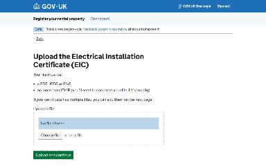](img/eic-file-upload/v1.jpg)

Shown on the default route

### You’ve uploaded 1 file

`check-eic-uploads` · CheckEicUploadsStepConfig

[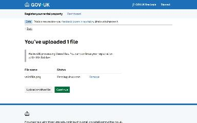](img/check-eic-uploads/v1.jpg)

Shown on the default route

[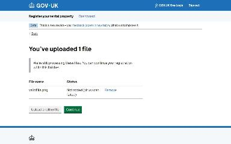](img/check-eic-uploads/v2.jpg)

Shown when Electrical safety certificate: Change Which electrical safety certificate do you have for this property?; Are you sure you want to remove validFile.png?: No (when changing an answer)

[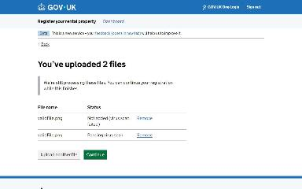](img/check-eic-uploads/v3.jpg)

Shown when You’ve uploaded 1 file: Upload another file

[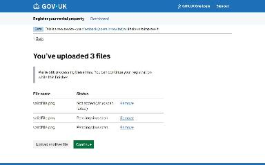](img/check-eic-uploads/v4.jpg)

Shown when You’ve uploaded 1 file: Upload another file; You’ve uploaded 2 files: Upload another file

[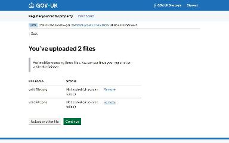](img/check-eic-uploads/v5.jpg)

Shown when You’ve uploaded 1 file: Upload another file; You’ve uploaded 2 files: Remove validFile.png

Shown when Starting point: Property is vacant; You’ve uploaded 1 file: Upload another file

### Electrical safety certificate

`check-electrical-safety-answers` · UpdateCheckElectricalSafetyAnswersStepConfig

[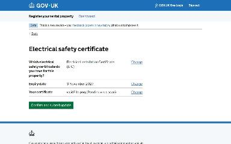](img/check-electrical-safety-answers/v1.jpg)

Shown on the default route

[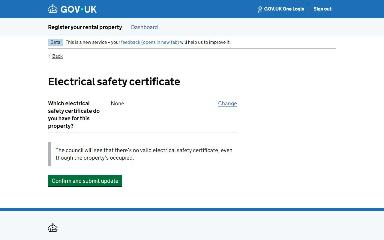](img/check-electrical-safety-answers/v2.jpg)

Shown when Which electrical safety certificate do you have for this property?: None of the above, Continue

[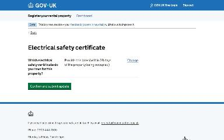](img/check-electrical-safety-answers/v3.jpg)

Shown when Starting point: Property is vacant; Which electrical safety certificate do you have for this property?: None of the above, Continue

### 1 Example Road EG1 1AA

`/landlord/property-details/1`

Shown on the default route

[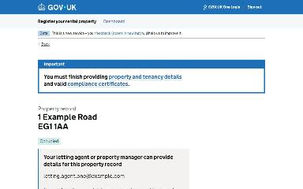](img/landlord_property-details_1/v2.jpg)

Shown when Which electrical safety certificate do you have for this property?: None of the above, Continue

Shown when What’s the expiry date on the Electrical Installation Certificate?: Date: 3 October 2026

Shown when Starting point: Property is vacant

[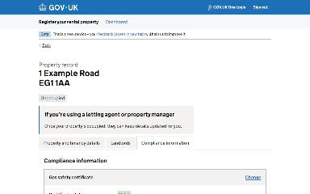](img/landlord_property-details_1/v5.jpg)

Shown when Starting point: Property is vacant; Which electrical safety certificate do you have for this property?: None of the above, Continue

### What’s the expiry date on the Electrical Installation Condition Report?

`eicr-expiry-date` · EicrExpiryDateStepConfig

Shown when Electrical safety certificate: Change Which electrical safety certificate do you have for this property?; Which electrical safety certificate do you have for this property?: Electrical Installation Condition Report (EICR), Continue (when changing an answer)

### You must get a valid electrical safety certificate for this property

`electrical-safety-certificate-missing` · ElectricalCertMissingStepConfig

[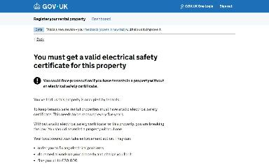](img/change_electrical-safety-certificate-missing/v1.jpg)

Shown when Electrical safety certificate: Change Which electrical safety certificate do you have for this property?; Which electrical safety certificate do you have for this property?: None of the above, Continue (when changing an answer)

### Upload the Electrical Installation Condition Report (EICR)

`eicr-file-upload` · UploadEicrStepConfig

Shown when Electrical safety certificate: Change Which electrical safety certificate do you have for this property? (when changing an answer)

### Are you sure you want to remove validFile.png?

`remove-eic-upload` · RemoveEicUploadStepConfig

[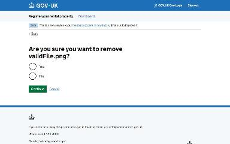](img/change_remove-eic-upload/v1.jpg)

Shown when Electrical safety certificate: Change Which electrical safety certificate do you have for this property?; You’ve uploaded 1 file: Remove validFile.png (when changing an answer)

### You’ve uploaded 1 file

`check-eicr-uploads` · CheckEicrUploadsStepConfig

Shown when Electrical safety certificate: Change Which electrical safety certificate do you have for this property? (when changing an answer)

### You’ve uploaded 2 files

`check-eic-uploads` · CheckEicUploadsStepConfig

[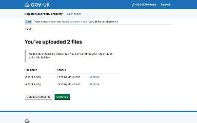](img/change_check-eic-uploads/v1.jpg)

Shown when Electrical safety certificate: Change Which electrical safety certificate do you have for this property? (when changing an answer)

### Are you sure you want to remove validFile.png?

`remove-eicr-upload` · RemoveEicrUploadStepConfig

Shown when Electrical safety certificate: Change Which electrical safety certificate do you have for this property?; You’ve uploaded 1 file: Remove validFile.png (when changing an answer)

### What’s the expiry date on the Electrical Installation Condition Report?

`eicr-expiry-date` · EicrExpiryDateStepConfig

[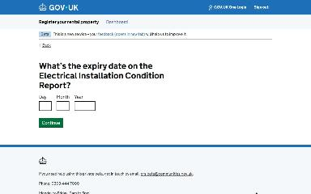](img/eicr-expiry-date/v1.jpg)

Shown when Which electrical safety certificate do you have for this property?: Electrical Installation Condition Report (EICR), Continue

### Upload the Electrical Installation Condition Report (EICR)

`eicr-file-upload` · UploadEicrStepConfig

[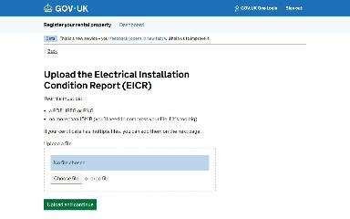](img/eicr-file-upload/v1.jpg)

Shown when Which electrical safety certificate do you have for this property?: Electrical Installation Condition Report (EICR), Continue

### You’ve uploaded 1 file

`check-eicr-uploads` · CheckEicrUploadsStepConfig

Shown when Which electrical safety certificate do you have for this property?: Electrical Installation Condition Report (EICR), Continue

Shown when Which electrical safety certificate do you have for this property?: Electrical Installation Condition Report (EICR), Continue; You’ve uploaded 1 file: Upload another file

Shown when Which electrical safety certificate do you have for this property?: Electrical Installation Condition Report (EICR), Continue; You’ve uploaded 1 file: Remove validFile.png

Shown when Which electrical safety certificate do you have for this property?: Electrical Installation Condition Report (EICR), Continue; You’ve uploaded 1 file: Upload another file; You’ve uploaded 2 files: Upload another file

Shown when Which electrical safety certificate do you have for this property?: Electrical Installation Condition Report (EICR), Continue; You’ve uploaded 1 file: Upload another file; You’ve uploaded 2 files: Remove validFile.png

### You must get a valid electrical safety certificate for this property

`electrical-safety-certificate-missing` · ElectricalCertMissingStepConfig

Shown when Which electrical safety certificate do you have for this property?: None of the above, Continue

[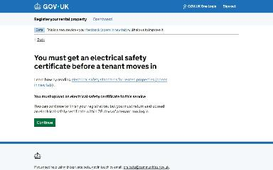](img/electrical-safety-certificate-missing/v2.jpg)

Shown when Starting point: Property is vacant; Which electrical safety certificate do you have for this property?: None of the above, Continue

### This electrical safety certificate has expired

`eic-expired` · EicExpiredStepConfig

Shown when What’s the expiry date on the Electrical Installation Certificate?: Date: 3 October 2026

### Are you sure you want to remove validFile.png?

`remove-eic-upload` · RemoveEicUploadStepConfig

Shown when You’ve uploaded 1 file: Remove validFile.png

### This electrical safety certificate has expired

`eicr-expired` · EicrExpiredStepConfig

[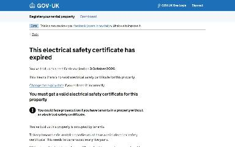](img/eicr-expired/v1.jpg)

Shown when Which electrical safety certificate do you have for this property?: Electrical Installation Condition Report (EICR), Continue; What’s the expiry date on the Electrical Installation Condition Report?: Date: 3 October 2026

### Are you sure you want to remove validFile.png?

`remove-eicr-upload` · RemoveEicrUploadStepConfig

Shown when Which electrical safety certificate do you have for this property?: Electrical Installation Condition Report (EICR), Continue; You’ve uploaded 1 file: Remove validFile.png

### Provide electrical cert later

`provide-electrical-safety-certificate-later` · ProvideElectricalCertLaterStepConfig

_Not reached by the generator._
