# Update the energy performance certificate journey map

Generated 2026-10-23T09:35:57.904050200Z at commit `3a5832daa`. Feature flags: failover-test-endpoints=false, subject-identifier-page=true, pdjb-939-property-registration-phase-two=false, pdjb-1053-dashboard-nav-link=true, pdjb-1022-delegate-to-letting-agent=true, pdjb-1664-password-benchmark-endpoint=false, pdjb-238-gatling-post-endpoint=false, pdjb-1040-correspondence-address=true, pdjb-1009-payments=false, pdjb-926-landlord-dashboard-update=true, pdjb-1210-multi-user-organisations=false.

Open `index.html` for the interactive map. `report.md` lists gaps and errors.

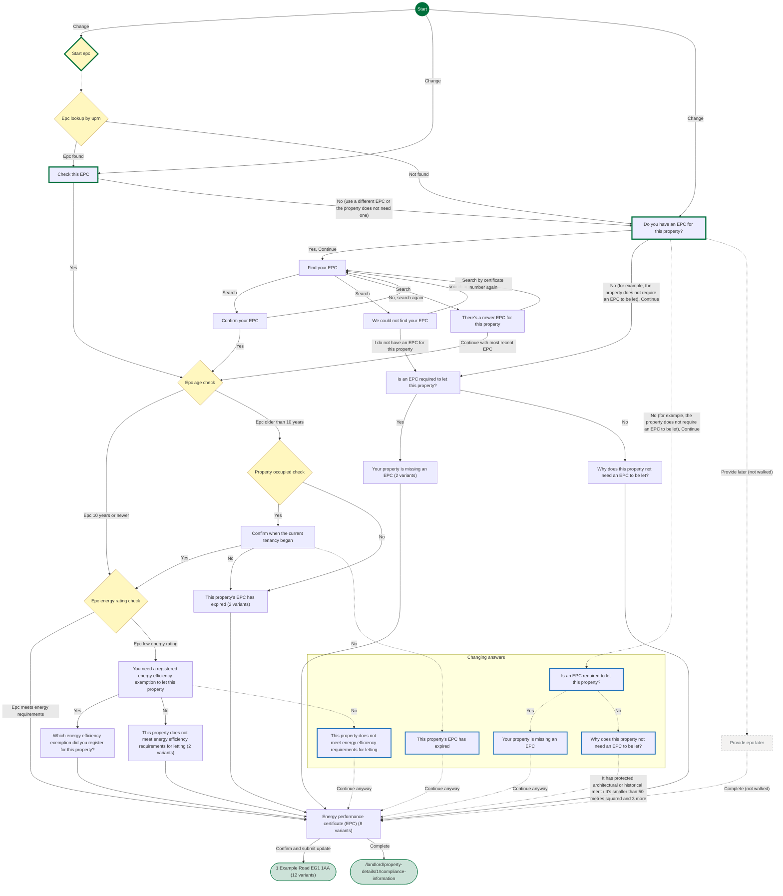

## Pages

### Do you have an EPC for this property?

`has-epc` · HasEpcStepConfig

[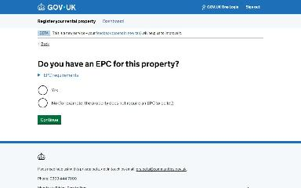](img/has-epc/v1.jpg)

Shown on the default route

### Find your EPC

`find-your-epc` · FindYourEpcStepConfig

[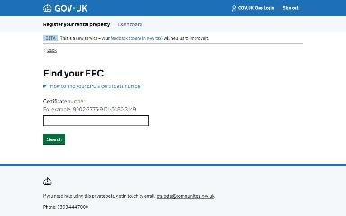](img/find-your-epc/v1.jpg)

Shown on the default route

### Confirm your EPC

`confirm-epc-details` · ConfirmEpcDetailsRetrievedByCertificateNumberStepConfig

Shown on the default route

### Energy performance certificate (EPC)

`check-epc-answers` · UpdateCheckEpcAnswersStepConfig

[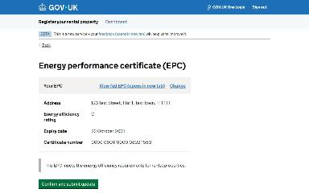](img/check-epc-answers/v1.jpg)

Shown on the default route

[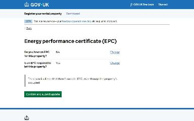](img/check-epc-answers/v2.jpg)

Shown when Do you have an EPC for this property?: No (for example, the property does not require an EPC to be let), Continue

Shown when EPC register search by certificate number: Expired certificate found

[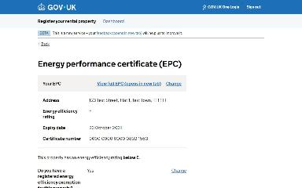](img/check-epc-answers/v4.jpg)

Shown when EPC register search by certificate number: Low rated certificate found

[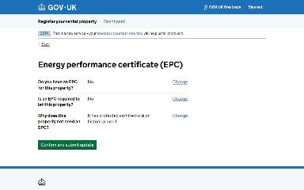](img/check-epc-answers/v5.jpg)

Shown when Do you have an EPC for this property?: No (for example, the property does not require an EPC to be let), Continue; Is an EPC required to let this property?: No

Shown when EPC register search by certificate number: Expired certificate found; Confirm when the current tenancy began: No

Shown when EPC register search by certificate number: Low rated certificate found; You need a registered energy efficiency exemption to let this property: No

[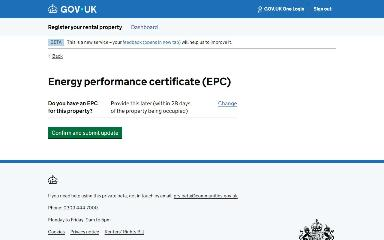](img/check-epc-answers/v8.jpg)

Shown when Starting point: Property is vacant; Do you have an EPC for this property?: No (for example, the property does not require an EPC to be let), Continue

### 1 Example Road EG1 1AA

`/landlord/property-details/1`

Shown on the default route

Shown when Do you have an EPC for this property?: No (for example, the property does not require an EPC to be let), Continue

Shown when EPC register search by certificate number: Expired certificate found

[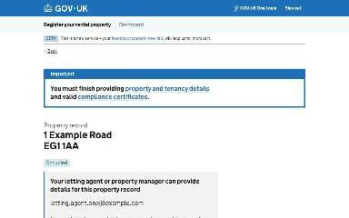](img/landlord_property-details_1/v4.jpg)

Shown when EPC register search by certificate number: Low rated certificate found

Shown when Do you have an EPC for this property?: No (for example, the property does not require an EPC to be let), Continue; Is an EPC required to let this property?: No

Shown when EPC register search by certificate number: Expired certificate found; Confirm when the current tenancy began: No

Shown when EPC register search by certificate number: Low rated certificate found; You need a registered energy efficiency exemption to let this property: No

Shown when Starting point: Property is vacant

[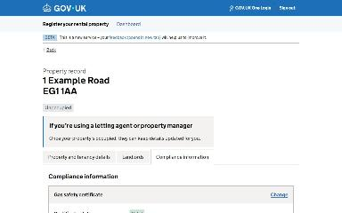](img/landlord_property-details_1/v9.jpg)

Shown when Starting point: Property is vacant; Do you have an EPC for this property?: No (for example, the property does not require an EPC to be let), Continue

Shown when Starting point: Property is vacant; Do you have an EPC for this property?: No (for example, the property does not require an EPC to be let), Continue; Is an EPC required to let this property?: No

[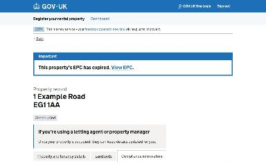](img/landlord_property-details_1/v11.jpg)

Shown when Starting point: Property is vacant; EPC register search by address: Expired EPC found

Shown when Starting point: Property is vacant; EPC register search by address: Low rated EPC found

### Is an EPC required to let this property?

`is-epc-required` · IsEpcRequiredStepConfig

Shown when Energy performance certificate (EPC): Change; Do you have an EPC for this property?: No (for example, the property does not require an EPC to be let), Continue (when changing an answer)

### Your property is missing an EPC

`epc-missing` · EpcMissingStepConfig

Shown when Energy performance certificate (EPC): Change; Is an EPC required to let this property?: Yes (when changing an answer)

### Why does this property not need an EPC to be let?

`epc-exemption` · EpcExemptionStepConfig

Shown when Energy performance certificate (EPC): Change; Is an EPC required to let this property?: No (when changing an answer)

### Is an EPC required to let this property?

`is-epc-required` · IsEpcRequiredStepConfig

[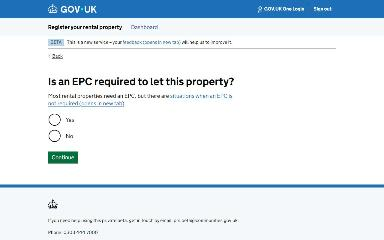](img/is-epc-required/v1.jpg)

Shown when Do you have an EPC for this property?: No (for example, the property does not require an EPC to be let), Continue

### Your property is missing an EPC

`epc-missing` · EpcMissingStepConfig

[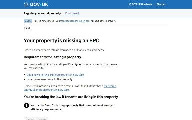](img/epc-missing/v1.jpg)

Shown when Do you have an EPC for this property?: No (for example, the property does not require an EPC to be let), Continue

[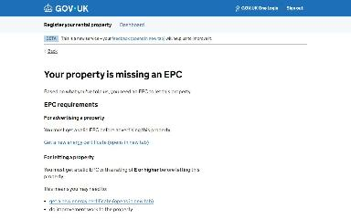](img/epc-missing/v2.jpg)

Shown when Starting point: Property is vacant; Do you have an EPC for this property?: No (for example, the property does not require an EPC to be let), Continue

### We could not find your EPC

`epc-not-found` · EpcNotFoundStepConfig

[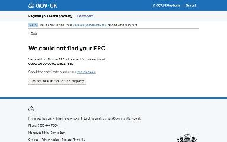](img/epc-not-found/v1.jpg)

Shown when EPC register search by certificate number: Certificate not found

### There’s a newer EPC for this property

`epc-superseded` · EpcSuperseededStepConfig

[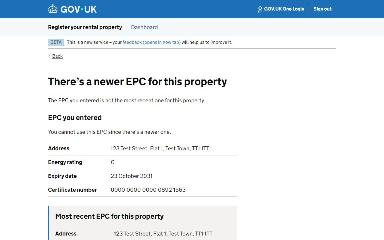](img/epc-superseded/v1.jpg)

Shown when EPC register search by certificate number: Superseded certificate found

### Confirm when the current tenancy began

`epc-in-date-at-start-of-tenancy-check` · EpcInDateAtStartOfTenancyCheckStepConfig

[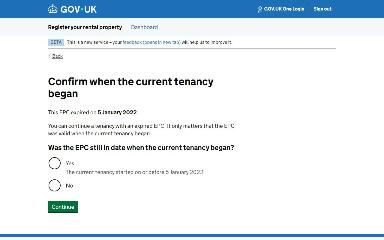](img/epc-in-date-at-start-of-tenancy-check/v1.jpg)

Shown when EPC register search by certificate number: Expired certificate found

### This property’s EPC has expired

`epc-expired` · EpcExpiredStepConfig

[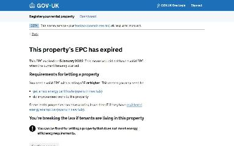](img/change_epc-expired/v1.jpg)

Shown when EPC register search by certificate number: Expired certificate found; Energy performance certificate (EPC): Change Was the EPC still in date when the current tenancy began?; Confirm when the current tenancy began: No (when changing an answer)

### You need a registered energy efficiency exemption to let this property

`has-mees-exemption` · HasMeesExemptionStepConfig

[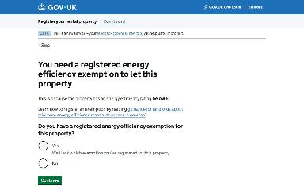](img/has-mees-exemption/v1.jpg)

Shown when EPC register search by certificate number: Low rated certificate found

### Which energy efficiency exemption did you register for this property?

`mees-exemption` · MeesExemptionStepConfig

[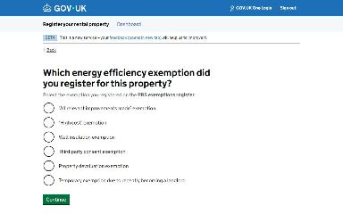](img/mees-exemption/v1.jpg)

Shown when EPC register search by certificate number: Low rated certificate found

### This property does not meet energy efficiency requirements for letting

`low-energy-rating` · LowEnergyRatingStepConfig

Shown when EPC register search by certificate number: Low rated certificate found; Energy performance certificate (EPC): Change Do you have a registered energy efficiency exemption for this property?; You need a registered energy efficiency exemption to let this property: No (when changing an answer)

### Why does this property not need an EPC to be let?

`epc-exemption` · EpcExemptionStepConfig

[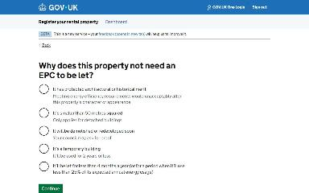](img/epc-exemption/v1.jpg)

Shown when Do you have an EPC for this property?: No (for example, the property does not require an EPC to be let), Continue; Is an EPC required to let this property?: No

### This property’s EPC has expired

`epc-expired` · EpcExpiredStepConfig

Shown when EPC register search by certificate number: Expired certificate found; Confirm when the current tenancy began: No

[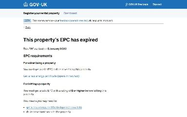](img/epc-expired/v2.jpg)

Shown when Starting point: Property is vacant; EPC register search by address: Expired EPC found

### This property does not meet energy efficiency requirements for letting

`low-energy-rating` · LowEnergyRatingStepConfig

[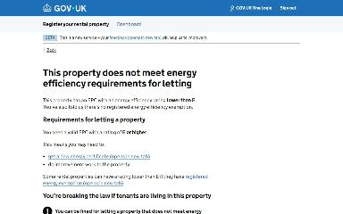](img/low-energy-rating/v1.jpg)

Shown when EPC register search by certificate number: Low rated certificate found; You need a registered energy efficiency exemption to let this property: No

[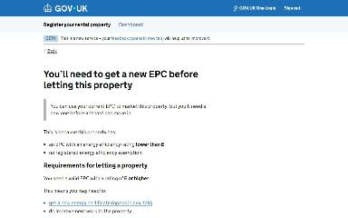](img/low-energy-rating/v2.jpg)

Shown when Starting point: Property is vacant; EPC register search by address: Low rated EPC found; You need a registered energy efficiency exemption to let this property: No

### Check this EPC

`check-epc-details` · ConfirmEpcRetrievedByUprnStepConfig

[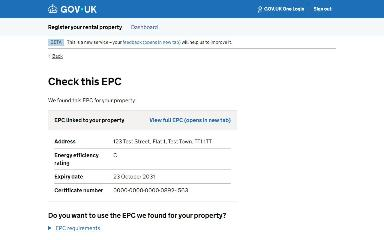](img/check-epc-details/v1.jpg)

Shown when EPC register search by address: EPC found

### Provide epc later

`provide-epc-later` · ProvideEpcLaterStepConfig

_Not reached by the generator._

### /landlord/property-details/1#compliance-information

`/landlord/property-details/1#compliance-information`

_Not reached by the generator._
