# Update gas safety journey map

Generated 2026-10-23T09:36:28.568507300Z at commit `3a5832daa`. Feature flags: failover-test-endpoints=false, subject-identifier-page=true, pdjb-939-property-registration-phase-two=false, pdjb-1053-dashboard-nav-link=true, pdjb-1022-delegate-to-letting-agent=true, pdjb-1664-password-benchmark-endpoint=false, pdjb-238-gatling-post-endpoint=false, pdjb-1040-correspondence-address=true, pdjb-1009-payments=false, pdjb-926-landlord-dashboard-update=true, pdjb-1210-multi-user-organisations=false.

Open `index.html` for the interactive map. `report.md` lists gaps and errors.

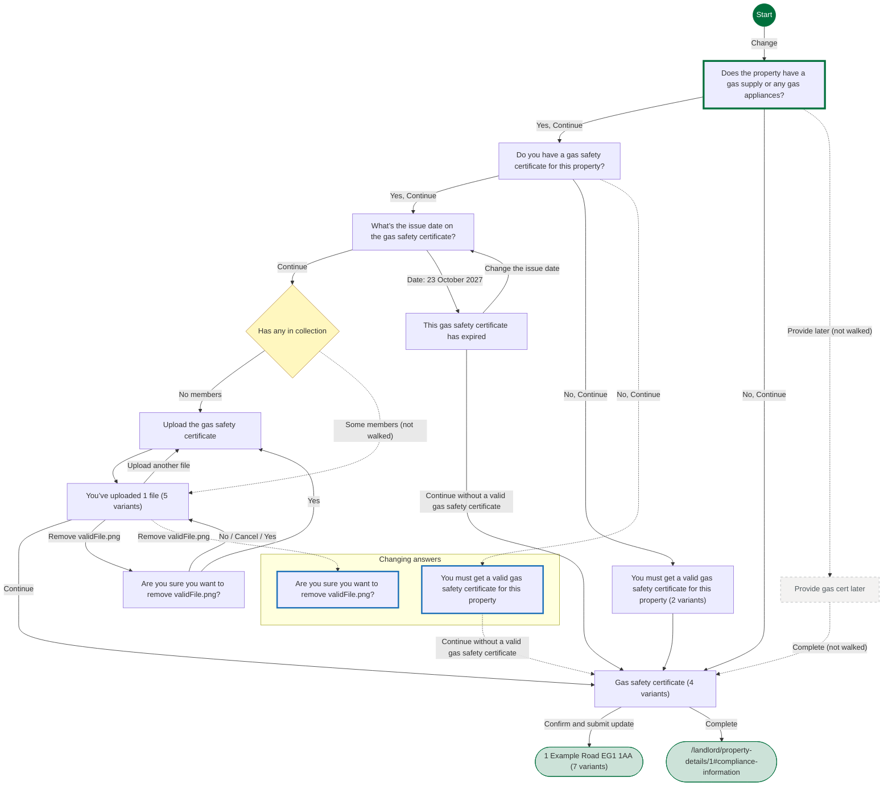

## Pages

### Does the property have a gas supply or any gas appliances?

`has-gas-supply` · HasGasSupplyStepConfig

[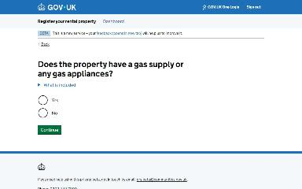](img/has-gas-supply/v1.jpg)

Shown on the default route

### Do you have a gas safety certificate for this property?

`has-gas-safety` · HasGasCertStepConfig

[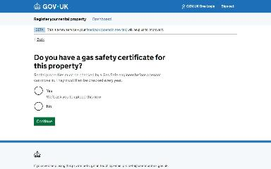](img/has-gas-safety/v1.jpg)

Shown on the default route

### What’s the issue date on the gas safety certificate?

`gas-safety-certificate-issue-date` · GasCertIssueDateStepConfig

[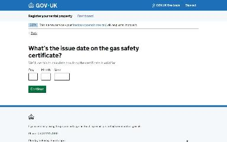](img/gas-safety-certificate-issue-date/v1.jpg)

Shown on the default route

### Upload the gas safety certificate

`gas-safety-certificate-file-upload` · UploadGasCertStepConfig

[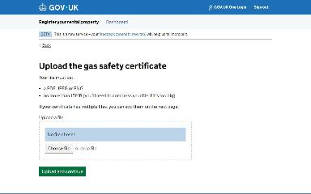](img/gas-safety-certificate-file-upload/v1.jpg)

Shown on the default route

### You’ve uploaded 1 file

`check-gas-safety-certificate-uploads` · CheckGasCertUploadsStepConfig

[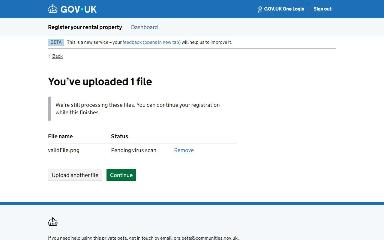](img/check-gas-safety-certificate-uploads/v1.jpg)

Shown on the default route

[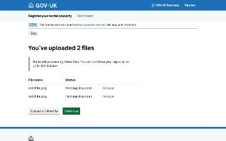](img/check-gas-safety-certificate-uploads/v2.jpg)

Shown when You’ve uploaded 1 file: Upload another file

Shown when You’ve uploaded 1 file: Remove validFile.png

Shown when You’ve uploaded 1 file: Upload another file; You’ve uploaded 2 files: Upload another file

Shown when You’ve uploaded 1 file: Upload another file; You’ve uploaded 2 files: Remove validFile.png

### Gas safety certificate

`check-gas-safety-answers` · UpdateCheckGasSafetyAnswersStepConfig

[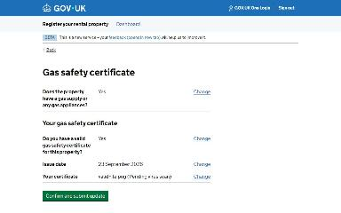](img/check-gas-safety-answers/v1.jpg)

Shown on the default route

[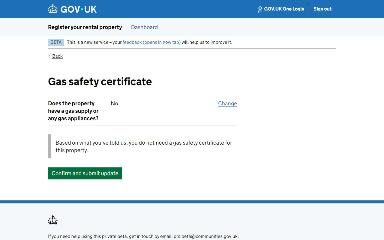](img/check-gas-safety-answers/v2.jpg)

Shown when Does the property have a gas supply or any gas appliances?: No, Continue

[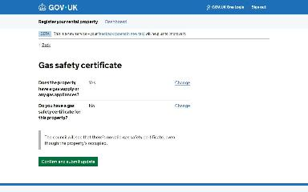](img/check-gas-safety-answers/v3.jpg)

Shown when Do you have a gas safety certificate for this property?: No, Continue

[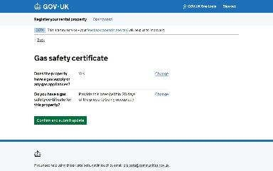](img/check-gas-safety-answers/v4.jpg)

Shown when Starting point: Property is vacant; Do you have a gas safety certificate for this property?: No, Continue

### 1 Example Road EG1 1AA

`/landlord/property-details/1`

Shown on the default route

Shown when Does the property have a gas supply or any gas appliances?: No, Continue

Shown when Do you have a gas safety certificate for this property?: No, Continue

Shown when What’s the issue date on the gas safety certificate?: Date: 23 October 2027

Shown when Starting point: Property is vacant

[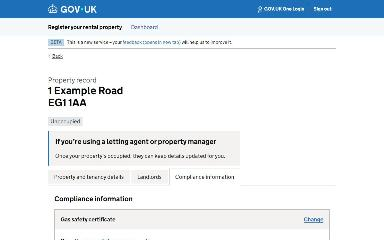](img/landlord_property-details_1/v6.jpg)

Shown when Starting point: Property is vacant; Does the property have a gas supply or any gas appliances?: No, Continue

Shown when Starting point: Property is vacant; Do you have a gas safety certificate for this property?: No, Continue

### You must get a valid gas safety certificate for this property

`gas-safety-certificate-missing` · GasCertMissingStepConfig

Shown when Gas safety certificate: Change Does the property have a gas supply or any gas appliances?; Do you have a gas safety certificate for this property?: No, Continue (when changing an answer)

### Are you sure you want to remove validFile.png?

`remove-gas-safety-certificate-upload` · RemoveGasCertUploadStepConfig

Shown when Gas safety certificate: Change Does the property have a gas supply or any gas appliances?; You’ve uploaded 1 file: Remove validFile.png (when changing an answer)

### You must get a valid gas safety certificate for this property

`gas-safety-certificate-missing` · GasCertMissingStepConfig

Shown when Do you have a gas safety certificate for this property?: No, Continue

[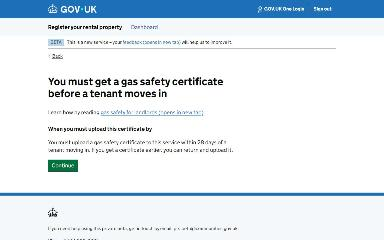](img/gas-safety-certificate-missing/v2.jpg)

Shown when Starting point: Property is vacant; Do you have a gas safety certificate for this property?: No, Continue

### This gas safety certificate has expired

`gas-safety-certificate-expired` · GasCertExpiredStepConfig

[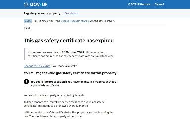](img/gas-safety-certificate-expired/v1.jpg)

Shown when What’s the issue date on the gas safety certificate?: Date: 23 October 2027

### Are you sure you want to remove validFile.png?

`remove-gas-safety-certificate-upload` · RemoveGasCertUploadStepConfig

Shown when You’ve uploaded 1 file: Remove validFile.png

### Provide gas cert later

`provide-gas-safety-certificate-later` · ProvideGasCertLaterStepConfig

_Not reached by the generator._

### /landlord/property-details/1#compliance-information

`/landlord/property-details/1#compliance-information`

_Not reached by the generator._
