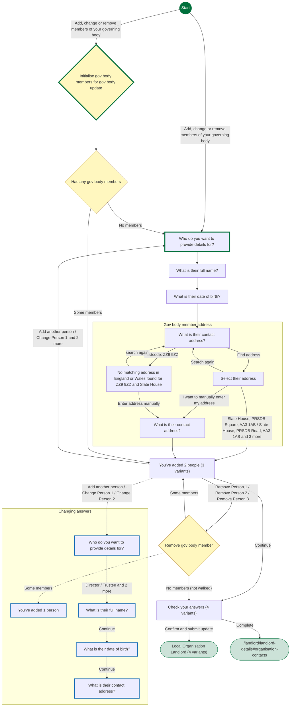
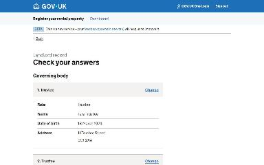
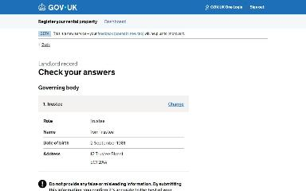
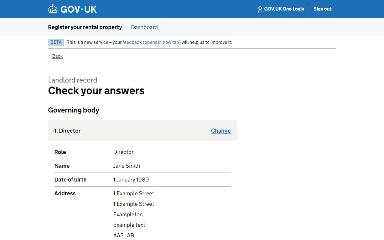
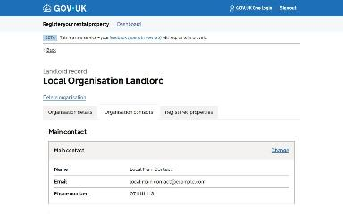
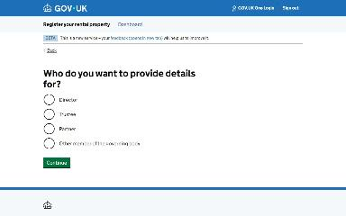
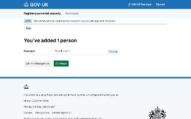

# Update the governing body journey map

Generated 2026-10-23T09:40:18.143977500Z at commit `3a5832daa`. Feature flags: failover-test-endpoints=false, subject-identifier-page=true, pdjb-939-property-registration-phase-two=false, pdjb-1053-dashboard-nav-link=true, pdjb-1022-delegate-to-letting-agent=true, pdjb-1664-password-benchmark-endpoint=false, pdjb-238-gatling-post-endpoint=false, pdjb-1040-correspondence-address=true, pdjb-1009-payments=false, pdjb-926-landlord-dashboard-update=true, pdjb-1210-multi-user-organisations=false.

Open `index.html` for the interactive map. `report.md` lists gaps and errors.

## Pages

### You’ve added 2 people

`organisation-governing-body-member-list` · OrgGovBodyMemberListStepConfig

Shown on the default route

Shown when You’ve added 2 people: Add another person

Shown when You’ve added 2 people: Remove Person 1

### Check your answers

`governing-body-check-your-answers` · UpdateGoverningBodyCyaStepConfig

Shown on the default route

Shown when You’ve added 2 people: Add another person

Shown when You’ve added 2 people: Remove Person 1

Shown when Starting point: Organisation has no governing body members

### Local Organisation Landlord

`/landlord/landlord-details`

Shown on the default route

Shown when You’ve added 2 people: Add another person

Shown when You’ve added 2 people: Remove Person 1

Shown when Starting point: Organisation has no governing body members

### Who do you want to provide details for?

`organisation-governing-body-who-to-provide` · OrgGovBodyWhoToProvideStepConfig

Shown when Check your answers: Change; You’ve added 2 people: Add another person (when changing an answer)

### You’ve added 1 person

`organisation-governing-body-member-list` · OrgGovBodyMemberListStepConfig

Shown when Check your answers: Change; You’ve added 2 people: Remove Person 1 (when changing an answer)

### What is their full name?

`organisation-governing-body-member-name` · OrgGovBodyMemberNameStepConfig

Shown when Check your answers: Change; Who do you want to provide details for?: Director (when changing an answer)

### What is their date of birth?

`organisation-governing-body-member-dob` · OrgGovBodyMemberDobStepConfig

Shown when Check your answers: Change (when changing an answer)

### What is their contact address?

`organisation-governing-body-member-address/lookup-address` · LookupAddressStepConfig

Shown when Check your answers: Change (when changing an answer)

### Who do you want to provide details for?

`organisation-governing-body-who-to-provide` · OrgGovBodyWhoToProvideStepConfig

Shown when You’ve added 2 people: Add another person

### What is their full name?

`organisation-governing-body-member-name` · OrgGovBodyMemberNameStepConfig

Shown when You’ve added 2 people: Add another person

### What is their date of birth?

`organisation-governing-body-member-dob` · OrgGovBodyMemberDobStepConfig

Shown when You’ve added 2 people: Add another person

### What is their contact address?

`organisation-governing-body-member-address/lookup-address` · LookupAddressStepConfig

Shown when You’ve added 2 people: Add another person

### Select their address

`organisation-governing-body-member-address/select-address` · SelectAddressStepConfig

Shown when You’ve added 2 people: Add another person

### What is their contact address?

`organisation-governing-body-member-address/manual-address` · ManualAddressStepConfig

Shown when You’ve added 2 people: Add another person

### No matching address in England or Wales found for ZZ9 9ZZ and Slate House

`organisation-governing-body-member-address/no-address-found` · NoAddressFoundStepConfig

Shown when You’ve added 2 people: Add another person; What is their contact address?: Postcode: ZZ9 9ZZ

### /landlord/landlord-details#organisation-contacts

`/landlord/landlord-details#organisation-contacts`

_Not reached by the generator._
