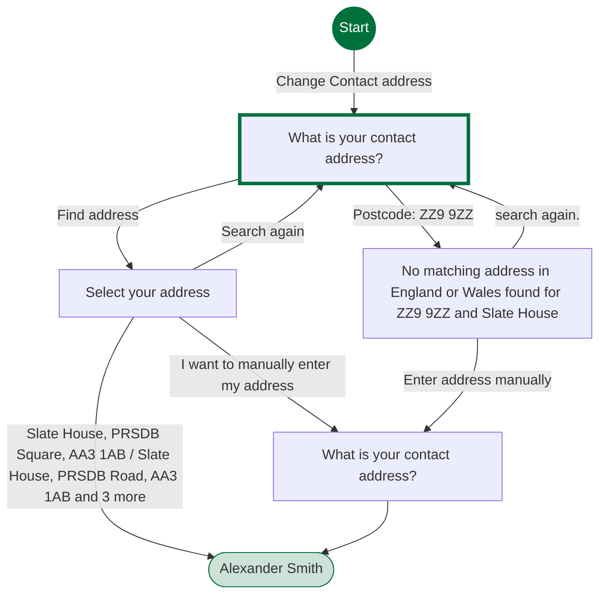
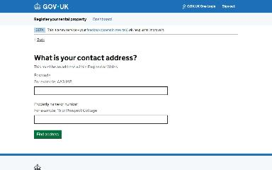
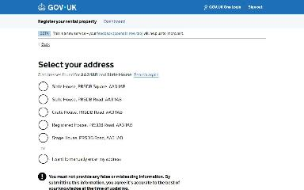
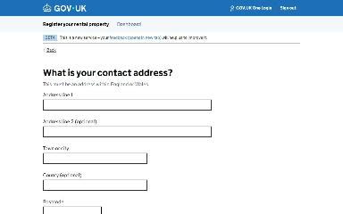

# Update your address journey map

Generated 2026-10-23T09:38:09.220738Z at commit `3a5832daa`. Feature flags: failover-test-endpoints=false, subject-identifier-page=true, pdjb-939-property-registration-phase-two=false, pdjb-1053-dashboard-nav-link=true, pdjb-1022-delegate-to-letting-agent=true, pdjb-1664-password-benchmark-endpoint=false, pdjb-238-gatling-post-endpoint=false, pdjb-1040-correspondence-address=true, pdjb-1009-payments=false, pdjb-926-landlord-dashboard-update=true, pdjb-1210-multi-user-organisations=false.

Open `index.html` for the interactive map. `report.md` lists gaps and errors.

## Pages

### What is your contact address?

`lookup-address` · LookupAddressStepConfig

Shown on the default route

### Select your address

`select-address` · SelectAddressStepConfig

Shown on the default route

### Alexander Smith

`/landlord/landlord-details`

Shown when Select your address: Slate House, PRSDB Square, AA3 1AB

### What is your contact address?

`manual-address` · ManualAddressStepConfig

Shown on the default route

### No matching address in England or Wales found for ZZ9 9ZZ and Slate House

`no-address-found` · NoAddressFoundStepConfig

Shown when What is your contact address?: Postcode: ZZ9 9ZZ

