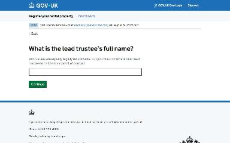
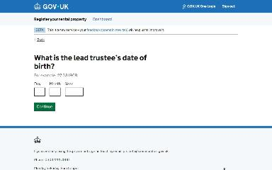
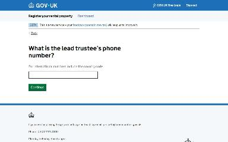
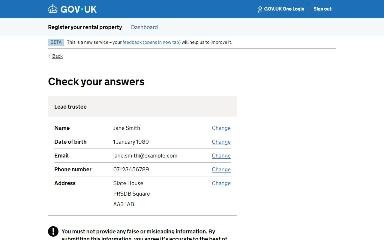
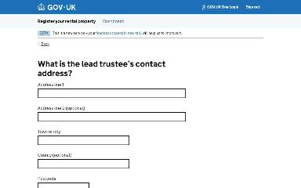

# Update the lead trustee journey map

Generated 2026-10-23T09:39:44.933871800Z at commit `3a5832daa`. Feature flags: failover-test-endpoints=false, subject-identifier-page=true, pdjb-939-property-registration-phase-two=false, pdjb-1053-dashboard-nav-link=true, pdjb-1022-delegate-to-letting-agent=true, pdjb-1664-password-benchmark-endpoint=false, pdjb-238-gatling-post-endpoint=false, pdjb-1040-correspondence-address=true, pdjb-1009-payments=false, pdjb-926-landlord-dashboard-update=true, pdjb-1210-multi-user-organisations=false.

Open `index.html` for the interactive map. `report.md` lists gaps and errors.

```mermaid
flowchart TD
    journeyStart(("Start"))
    subgraph c1["Trustee address"]
        n4["What is the lead trustee’s contact address?"]
        n5["Select your address"]
        n9["No matching address in England or Wales found for ZZ9 9ZZ and Slate House"]
        n10["What is the lead trustee’s contact address?"]
    end
    subgraph c2["Changing answers"]
        n8["What is the lead trustee’s contact address?"]
    end
    n0["What is the lead trustee’s full name?"]
    n1["What is the lead trustee’s date of birth?"]
    n2["What is the lead trustee’s email address?"]
    n3["What is the lead trustee’s phone number?"]
    n6["Check your answers"]
    n7(["Local Organisation Landlord"])
    n11(["/landlord/landlord-details#organisation-contacts"])
    journeyStart -->|"Change"| n0
    n0 --> n1
    n1 --> n2
    n2 --> n3
    n3 --> n4
    n4 -->|"Find address"| n5
    n4 -->|"Postcode: ZZ9 9ZZ"| n9
    n5 -->|"Slate House, PRSDB Square, AA3 1AB / Slate House, PRSDB Road, AA3 1AB and 3 more"| n6
    n5 -->|"I want to manually enter my address"| n10
    n5 -->|"Search again"| n4
    n6 -->|"Confirm and submit update"| n7
    n5 -.->|"I want to manually enter my address"| n8
    n8 -.->|"Continue"| n6
    n9 -->|"Enter address manually"| n10
    n9 -->|"search again."| n4
    n10 --> n6
    n6 -->|"Complete"| n11
    classDef gap fill:#f3f2f1,stroke:#b1b4b6,stroke-dasharray: 5 5,color:#505a5f
    classDef decision fill:#fff7bf,stroke:#b58840
    classDef terminal fill:#cce2d8,stroke:#00703c
    classDef change stroke:#1d70b8,stroke-width:3px
    classDef startNode fill:#00703c,stroke:#00703c,color:#ffffff
    classDef entryPoint stroke:#00703c,stroke-width:4px
    class journeyStart startNode
    class n0 entryPoint
    class n7 terminal
    class n8 change
    class n11 terminal
```

## Pages

### What is the lead trustee’s full name?

`lead-trustee-name` · LeadTrusteeNameStepConfig

Shown on the default route

### What is the lead trustee’s date of birth?

`lead-trustee-dob` · LeadTrusteeDobStepConfig

Shown on the default route

### What is the lead trustee’s email address?

`lead-trustee-email` · LeadTrusteeEmailStepConfig

Shown on the default route

### What is the lead trustee’s phone number?

`lead-trustee-phone` · LeadTrusteePhoneStepConfig

Shown on the default route

### What is the lead trustee’s contact address?

`lead-trustee-address/lookup-address` · LookupAddressStepConfig

Shown on the default route

### Select your address

`lead-trustee-address/select-address` · SelectAddressStepConfig

Shown on the default route

### Check your answers

`lead-trustee-check-your-answers` · UpdateLeadTrusteeCyaStepConfig

Shown on the default route

### Local Organisation Landlord

`/landlord/landlord-details`

Shown on the default route

### What is the lead trustee’s contact address?

`lead-trustee-address/manual-address` · ManualAddressStepConfig

Shown when Check your answers: Change Address; Select your address: I want to manually enter my address (when changing an answer)

### No matching address in England or Wales found for ZZ9 9ZZ and Slate House

`lead-trustee-address/no-address-found` · NoAddressFoundStepConfig

Shown when What is the lead trustee’s contact address?: Postcode: ZZ9 9ZZ

### What is the lead trustee’s contact address?

`lead-trustee-address/manual-address` · ManualAddressStepConfig

Shown when What is the lead trustee’s contact address?: Postcode: ZZ9 9ZZ

### /landlord/landlord-details#organisation-contacts

`/landlord/landlord-details#organisation-contacts`

_Not reached by the generator._
