# Update the lead trustee journey map

Generated 2026-11-03T12:34:29.303568800Z at commit `f960f1073`. Feature flags: failover-test-endpoints=false, subject-identifier-page=true, pdjb-939-property-registration-phase-two=true, pdjb-939-property-registration-phase-three=false, pdjb-1664-password-benchmark-endpoint=false, pdjb-238-gatling-post-endpoint=false, pdjb-1009-payments=true, pdjb-1210-multi-user-organisations=true, pdjb-1894-gas-certificate-14-month-expiry=false, pdjb-955-associated-parties=false, pdjb-1666-eic-issue-date=false, pdjb-973-asynchronous-email-sending=false.

Open `index.html` for the interactive map. `report.md` lists gaps and errors.

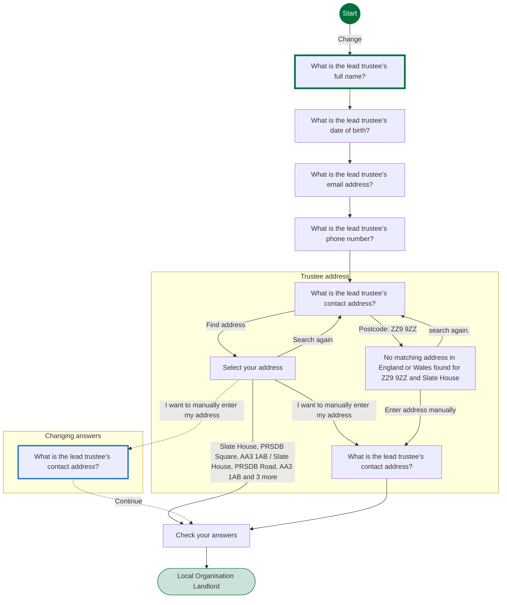

## Pages

### What is the lead trustee’s full name?

`lead-trustee-name` · LeadTrusteeNameStepConfig

[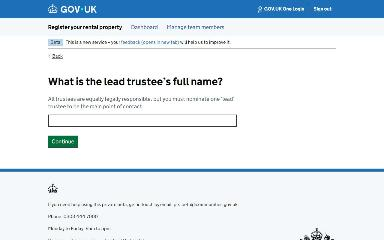](img/lead-trustee-name/v1.jpg)

Shown on the default route

### What is the lead trustee’s date of birth?

`lead-trustee-dob` · LeadTrusteeDobStepConfig

[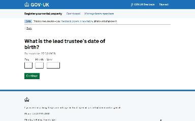](img/lead-trustee-dob/v1.jpg)

Shown on the default route

### What is the lead trustee’s email address?

`lead-trustee-email` · LeadTrusteeEmailStepConfig

[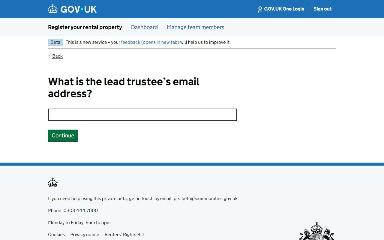](img/lead-trustee-email/v1.jpg)

Shown on the default route

### What is the lead trustee’s phone number?

`lead-trustee-phone` · LeadTrusteePhoneStepConfig

[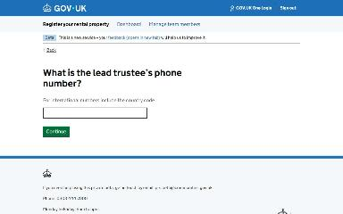](img/lead-trustee-phone/v1.jpg)

Shown on the default route

### What is the lead trustee’s contact address?

`lead-trustee-address/lookup-address` · LookupAddressStepConfig

[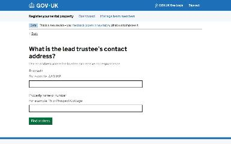](img/lead-trustee-address_lookup-address/v1.jpg)

Shown on the default route

### Select your address

`lead-trustee-address/select-address` · SelectAddressStepConfig

[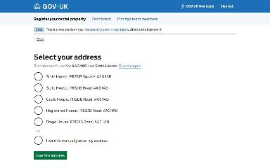](img/lead-trustee-address_select-address/v1.jpg)

Shown on the default route

### Check your answers

`lead-trustee-check-your-answers` · UpdateLeadTrusteeCyaStepConfig

[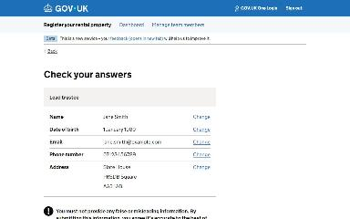](img/lead-trustee-check-your-answers/v1.jpg)

Shown on the default route

### Local Organisation Landlord

`/landlord/landlord-details`

[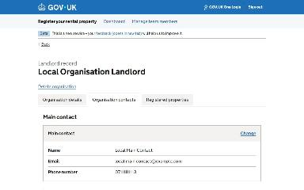](img/landlord_landlord-details/v1.jpg)

Shown on the default route

### What is the lead trustee’s contact address?

`lead-trustee-address/manual-address` · ManualAddressStepConfig

Shown when Check your answers: Change Address; Select your address: I want to manually enter my address (when changing an answer)

### No matching address in England or Wales found for ZZ9 9ZZ and Slate House

`lead-trustee-address/no-address-found` · NoAddressFoundStepConfig

[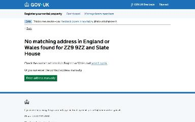](img/lead-trustee-address_no-address-found/v1.jpg)

Shown when What is the lead trustee’s contact address?: Postcode: ZZ9 9ZZ

### What is the lead trustee’s contact address?

`lead-trustee-address/manual-address` · ManualAddressStepConfig

[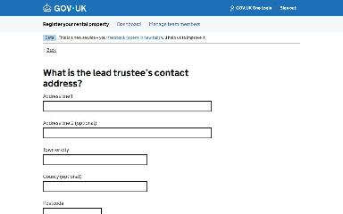](img/lead-trustee-address_manual-address/v1.jpg)

Shown when What is the lead trustee’s contact address?: Postcode: ZZ9 9ZZ

