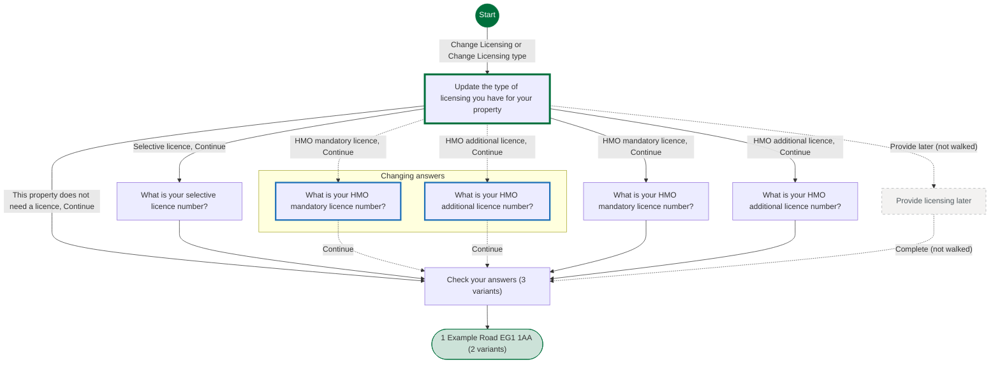
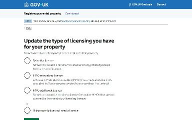
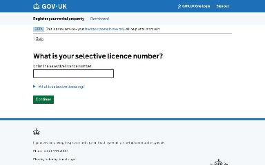
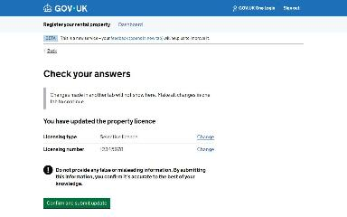
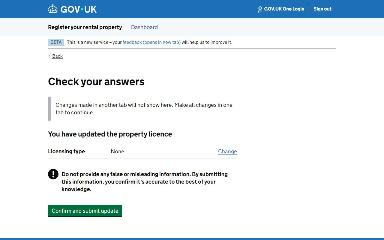
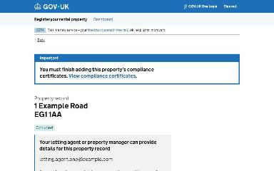
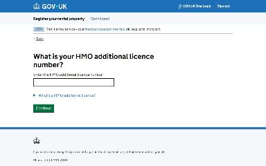
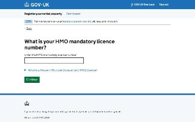

# Update licensing journey map

Generated 2026-10-23T09:37:56.892263800Z at commit `3a5832daa`. Feature flags: failover-test-endpoints=false, subject-identifier-page=true, pdjb-939-property-registration-phase-two=false, pdjb-1053-dashboard-nav-link=true, pdjb-1022-delegate-to-letting-agent=true, pdjb-1664-password-benchmark-endpoint=false, pdjb-238-gatling-post-endpoint=false, pdjb-1040-correspondence-address=true, pdjb-1009-payments=false, pdjb-926-landlord-dashboard-update=true, pdjb-1210-multi-user-organisations=false.

Open `index.html` for the interactive map. `report.md` lists gaps and errors.

## Pages

### Update the type of licensing you have for your property

`licensing-type` · LicensingTypeStepConfig

Shown on the default route

### What is your selective licence number?

`selective-licence` · SelectiveLicenceStepConfig

Shown on the default route

### Check your answers

`check-licensing-answers` · UpdateLicensingCyaConfig

Shown on the default route

Shown when Update the type of licensing you have for your property: This property does not need a licence, Continue

Shown when Starting point: Property has a licence; Update the type of licensing you have for your property: This property does not need a licence, Continue

### 1 Example Road EG1 1AA

`/landlord/property-details/1`

Shown on the default route

Shown when Update the type of licensing you have for your property: This property does not need a licence, Continue

### What is your HMO mandatory licence number?

`hmo-mandatory-licence` · HmoMandatoryLicenceStepConfig

Shown when Check your answers: Change Licensing type; Update the type of licensing you have for your property: HMO mandatory licence, Continue (when changing an answer)

### What is your HMO additional licence number?

`hmo-additional-licence` · HmoAdditionalLicenceStepConfig

Shown when Check your answers: Change Licensing type; Update the type of licensing you have for your property: HMO additional licence, Continue (when changing an answer)

### What is your HMO mandatory licence number?

`hmo-mandatory-licence` · HmoMandatoryLicenceStepConfig

Shown when Update the type of licensing you have for your property: HMO mandatory licence, Continue

### What is your HMO additional licence number?

`hmo-additional-licence` · HmoAdditionalLicenceStepConfig

Shown when Update the type of licensing you have for your property: HMO additional licence, Continue

### Provide licensing later

`provide-licensing-later` · ProvideLicensingLaterStepConfig

_Not reached by the generator._
