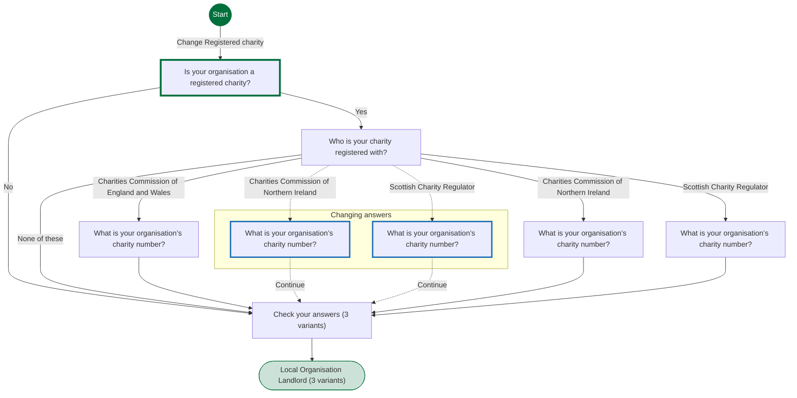
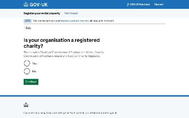
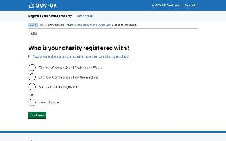
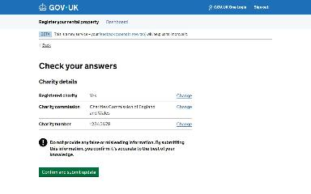
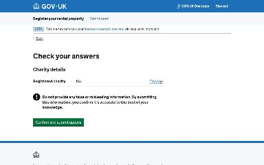
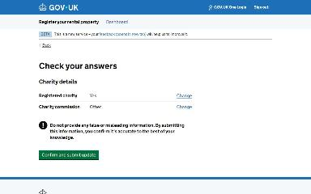
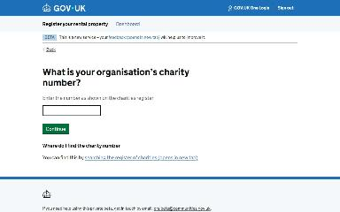

# Update whether the organisation is a registered charity journey map

Generated 2026-10-23T09:38:47.133712Z at commit `3a5832daa`. Feature flags: failover-test-endpoints=false, subject-identifier-page=true, pdjb-939-property-registration-phase-two=false, pdjb-1053-dashboard-nav-link=true, pdjb-1022-delegate-to-letting-agent=true, pdjb-1664-password-benchmark-endpoint=false, pdjb-238-gatling-post-endpoint=false, pdjb-1040-correspondence-address=true, pdjb-1009-payments=false, pdjb-926-landlord-dashboard-update=true, pdjb-1210-multi-user-organisations=false.

Open `index.html` for the interactive map. `report.md` lists gaps and errors.

## Pages

### Is your organisation a registered charity?

`organisation-charity` · OrgIsRegisteredCharityStepConfig

Shown on the default route

### Who is your charity registered with?

`organisation-charity-registered-with` · OrgCharityRegisteredWithStepConfig

Shown on the default route

### What is your organisation’s charity number?

`organisation-charity-number` · OrgCharityNumberEnglandAndWalesStepConfig

Shown on the default route

### Check your answers

`organisation-charity-check-your-answers` · UpdateOrganisationCharityCyaStepConfig

Shown on the default route

Shown when Is your organisation a registered charity?: No

Shown when Who is your charity registered with?: None of these

### Local Organisation Landlord

`/landlord/landlord-details`

Shown on the default route

Shown when Is your organisation a registered charity?: No

Shown when Who is your charity registered with?: None of these

### What is your organisation’s charity number?

`organisation-charity-number-northern-ireland` · OrgCharityNumberNorthernIrelandStepConfig

Shown when Check your answers: Change Registered charity; Who is your charity registered with?: Charities Commission of Northern Ireland (when changing an answer)

### What is your organisation’s charity number?

`organisation-charity-number-scotland` · OrgCharityNumberScotlandStepConfig

Shown when Check your answers: Change Registered charity; Who is your charity registered with?: Scottish Charity Regulator (when changing an answer)

### What is your organisation’s charity number?

`organisation-charity-number-northern-ireland` · OrgCharityNumberNorthernIrelandStepConfig

Shown when Who is your charity registered with?: Charities Commission of Northern Ireland

### What is your organisation’s charity number?

`organisation-charity-number-scotland` · OrgCharityNumberScotlandStepConfig

Shown when Who is your charity registered with?: Scottish Charity Regulator

