# Update the organisation type journey map

Generated 2026-10-23T09:38:37.749667400Z at commit `3a5832daa`. Feature flags: failover-test-endpoints=false, subject-identifier-page=true, pdjb-939-property-registration-phase-two=false, pdjb-1053-dashboard-nav-link=true, pdjb-1022-delegate-to-letting-agent=true, pdjb-1664-password-benchmark-endpoint=false, pdjb-238-gatling-post-endpoint=false, pdjb-1040-correspondence-address=true, pdjb-1009-payments=false, pdjb-926-landlord-dashboard-update=true, pdjb-1210-multi-user-organisations=false.

Open `index.html` for the interactive map. `report.md` lists gaps and errors.

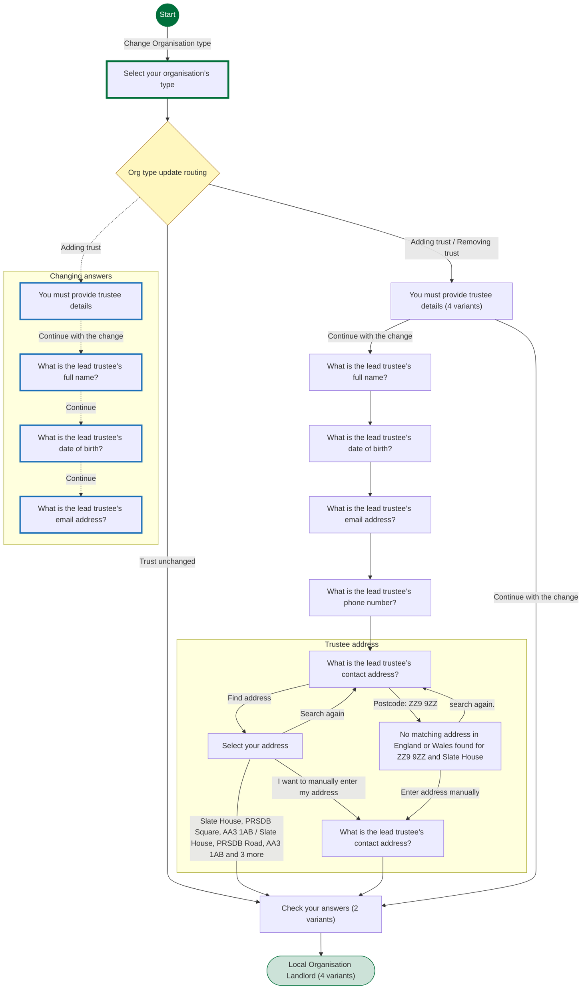

## Pages

### Select your organisation’s type

`organisation-type` · OrgTypeStepConfig

[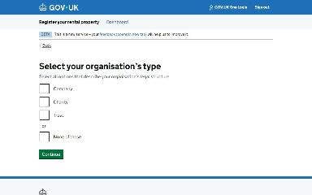](img/organisation-type/v1.jpg)

Shown on the default route

### Check your answers

`organisation-type-check-your-answers` · OrgTypeCyaStepConfig

[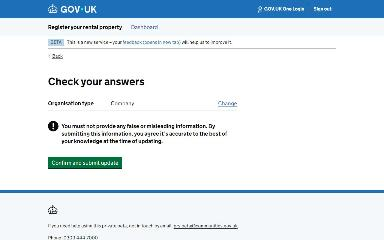](img/organisation-type-check-your-answers/v1.jpg)

Shown on the default route

[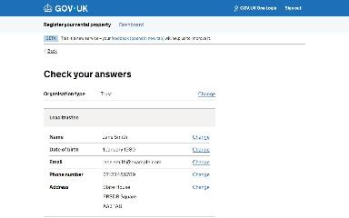](img/organisation-type-check-your-answers/v2.jpg)

Shown when Select your organisation’s type: Trust

### Local Organisation Landlord

`/landlord/landlord-details`

Shown on the default route

Shown when Select your organisation’s type: Trust

[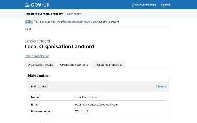](img/landlord_landlord-details/v3.jpg)

Shown when Starting point: Organisation is a trust

Shown when Starting point: Organisation is a trust; Select your organisation’s type: Trust

### You must provide trustee details

`organisation-type-trust-interruption` · OrgTypeTrustInterruptionStepConfig

Shown when Check your answers: Change Organisation type; Select your organisation’s type: Trust (when changing an answer)

### What is the lead trustee’s full name?

`lead-trustee-name` · LeadTrusteeNameStepConfig

Shown when Check your answers: Change Organisation type (when changing an answer)

### What is the lead trustee’s date of birth?

`lead-trustee-dob` · LeadTrusteeDobStepConfig

Shown when Check your answers: Change Organisation type (when changing an answer)

### What is the lead trustee’s email address?

`lead-trustee-email` · LeadTrusteeEmailStepConfig

Shown when Check your answers: Change Organisation type (when changing an answer)

### You must provide trustee details

`organisation-type-trust-interruption` · OrgTypeTrustInterruptionStepConfig

[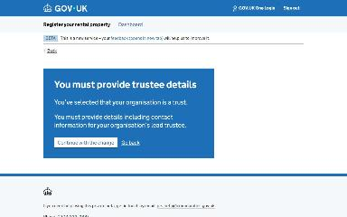](img/organisation-type-trust-interruption/v1.jpg)

Shown when Select your organisation’s type: Trust

Shown when Starting point: Organisation is a trust; Select your organisation’s type: Charity

[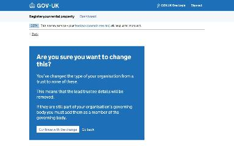](img/organisation-type-trust-interruption/v3.jpg)

Shown when Starting point: Organisation is a trust; Select your organisation’s type: None of these

Shown when Starting point: Organisation is a trust

### What is the lead trustee’s full name?

`lead-trustee-name` · LeadTrusteeNameStepConfig

[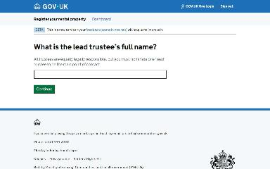](img/lead-trustee-name/v1.jpg)

Shown when Select your organisation’s type: Trust

### What is the lead trustee’s date of birth?

`lead-trustee-dob` · LeadTrusteeDobStepConfig

Shown when Select your organisation’s type: Trust

### What is the lead trustee’s email address?

`lead-trustee-email` · LeadTrusteeEmailStepConfig

[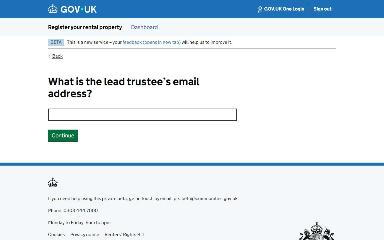](img/lead-trustee-email/v1.jpg)

Shown when Select your organisation’s type: Trust

### What is the lead trustee’s phone number?

`lead-trustee-phone` · LeadTrusteePhoneStepConfig

Shown when Select your organisation’s type: Trust

### What is the lead trustee’s contact address?

`lead-trustee-address/lookup-address` · LookupAddressStepConfig

[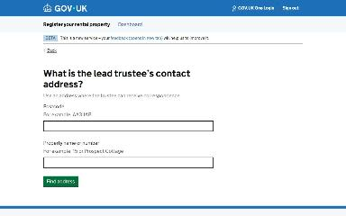](img/lead-trustee-address_lookup-address/v1.jpg)

Shown when Select your organisation’s type: Trust

### Select your address

`lead-trustee-address/select-address` · SelectAddressStepConfig

[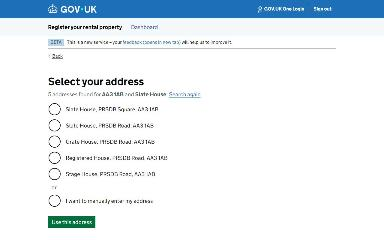](img/lead-trustee-address_select-address/v1.jpg)

Shown when Select your organisation’s type: Trust

### No matching address in England or Wales found for ZZ9 9ZZ and Slate House

`lead-trustee-address/no-address-found` · NoAddressFoundStepConfig

Shown when Select your organisation’s type: Trust; What is the lead trustee’s contact address?: Postcode: ZZ9 9ZZ

### What is the lead trustee’s contact address?

`lead-trustee-address/manual-address` · ManualAddressStepConfig

Shown when Select your organisation’s type: Trust; What is the lead trustee’s contact address?: Postcode: ZZ9 9ZZ

