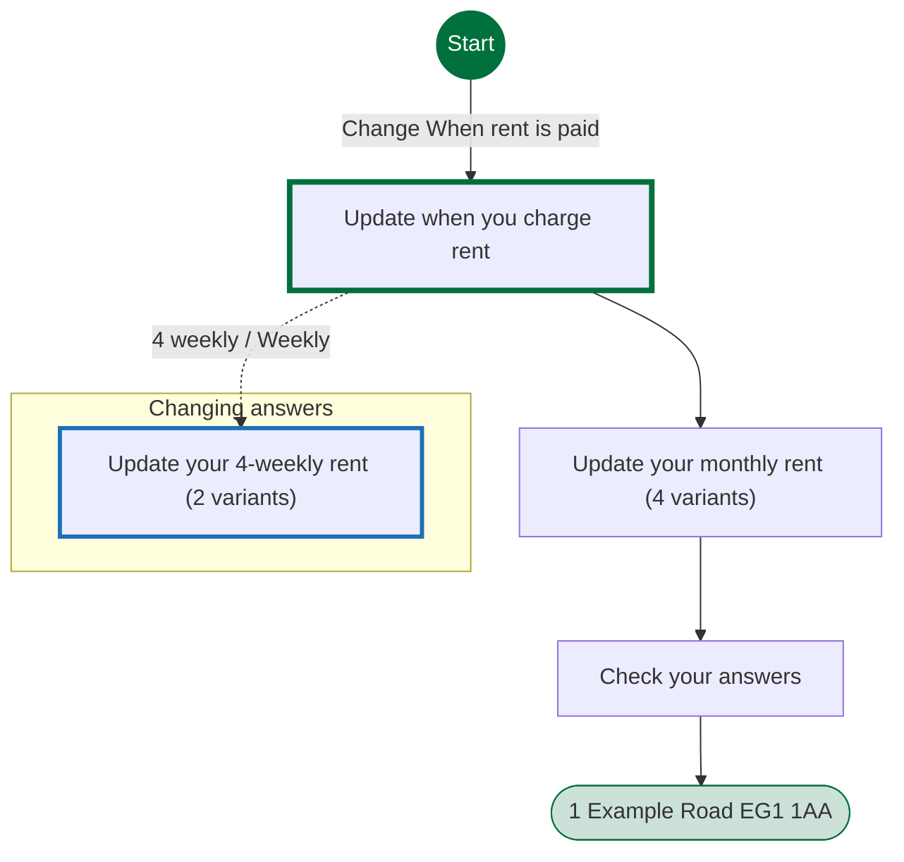
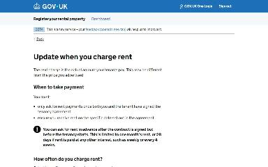
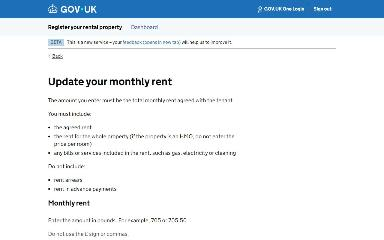
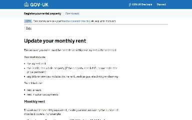
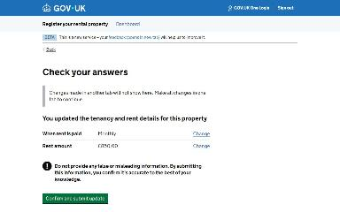
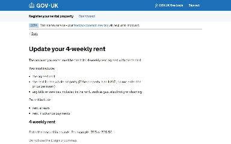
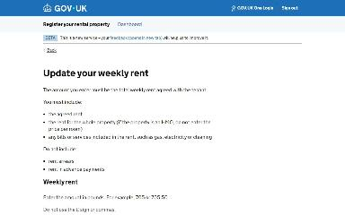

# Update the rent frequency and amount journey map

Generated 2026-10-23T09:36:57.440805300Z at commit `3a5832daa`. Feature flags: failover-test-endpoints=false, subject-identifier-page=true, pdjb-939-property-registration-phase-two=false, pdjb-1053-dashboard-nav-link=true, pdjb-1022-delegate-to-letting-agent=true, pdjb-1664-password-benchmark-endpoint=false, pdjb-238-gatling-post-endpoint=false, pdjb-1040-correspondence-address=true, pdjb-1009-payments=false, pdjb-926-landlord-dashboard-update=true, pdjb-1210-multi-user-organisations=false.

Open `index.html` for the interactive map. `report.md` lists gaps and errors.

## Pages

### Update when you charge rent

`rent-frequency` · RentFrequencyStepConfig

Shown on the default route

### Update your monthly rent

`rent-amount` · RentAmountStepConfig

Shown on the default route

Shown when Check your answers: Change When rent is paid; Update when you charge rent: Other (when changing an answer)

Shown when Update when you charge rent: 4 weekly

Shown when Update when you charge rent: Weekly

### Check your answers

`rent-frequency-and-amount-check-your-answers` · UpdateRentFrequencyAndAmountCyaConfig

Shown on the default route

### 1 Example Road EG1 1AA

`/landlord/property-details/1`

Shown on the default route

### Update your 4-weekly rent

`rent-amount` · RentAmountStepConfig

Shown when Check your answers: Change When rent is paid; Update when you charge rent: 4 weekly (when changing an answer)

Shown when Check your answers: Change When rent is paid; Update when you charge rent: Weekly (when changing an answer)

